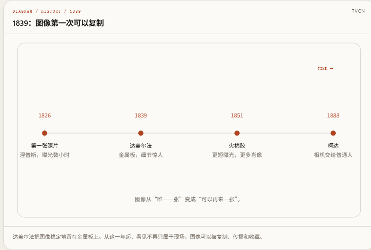

<!-- DIAGRAM_START -->
## 图解

<figure>
  
  <figcaption>达盖尔法把图像稳定地留在金属板上。从这一年起，看见不再只属于现场，图像可以被复制、传播和收藏。</figcaption>
</figure>
<!-- DIAGRAM_END -->

## 发生了什么

1839 年，法国政府公布达盖尔法。它不是第一张照片，但它是第一种被国家公开、被系统传播的摄影方法。图像第一次可以稳定地留在金属板上，并且可以被复制、装框、寄送、收藏。

## 为什么重要

在摄影之前，图像靠手绘。手绘是一种解释；摄影把光线本身留在材料上，变成一种“看起来像证据”的图像。这个变化不只属于艺术史，也属于证据、新闻、肖像和权力。

## 它改变了什么

- 肖像不再是贵族和画家的专利，中产阶级开始拍自己。
- 新闻开始有“现场图像”的概念，尽管当时的曝光时间还很长。
- 绘画被迫重新回答“为什么要画”，而不是“画得像不像”。

## 今天怎么用

拍第一条片时，你也在做同一件事：把一段光线、一个动作、一个瞬间固定下来。先问“我要留下什么”，再问“我用什么机器”。

## 3 条验收

- 能说出达盖尔法不是“第一张照片”，而是“第一种被公开传播的摄影方法”。
- 能说出摄影和手绘在“证据感”上的差别。
- 能把这个变化和今天的手机拍摄、AI 生成图像连起来。

## 边界

本条只讲摄影史的一个节点，不展开银版法化学细节；技术细节放在摄影史长文里。

<section><h2>三个失败</h2>
摄影史写作最常见的三种失败，不是“年代记错”这么简单：
<ul><li><strong>1. 把发明归给一个人。</strong> 1839 年的公布背后有达盖尔、涅普斯、塔尔博特等不同路线；只写一个名字，会把技术竞争写成英雄故事。</li><li><strong>2. 用今天的清晰度标准评判早期工艺。</strong> 银版、卡罗式、湿版各有材料与曝光限制；用现代像素标准回看，会看不见当时真正的约束。</li><li><strong>3. 只列年份，不写材料与传播。</strong> 一种工艺能不能成立，取决于感光材料、曝光时间、观看方式和复制成本；缺一项，时间线就变成空壳。</li></ul></section>
<!-- SOURCES_START -->
## 参考与延伸阅读

- [S07] [美国国会图书馆：银版摄影资料](https://www.loc.gov/pictures/collection/dag/background.html) — 2026-11-26 访问。用于核对「发生了什么」一节的术语/方法/规则（国会图书馆银版摄影史料，不是拍摄教程）；不核对其中由本页经验得出的数字、型号与现场结论，也不替代测试。
- [S08] [大都会博物馆：达盖尔与摄影发明](https://www.metmuseum.org/TOAH/hd/dagu/hd_dagu.htm) — 2026-11-26 访问。用于核对「为什么重要」一节的术语/方法/规则（大都会博物馆摄影史资料，不是当代参数）；不核对其中由本页经验得出的数字、型号与现场结论，也不替代测试。
- [S11] [Britannica：摄影](https://www.britannica.com/technology/photography) — 2026-11-26 访问。用于核对「它改变了什么」一节的术语/方法/规则（Britannica 摄影史条目，不是操作手册）；不核对其中由本页经验得出的数字、型号与现场结论，也不替代测试。
<!-- SOURCES_END -->

