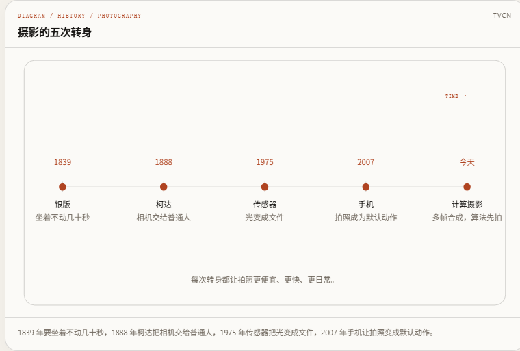

<!-- DIAGRAM_START -->
## 图解

<figure>
  
  <figcaption>1839 年要坐着不动几十秒，1888 年柯达把相机交给普通人，1975 年传感器把光变成文件，2007 年手机让拍照变成默认动作。</figcaption>
</figure>
<!-- DIAGRAM_END -->

## 1839：先让人相信照片

曝光要几十秒，人物得靠支架保持不动。那时候的照片更像一件唯一的物件，不像今天可以无限复制。

也从那时起，照片开始被当成“证据”。人们很快学会摆姿势、修底片，证明和表演同时出现。

## 1888：相机从工作室走到街上

柯达的卷片和“你按快门，剩下交给我们”把摄影变成日常。拍照的人不再需要会配药水、算曝光。

相机变小之后，照片里的世界也变了：街头、旅行、家庭聚会，开始出现在普通人自己的相册里。

## 1925：小相机跟着人走

35mm 相机让记者把机器带进人群，新闻摄影开始有抓拍。器材变小，画面里的世界反而变大。

布列松那一代人的贡献，不只是构图，而是证明“决定性瞬间”可以在街头发生，不必在影棚里摆。

## 1975：光变成文件

柯达工程师做出第一台数字相机原型，当时没人觉得它会取代胶片。后来成本曲线替所有人做了决定。

从那一刻起，照片可以无损复制、即时传输，也可以被元数据追踪。摄影的时间感从“冲洗”变成“上传”。

## 2007：手机把拍照变成默认

iPhone 之后，相机不再是一个目的地，而是说话的一部分。计算摄影把“拍清楚”变成默认，也把“修过”变成默认。

今天每个人口袋里都有一台可以拍、可以修、可以立刻发布的相机。摄影史没有结束，只是进入了别人手里。

## 3 条验收

- 能说出 1839、1888、1925、1975、2007 各发生了什么。
- 能解释“照片是证据”为什么从一开始就不稳。
- 知道手机改变的不只是器材，还有发布速度。

<section><h2>边界</h2>
本页只解决「从银版到手机：摄影的五次转身」这一个问题；不替代 平台规则：什么会被限流、肖像、场地与未成年人授权：一张 Release 要写什么、纪录模板：一个人、一件事、一个变化。如果现场问题属于后者，先读对应页，不要在本页继续加参数。
</section>
<section><h2>三个失败</h2>
摄影史写作最常见的三种失败，不是“年代记错”这么简单：
<ul><li><strong>1. 把发明归给一个人。</strong> 1839 年的公布背后有达盖尔、涅普斯、塔尔博特等不同路线；只写一个名字，会把技术竞争写成英雄故事。</li><li><strong>2. 用今天的清晰度标准评判早期工艺。</strong> 银版、卡罗式、湿版各有材料与曝光限制；用现代像素标准回看，会看不见当时真正的约束。</li><li><strong>3. 只列年份，不写材料与传播。</strong> 一种工艺能不能成立，取决于感光材料、曝光时间、观看方式和复制成本；缺一项，时间线就变成空壳。</li></ul></section>
<!-- SOURCES_START -->
## 参考与延伸阅读

- [S07] [美国国会图书馆：银版摄影资料](https://www.loc.gov/pictures/collection/dag/background.html) — 2026-11-26 访问。用于核对「1839：先让人相信照片」一节的术语/方法/规则（国会图书馆银版摄影史料，不是拍摄教程）；不核对其中由本页经验得出的数字、型号与现场结论，也不替代测试。
- [S08] [大都会博物馆：达盖尔与摄影发明](https://www.metmuseum.org/TOAH/hd/dagu/hd_dagu.htm) — 2026-11-26 访问。用于核对「1888：相机从工作室走到街上」一节的术语/方法/规则（大都会博物馆摄影史资料，不是当代参数）；不核对其中由本页经验得出的数字、型号与现场结论，也不替代测试。
- [S11] [Britannica：摄影](https://www.britannica.com/technology/photography) — 2026-11-26 访问。用于核对「1925：小相机跟着人走」一节的术语/方法/规则（Britannica 摄影史条目，不是操作手册）；不核对其中由本页经验得出的数字、型号与现场结论，也不替代测试。
<!-- SOURCES_END -->

