<!-- DIAGRAM_START -->
<h2>图解</h2>
<figure>
  
  <figcaption>示意：器材、损坏、责任、货运，四类风险不要用一张保单硬覆盖。</figcaption>
</figure>
<!-- DIAGRAM_END -->
<h2>适用边界</h2>
本页讨论中国大陆影视器材与制作保险的一般配置，不构成保险或法律意见。投保前以保险公司条款、特别约定、免赔额与除外责任为准；跨省/跨境拍摄要单独确认地域范围。
<h2>关键条款：四类风险</h2>
<strong>财产一切险</strong>：火灾、盗抢、意外碰撞、水浸等，通常按重置价值或约定价值投保。<strong>机器损坏险</strong>：突发机械/电气故障，常有电压异常、未按保养除外。<strong>公众责任险</strong>：拍摄现场第三方人身/财产损失，注意雇员与合同责任除外。<strong>货运险</strong>：运输/装卸中的损失，包装不当、延误通常不保。租赁器材要确认出租方是否已投保、谁负责理赔。
<h2>执行流程：投保到理赔</h2>
列出器材清单（型号、序列号、购置价、当前价值），拍照片/视频，保留发票。投保时申报所有高风险用途（航拍、水下、火、车辆、无人机）。出险后先保护现场、拍照、报警/报险，不要自行拆修；收集事故说明、现场照片、警方/场地方证明、维修报价、发票、序列号、租赁合同。理赔前确认免赔额与折旧，避免“修好才想起没报案”。
<h2>常见争议：四个拒赔点</h2>
<strong>未申报的高风险用途</strong>：航拍炸机、水下进水常被除外。<strong>免赔额高于维修费</strong>：小修不如自费，但别因此不报案。<strong>折旧</strong>：旧机按实际价值赔，不是按新机价。<strong>租赁责任</strong>：出租方与承租方谁投保、谁承担免赔额，合同要写清。
<h2>模板要点：器材清单与事故包</h2>
器材清单：名称/型号/序列号/购置日期/发票价/当前估值/照片。事故包：保单号、出险时间地点、事故说明、现场照片/视频、警方或场地方证明、第三方损失清单、维修报价、租赁合同、沟通记录。每季度更新一次清单。
<h2>验收</h2><ul><li>器材清单含序列号与估值。</li><li>高风险用途已申报。</li><li>免赔额与折旧已确认。</li><li>公众责任险覆盖第三方。</li><li>租赁责任与理赔人写清。</li><li>事故包材料齐全。</li></ul>

<!-- SOURCES_START -->
## 参考与延伸阅读

- [S22] [全国人民代表大会：《民法典》](http://www.npc.gov.cn/npc/c2/c30834/202006/t20200602_306457.html) — 2026-11-26 访问。用于核对首段“设备险不是“坏了就赔”。要区分财产一切险、机器损坏险、公众责任险、货运险；免赔额、折旧、除外责任和理赔材料决定你能不能拿”中的术语与公开背景（肖像、隐私、合同与场地权利的上位法文本）；不替代现场测试。
- [S01] [UNESCO](https://www.unesco.org/mil4teachers/en/module1) — 2026-11-26 访问。用于核对首段“设备险不是“坏了就赔”。要区分财产一切险、机器损坏险、公众责任险、货运险；免赔额、折旧、除外责任和理赔材料决定你能不能拿”中的术语与公开背景（媒介素养的定义、教师模块与批判性问题）；不替代现场测试。
- [S02] [WIPO](https://www.wipo.int/en/web/copyright/faq-copyright) — 2026-11-26 访问。用于核对首段“设备险不是“坏了就赔”。要区分财产一切险、机器损坏险、公众责任险、货运险；免赔额、折旧、除外责任和理赔材料决定你能不能拿”中的术语与公开背景（版权保护对象、经济权利与精神权利）；不替代现场测试。
- [S03] [全国人民代表大会：《个人信息保护法》](http://www.npc.gov.cn/npc/c2/c30834/202108/t20210820_313088.html) — 2026-11-26 访问。用于核对首段“设备险不是“坏了就赔”。要区分财产一切险、机器损坏险、公众责任险、货运险；免赔额、折旧、除外责任和理赔材料决定你能不能拿”中的术语与公开背景（处理个人信息、敏感信息与告知同意的法律文本）；不替代现场测试。
- [S16] [BBC 编辑准则](https://www.bbc.co.uk/editorialguidelines/) — 2026-11-26 访问。用于核对首段“设备险不是“坏了就赔”。要区分财产一切险、机器损坏险、公众责任险、货运险；免赔额、折旧、除外责任和理赔材料决定你能不能拿”中的术语与公开背景（准确性、公正、隐私与隐蔽拍摄的编辑标准）；不替代现场测试。
<!-- SOURCES_END -->

