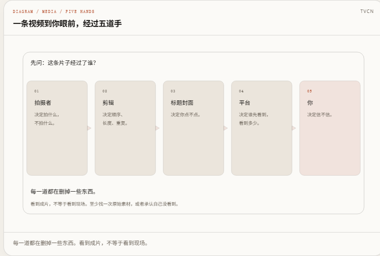

<!-- DIAGRAM_START -->
## 图解

<figure>
  
  <figcaption>每一道都在删掉一些东西。看到成片，不等于看到现场。</figcaption>
</figure>
<!-- DIAGRAM_END -->

不要先问“真的假的”，先问：谁做的、剪掉了什么、放在什么语境、为什么现在推给我。

## 五个问题

来源：谁拍的，谁付的钱，谁在传播。剪辑：前后各删了什么。语境：标题、配乐、字幕有没有改变意思。AI：画面有没有生成痕迹。版权：我能不能用，怎么用。

五个问题不需要全答完。任何一个答不上来，都值得先停下来，不要立刻转发。

## 剪辑如何改变意思

同一段素材，接一个笑声就是喜剧，接一个停顿就是悲剧。剪辑通过“删掉什么”和“放在谁后面”制造因果。

看到一条很有情绪的片子，先找它的剪切点：它让你在什么时候笑、什么时候愤怒。那个时间点就是作者的手。

## AI 痕迹

手指、文字、物理、反射、重复纹理，仍然是常见的生成痕迹。但“有痕迹”不等于“全假”，“没痕迹”也不等于“真实”。

把 AI 痕迹当成一个提问的入口，不要当成判决。更重要的是来源和语境：谁有动机做这条片子。

## 3 条验收

- 能对一条视频说出至少 3 个来源问题。
- 能找到一条片子的关键剪切点。
- 不会把“AI 痕迹”直接当成真假结论。

<!-- SOURCES_START -->
## 参考与延伸阅读

- [S01] UNESCO：媒介与信息素养

完整链接与用途见 [`SOURCES.md`](../../../SOURCES.md)。
<!-- SOURCES_END -->

<!-- DEEP_DIVE_START -->
## 深读

<strong>约 7 分钟。</strong> 媒介素养不是怀疑一切，是每看一条片子，先问谁做的、谁付钱、漏了什么。

### 先问三个人

谁拍的、谁出钱、谁受益；三个人不一定是同一个。出钱的人决定片子要证明什么，拍的人决定怎么证明，平台决定谁能看到。

三个答案都找不到，先把这条片子当“未知来源”，不要当证据。找不到来源不等于假，但不够格被转发。

### 看漏了什么

一条片子给你看的是选择后的三十秒；问它剪掉了什么：前因、反对者、失败、时间跨度。特别是冲突类片子，缺的那一方往往就是答案。

看镜头语言：谁被仰拍、谁被俯拍、音乐什么时候进来。形式不是中性，它在你还没反应时已经站好队。

### 平台为什么推这条

平台推的是停留、转发、评论，不是准确。情绪强、立场清楚、三秒有冲突的片子更容易被推；准确但慢的片子常常看不到。

看到一条“刚好证明你观点”的片子，先停三秒：是内容说服你，还是推荐系统知道你会喜欢。这个停顿就是媒介素养。

### 五分钟练习：一条片子三问

拿今天刷到的一条片子，写下三行：谁做的、谁付钱、漏了什么。写不出就写“未知”，不要编。

再把声音关掉看一遍，只看画面；把画面遮住听一遍，只听声音。两次哪一次让你更信？记下来，下次先看那一边。

### 什么时候算看懂了

你能用一句话说出它想让你做什么，也能用一句话说出它没让你看到什么；两句都成立，才算看懂。

如果你只能说“很感动”或“很假”，说明还停在反应层；回到三个人和三个遗漏，把反应拆成证据。

### 媒介素养，十项检查
<ul><li>先问谁拍的</li><li>再问谁出钱</li><li>再问谁受益</li><li>来源未知不当证据</li><li>列出被剪掉的前因</li><li>找缺失的反对者</li><li>注意仰俯拍和音乐</li><li>平台按情绪推荐</li><li>刚好证明你观点时先停</li><li>静音和遮画面各看一遍</li></ul>
媒介素养不是多疑，是在转发之前，能说出这条片子想让你做什么。

<!-- DEEP_DIVE_END -->
