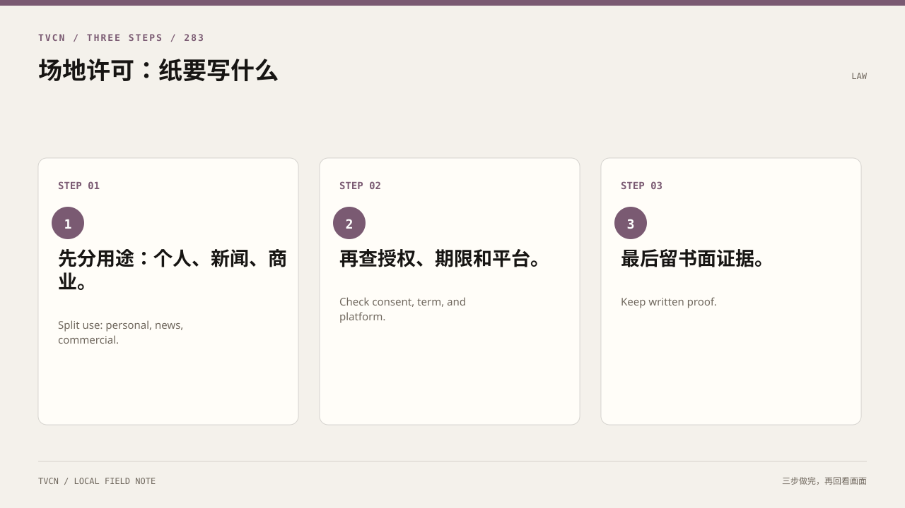

一页场地许可至少包括：地址和具体区域、拍摄日期与时段、人数与器材、是否商业用途、是否可剪辑发布、损坏与恢复责任、联系人。

<!-- DIAGRAM_START -->
<h2>图解</h2>
<figure>
  
  <figcaption>看“写拍摄日期、时段和具体区域”和“写允许的干扰范围，比如封几条通道”两处，判断它替代了什么旧办法，又新增了什么限制。</figcaption>
</figure>
<!-- DIAGRAM_END -->
<section><h2 id="section-1">场地许可要写清“拍什么、拍多久、谁能进”</h2>
拍之前拍一张现场原状照片，收工再拍一张；这两张照片比口头承诺有用。
<h2 id="section-2">边界</h2>
口头同意不算许可。房东、物业、店主、邻居都可能是不同权利人；不要用一个“我认识老板”覆盖所有人。
</section><section><h2 id="section-3">现场</h2>
写时间、区域、干扰、损坏责任、成片使用权；附联系人。
</section><section><h2 id="section-4">怎么做</h2><ol><li>写拍摄日期、时段和具体区域。</li><li>写允许的干扰范围，比如封几条通道。</li><li>写损坏责任、成片使用权和现场联系人。</li></ol></section><section><h2 id="section-5">别踩</h2>
别只写“允许拍摄”；时间、区域、损坏责任没写，现场就扯皮。
</section><section><h2>今天怎么用</h2>
把这条历史放回一个今天的工作：做档案、修复、教学或短片时，先问它解决了什么，再问它今天还缺什么。
<ul><li>找一条今天的同类作品，标出一个它继承的旧限制。</li><li>找一个它已经不再需要的条件，说明为什么。</li><li>写一句今天仍不能做的事。</li></ul></section><section><h2>来源边界</h2>
这是解释，不是原始档案；关键年份、人物和法律条文回到 <a href="../../about/">SOURCES.md</a> 的原始链接复核。二手叙述只能当线索，不能当证据。
</section>
<h2>验收</h2><ul><li>许可写清日期、时段和具体区域。</li><li>干扰范围有数字，比如封几条通道。</li><li>损坏责任、成片使用权和现场联系人齐全。</li></ul>

<!-- SOURCES_START -->
## 参考与延伸阅读

- [S02] [WIPO：版权常见问题](https://www.wipo.int/en/web/copyright/faq-copyright) — 2026-11-26 访问。用于核对「场地许可要写清“拍什么、拍多久、谁能进”」一节的术语/方法/规则（WIPO 版权常见问题，不是中国法条）；不核对其中由本页经验得出的数字、型号与现场结论，也不替代测试。
- [S03] [全国人大：《个人信息保护法》](http://www.npc.gov.cn/npc/c2/c30834/202108/t20210820_313088.html) — 2026-11-26 访问。用于核对「现场」一节的术语/方法/规则（《个人信息保护法》条文，不是内容版权）；不核对其中由本页经验得出的数字、型号与现场结论，也不替代测试。
- [S22] [全国人大：《民法典》](http://www.npc.gov.cn/npc/c2/c30834/202006/t20200602_306457.html) — 2026-11-26 访问。用于核对「怎么做」一节的术语/方法/规则（《民法典》条文，不是行业惯例）；不核对其中由本页经验得出的数字、型号与现场结论，也不替代测试。
<!-- SOURCES_END -->

