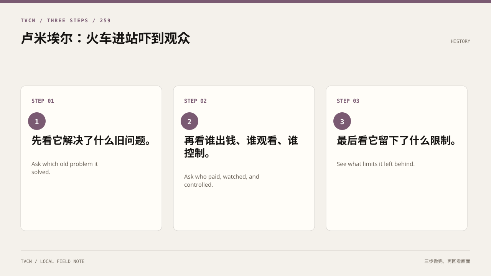

卢米埃尔把火车进站投在墙上，观众第一次被“假的东西”吓到。

<!-- DIAGRAM_START -->
<h2>图解</h2>
<figure>
  
  <figcaption>把三步按顺序做完，再回看画面或文件。</figcaption>
</figure>
<!-- DIAGRAM_END -->
<h2>现场</h2>

《火车进站》是固定机位、斜向纵深；观众害怕的是火车朝镜头来，不是 3D。

<h2>怎么做</h2>

卢米埃尔把火车进站投在墙上，观众第一次被“假的东西”吓到。
<ol><li>用固定机位，让火车斜向纵深驶来。</li><li>不要剪切，保持一个长镜头。</li><li>看观众害怕的是朝向镜头的运动，不是 3D。</li></ol>
<h2>别踩</h2>

别把观众反应说成 3D；那是一列火车朝镜头开来。

<h2>验收</h2>
<ul><li>镜头是固定机位，火车沿斜向纵深进入。</li><li>全片没有剪切，靠一个长镜头完成。</li><li>能说清恐惧来自朝向镜头的运动，而非立体技术。</li></ul>

<!-- SOURCES_START -->
## 参考与延伸阅读

- [S09] 卢米埃尔研究所：电影机与博物馆
- [S10] BFI：电影史与影像研究入口

完整链接与用途见 [`SOURCES.md`](../../SOURCES.md)。
<!-- SOURCES_END -->
