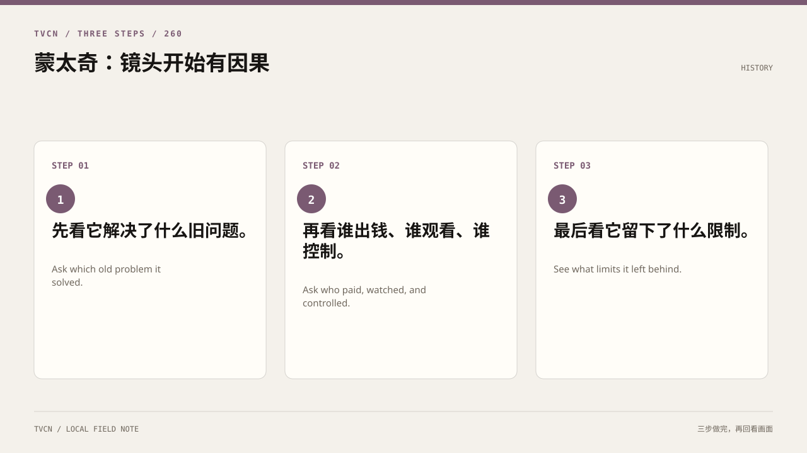

蒙太奇让两个镜头并置产生第三个意思：观众不是被动接收画面，而是在剪辑点之间建立因果。它把电影从“记录”推进到“论证”和“情绪构造”。

<!-- DIAGRAM_START -->
<h2>图解</h2>
<figure>
  
  <figcaption>看“选敖德萨阶梯段落，逐镜记时长和运动方…”和“把方向相反的镜头配对，看观众是否读出…”两处，判断它替代了什么旧办法，又新增了什么限制。</figcaption>
</figure>
<!-- DIAGRAM_END -->
<section><h2 id="section-1">当时改变了什么</h2><h2 id="section-2">今天怎么用</h2><ul><li>剪一个段落时，先写清每个镜头要观众得出什么结论，再决定顺序。</li><li>用 Kuleshov 式并置测试：同一张脸接食物、接尸体、接孩子，看意思是否变了。</li><li>做预告或广告时，用镜头关系制造主张，不要只堆最快画面。</li></ul><h2 id="section-3">不要误用</h2>
不要把蒙太奇当成“快速切”。没有因果和视角的切换，只是噪音。
<h2 id="section-4">蒙太奇不是“快速剪”，是“两个镜头生出第三个意思”</h2>

库里肖夫实验的核心是：同一张脸，接不同镜头，观众读出不同情绪。意义不在单个镜头里，在镜头之间的关系里。把蒙太奇等同于快切，是把它降级成节奏技巧。

<h3>常见误读</h3>

“蒙太奇等于联想”不完整。它也包括叙事省略、平行、交叉和冲突。另一个误读是把“苏联蒙太奇”当成唯一来源；格里菲斯等人也在并行发展剪辑语法。

<h3>对今天的一个用处</h3>

当一场戏情绪不对，先别加音乐。换一个反应镜头，或把两个镜头顺序对调，意义可能就变了。
</section><section><h2 id="section-5">现场</h2>
敖德萨阶梯用不同方向的镜头制造因果；数镜头时长和方向，不看血腥。
</section><section><h2 id="section-6">怎么做</h2><ol><li>选敖德萨阶梯段落，逐镜记时长和运动方向。</li><li>把方向相反的镜头配对，看观众是否读出因果。</li><li>不要只看血腥，先看剪辑怎么组织。</li></ol></section><section><h2 id="section-7">别踩</h2>
别只数切点；方向相反的镜头才是因果的来源。
</section><section><h2>来源边界</h2>
这是解释，不是原始档案；关键年份、人物和法律条文回到 <a href="../../about/">SOURCES.md</a> 的原始链接复核。二手叙述只能当线索，不能当证据。
</section>
<h2>验收</h2><ul><li>逐镜记录了时长和运动方向，不只看总镜头数。</li><li>能指出一对方向相反的镜头，并解释观众如何读出因果。</li><li>分析落在剪辑组织上，不只描述血腥场面。</li></ul>

<!-- SOURCES_START -->
