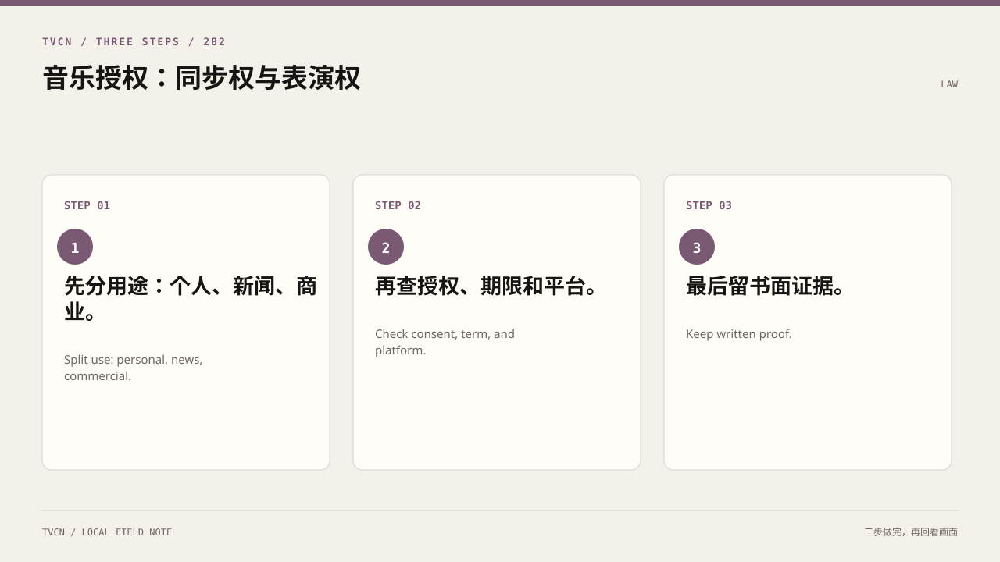

音乐授权分同步权和表演权；买了一张唱片，不等于可以放进广告。

<!-- DIAGRAM_START -->
<h2>图解</h2>
<figure>
  
  <figcaption>把三步按顺序做完，再回看画面或文件。</figcaption>
</figure>
<!-- DIAGRAM_END -->
<h2>现场</h2>

同步权是画面配乐，表演权是公开播放；买唱片不等于商用授权。

<h2>怎么做</h2>

音乐授权分同步权和表演权；买了一张唱片，不等于可以放进广告。
<ol><li>先分清同步权（配画面）和表演权（公开播放）。</li><li>查授权范围、期限、平台和地域。</li><li>把授权书写明曲目、片段时长和使用场景。</li></ol>
<h2>别踩</h2>

别把买唱片当商用授权；同步权还要单独谈。

<h2>验收</h2>
<ul><li>能说清同步权和表演权的区别。</li><li>授权范围、期限、平台、地域四项都查过。</li><li>授权书里写明了曲目、片段时长和使用场景。</li></ul>

<!-- SOURCES_START -->
## 参考与延伸阅读

- [S02] WIPO：版权常见问题

完整链接与用途见 [`SOURCES.md`](../../SOURCES.md)。
<!-- SOURCES_END -->
