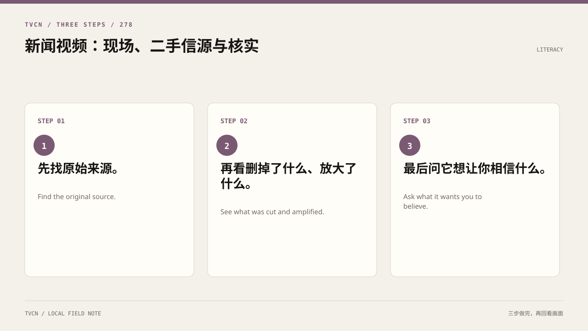

新闻视频先分现场、二手信源和核实；没有核实的“现场”只是素材。

<!-- DIAGRAM_START -->
<h2>图解</h2>
<figure>
  
  <figcaption>把三步按顺序做完，再回看画面或文件。</figcaption>
</figure>
<!-- DIAGRAM_END -->
<h2>现场</h2>

分现场、二手、核实三层；二手画面角标，核实写时间和信源。

<h2>怎么做</h2>

新闻视频先分现场、二手信源和核实；没有核实的“现场”只是素材。
<ol><li>标清哪段是记者现场，哪段是网友转载。</li><li>找第二个独立来源、原始上传者和时间地点。</li><li>无法核实的画面加“未核实”标注，不配确定结论。</li></ol>
<h2>别踩</h2>

别把转载画面当现场；来源链要写出来。

<h2>验收</h2>
<ul><li>标清了记者现场和网友转载。</li><li>第二独立来源、原始上传者和时间地点找过。</li><li>无法核实的画面标了“未核实”，没配确定结论。</li></ul>

<!-- SOURCES_START -->
## 参考与延伸阅读

- [S17] Reuters Trust Principles
- [S16] BBC 编辑准则

完整链接与用途见 [`SOURCES.md`](../../SOURCES.md)。
<!-- SOURCES_END -->
