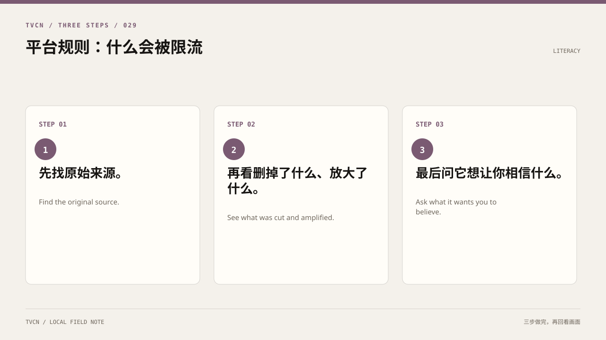

平台规则不是玄学算法，首先看四类硬线：画面与标题是否误导、版权与音乐是否授权、敏感类别是否允许、未成年人是否被消费。每条硬线都能在社区规范里找到原文。

<!-- DIAGRAM_START -->
<h2>图解</h2>
<figure>
  
  <figcaption>看“查重复搬运或二次剪辑，加自己的解说、…”和“删绝对化和承诺性用语，改成可验证的说…”两处，判断它替代了什么旧办法，又新增了什么限制。</figcaption>
</figure>
<!-- DIAGRAM_END -->
<section><h2 id="section-1">先读社区规范，再谈流量</h2>
发布前做一张检查表：标题承诺、封面画面、音乐来源、人物授权、敏感词、商业披露。任何一项写“应该没事”，就还没检查完。
<h2 id="section-2">边界</h2>
规则会变，平台也会执行不一。不要用“别人也发了”当许可；用自己的账号和内容做一次小范围测试，保留申诉记录。
</section><section><h2 id="section-3">现场</h2>
发布前查四项：是否搬运、有没有夸大承诺、是否诱导互动、敏感画面；逐项改，不要只改标题。
</section><section><h2 id="section-4">怎么做</h2>
平台限流常见四类：搬运、夸大承诺、诱导互动、敏感画面；逐项改，别只改标题。
<ol><li>查重复搬运或二次剪辑，加自己的解说、实拍或可核查素材。</li><li>删绝对化和承诺性用语，改成可验证的说法。</li><li>去掉诱导点赞和评论，敏感画面做遮挡或加说明。</li></ol></section><section><h2 id="section-5">别踩</h2>
别只改标题；画面和承诺也会触发限流。
</section><section><h2>今天怎么用</h2>
把这条历史放回一个今天的工作：做档案、修复、教学或短片时，先问它解决了什么，再问它今天还缺什么。
<ul><li>找一条今天的同类作品，标出一个它继承的旧限制。</li><li>找一个它已经不再需要的条件，说明为什么。</li><li>写一句今天仍不能做的事。</li></ul></section><section><h2>来源边界</h2>
这是解释，不是原始档案；关键年份、人物和法律条文回到 <a href="../../about/">SOURCES.md</a> 的原始链接复核。二手叙述只能当线索，不能当证据。
</section>
<h2>验收</h2><ul><li>搬运或二剪加了自述、实拍或可核查素材。</li><li>绝对化和承诺性用语删了，改成可验证说法。</li><li>诱导互动去掉，敏感画面做了遮挡或说明。</li></ul>

<!-- SOURCES_START -->
## 参考与延伸阅读

- [S01] [UNESCO：媒体与信息素养课程](https://www.unesco.org/mil4teachers/en/module1) — 2026-11-26 访问。用于核对「先读社区规范，再谈流量」一节的术语/方法/规则（媒体与信息素养框架，不是具体平台规则）；不核对其中由本页经验得出的数字、型号与现场结论，也不替代测试。
- [S16] [BBC：编辑准则](https://www.bbc.co.uk/editorialguidelines/) — 2026-11-26 访问。用于核对「现场」一节的术语/方法/规则（BBC 编辑准则，不是平台流量规则）；不核对其中由本页经验得出的数字、型号与现场结论，也不替代测试。
- [S17] [路透社：信任原则](https://reutersagency.com/about/our-trust-principles/) — 2026-11-26 访问。用于核对「来源边界」一节的术语/方法/规则（路透社信任原则，不是一般创作建议）；不核对其中由本页经验得出的数字、型号与现场结论，也不替代测试。
<!-- SOURCES_END -->

