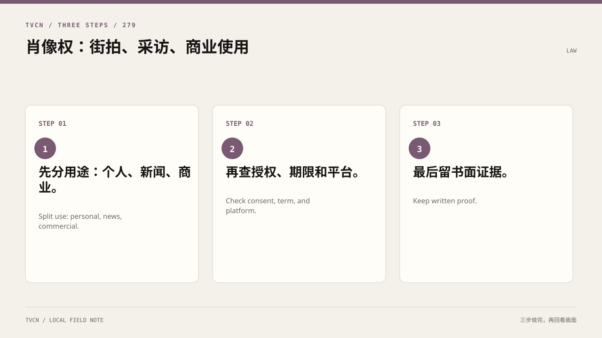

肖像权按用途分：街拍、采访、商业广告，边界完全不同；商业使用最需要书面授权。

<!-- DIAGRAM_START -->
<h2>图解</h2>
<figure>
  
  <figcaption>把三步按顺序做完，再回看画面或文件。</figcaption>
</figure>
<!-- DIAGRAM_END -->
<h2>现场</h2>

街拍、采访、商业分开；商业使用要书面肖像授权，期限和平台写清。

<h2>怎么做</h2>

肖像权按用途分：街拍、采访、商业广告，边界完全不同；商业使用最需要书面授权。
<ol><li>先分用途：街拍、采访、商业。</li><li>商业使用要书面肖像授权，写清期限和平台。</li><li>把授权文件和对应镜头编号放在一起。</li></ol>
<h2>别踩</h2>

别用“没人会告”当授权；那是赌博。

<h2>验收</h2>
<ul><li>每个出现人物的镜头都标了用途类别。</li><li>商业用途有书面授权，期限和平台写清。</li><li>授权文件能对应到具体镜头编号。</li></ul>

<!-- SOURCES_START -->
## 参考与延伸阅读

- [S22] 《中华人民共和国民法典》

完整链接与用途见 [`SOURCES.md`](../../SOURCES.md)。
<!-- SOURCES_END -->
