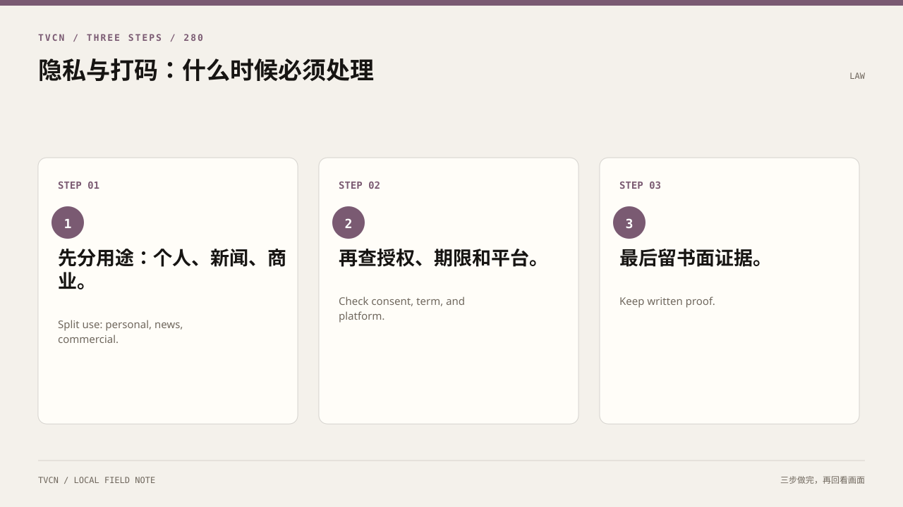

打码不是画一个静态方块。逐帧跟踪人脸、车牌、门牌和屏幕；运动、转身、遮挡时检查边缘。模糊半径要够大，别让轮廓仍可辨认。

<!-- DIAGRAM_START -->
<h2>图解</h2>
<figure>
  
  <figcaption>看“逐帧找出住址门牌、车牌、病历、未成年…”和“打码要覆盖背景反光和水面倒影”两处，判断它替代了什么旧办法，又新增了什么限制。</figcaption>
</figure>
<!-- DIAGRAM_END -->
<section><h2 id="section-1">模糊要跟住脸，也要跟住影子</h2>
导出前放大看 100%：边缘有没有漏出、跟踪有没有漂移；关键帧之间要手动修。
<h2 id="section-2">边界</h2>
打码不等于同意。公共场所拍到的人，如果可识别且用于商业内容，仍可能需要肖像授权；模糊只降低识别，不自动获得许可。
</section><section><h2 id="section-3">现场</h2>
住址、车牌、病历、未成年人能识别就处理；打码要覆盖背景反光。
</section><section><h2 id="section-4">怎么做</h2><ol><li>逐帧找出住址门牌、车牌、病历、未成年人。</li><li>打码要覆盖背景反光和水面倒影。</li><li>处理完回放一遍，确认没有可读信息漏出。</li></ol></section><section><h2 id="section-5">别踩</h2>
别只打主体；背景反光里的车牌一样能认出来。
</section><section><h2>今天怎么用</h2>
把这条历史放回一个今天的工作：做档案、修复、教学或短片时，先问它解决了什么，再问它今天还缺什么。
<ul><li>找一条今天的同类作品，标出一个它继承的旧限制。</li><li>找一个它已经不再需要的条件，说明为什么。</li><li>写一句今天仍不能做的事。</li></ul></section><section><h2>来源边界</h2>
这是解释，不是原始档案；关键年份、人物和法律条文回到 <a href="../../about/">SOURCES.md</a> 的原始链接复核。二手叙述只能当线索，不能当证据。
</section>
<h2>验收</h2><ul><li>住址、车牌、病历、未成年人四类都逐帧查过。</li><li>背景反光或倒影里的信息也被覆盖。</li><li>回放时没有任何可读的敏感信息。</li></ul>

<!-- SOURCES_START -->
## 参考与延伸阅读

- [S03] [全国人民代表大会：《个人信息保护法》](http://www.npc.gov.cn/npc/c2/c30834/202108/t20210820_313088.html) — 2026-11-26 访问。用于核对首段“打码不是礼貌，是义务：住址、车牌、病历、未成年人，能识别就要处理。”中的术语与公开背景（处理个人信息、敏感信息与告知同意的法律文本）；不替代现场测试。
- [S01] [UNESCO](https://www.unesco.org/mil4teachers/en/module1) — 2026-11-26 访问。用于核对首段“打码不是礼貌，是义务：住址、车牌、病历、未成年人，能识别就要处理。”中的术语与公开背景（媒介素养的定义、教师模块与批判性问题）；不替代现场测试。
- [S02] [WIPO](https://www.wipo.int/en/web/copyright/faq-copyright) — 2026-11-26 访问。用于核对首段“打码不是礼貌，是义务：住址、车牌、病历、未成年人，能识别就要处理。”中的术语与公开背景（版权保护对象、经济权利与精神权利）；不替代现场测试。
- [S16] [BBC 编辑准则](https://www.bbc.co.uk/editorialguidelines/) — 2026-11-26 访问。用于核对首段“打码不是礼貌，是义务：住址、车牌、病历、未成年人，能识别就要处理。”中的术语与公开背景（准确性、公正、隐私与隐蔽拍摄的编辑标准）；不替代现场测试。
- [S10] [BFI](https://www.bfi.org.uk/) — 2026-11-26 访问。用于核对首段“打码不是礼貌，是义务：住址、车牌、病历、未成年人，能识别就要处理。”中的术语与公开背景（英国电影协会的电影史、档案与观影研究入口）；不替代现场测试。
<!-- SOURCES_END -->

