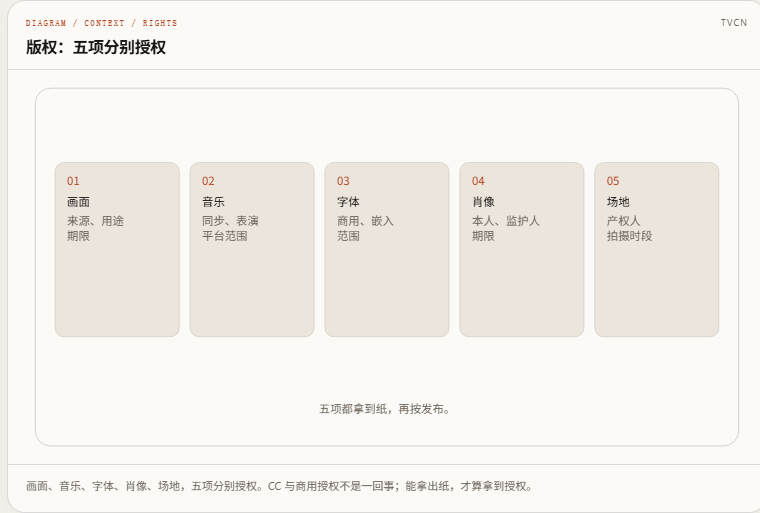

<!-- DIAGRAM_START -->
## 图解

<figure>
  
  <figcaption>画面、音乐、字体、肖像、场地，五项分别授权。CC 与商用授权不是一回事；能拿出纸，才算拿到授权。</figcaption>
</figure>
<!-- DIAGRAM_END -->

## 五项清单

画面：素材是你拍的，还是素材库的？音乐：平台曲库、CC、还是单独购买？字体：个人免费还是商用授权？

肖像：出镜人有没有签授权？场地：商场、地铁、餐厅是否允许拍摄和发布？五项缺一项，都可能在发布后被下架。

## CC 不是免费商用

CC BY 要求署名；CC BY-SA 要求衍生作品同样共享；CC BY-NC 禁止商业使用；CC BY-ND 禁止改编。四个条件经常组合。

“网上能找到”不等于“能商用”。商用项目最稳的做法：买明确商用授权，或只用自己拍的、自己做的。

## 平台规则与标注

每个平台对音乐、广告、AI 生成、医疗与金融内容都有单独规则。发布前看一遍该平台的创作者公约，不要只看别人的片子。

AI 生成、数字人、合成配音，按平台要求标注。标注不是求饶，是让观众知道自己在看什么。

## 3 条验收

- 五项授权都有记录或明确来源。
- 音乐与字体的商用范围写清楚。
- AI 生成或合成配音已按平台标注。

## 授权和“合理使用”不是一回事

授权是权利人给你的许可，合理使用是法律在特定条件下给的例外。例外有边界，不能拿“教学”或“评论”当万能通行证。

商业项目最稳的顺序：先找可商用授权，再谈合理使用。反过来，先把片子做完再补授权，通常会被素材方抬价。

## 平台规则只是第一层

平台检测到音乐就下架，不等于法律上不能用；平台没检测到，也不等于你有权。平台规则、著作权、肖像和商标是四套不同的东西。

字体、滤镜预设、LUT、模板也常有授权。它们不写在片尾，但会在交付时被追问。

## 发布前二十分钟

建一张四列表：素材、来源、授权类型、到期日。没有到期日的，写“永久”并附截图。

再把所有音乐、字体、档案画面各抽一条，点开授权页确认还能访问。链接失效，等于没有证据。

<!-- V11_DEEPEN -->

<!-- SOURCES_START -->
## 参考与延伸阅读

- [S02] [WIPO：版权常见问题](https://www.wipo.int/en/web/copyright/faq-copyright) — 2026-11-26 访问。用于核对「五项清单」一节的术语/方法/规则（WIPO 版权常见问题，不是中国法条）；不核对其中由本页经验得出的数字、型号与现场结论，也不替代测试。
- [S03] [全国人大：《个人信息保护法》](http://www.npc.gov.cn/npc/c2/c30834/202108/t20210820_313088.html) — 2026-11-26 访问。用于核对「CC 不是免费商用」一节的术语/方法/规则（《个人信息保护法》条文，不是内容版权）；不核对其中由本页经验得出的数字、型号与现场结论，也不替代测试。
- [S22] [全国人大：《民法典》](http://www.npc.gov.cn/npc/c2/c30834/202006/t20200602_306457.html) — 2026-11-26 访问。用于核对「平台规则与标注」一节的术语/方法/规则（《民法典》条文，不是行业惯例）；不核对其中由本页经验得出的数字、型号与现场结论，也不替代测试。
<!-- SOURCES_END -->

