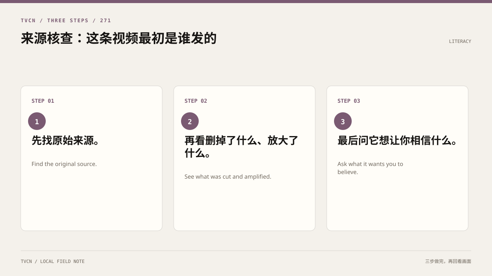

一条信息至少要有两个独立来源，或一个可核验的原始文件。转发、截图、二创视频不算独立来源；它们可能来自同一个首发。

<!-- DIAGRAM_START -->
<h2>图解</h2>
<figure>
  
  <figcaption>看“找最早账号、原始视频或图片，保存链接…”和“用反向图搜或关键帧搜索，找第二个独立…”两处，判断它替代了什么旧办法，又新增了什么限制。</figcaption>
</figure>
<!-- DIAGRAM_END -->
<section><h2 id="section-1">先找首发，再找第二个独立来源</h2>
把“谁最早发、什么时候、原始文件在哪”写在素材表上。找不到首发，就在片子里明确说“无法确认来源”。
<h2 id="section-2">边界</h2>
两个来源不是“两个人说了同样的话”。如果他们都引用同一篇报道，仍然只有一个来源。
</section><section><h2 id="section-3">现场</h2>
先找最早发布账号和原始文件，再看转发链；用反向图片或视频搜索，保存原链接。
</section><section><h2 id="section-4">怎么做</h2>
先找最初发布者和原始文件，再看转发链；转发十万次也不等于真实。
<ol><li>找最早账号、原始视频或图片，保存链接和发布时间。</li><li>用反向图搜或关键帧搜索，找第二个独立来源。</li><li>对时间、地点、天气、招牌，四项至少三项一致。</li></ol></section><section><h2 id="section-5">别踩</h2>
别把“很多人转发”当证据；转发只是传播。
</section><section><h2>今天怎么用</h2>
把这条历史放回一个今天的工作：做档案、修复、教学或短片时，先问它解决了什么，再问它今天还缺什么。
<ul><li>找一条今天的同类作品，标出一个它继承的旧限制。</li><li>找一个它已经不再需要的条件，说明为什么。</li><li>写一句今天仍不能做的事。</li></ul></section><section><h2>来源边界</h2>
这是解释，不是原始档案；关键年份、人物和法律条文回到 <a href="../../about/">SOURCES.md</a> 的原始链接复核。二手叙述只能当线索，不能当证据。
</section>
<h2>验收</h2><ul><li>最早账号、原始文件和时间戳保存了。</li><li>反向图搜或关键帧搜索找到第二个独立来源。</li><li>时间、地点、天气、招牌至少三项一致。</li></ul>

<!-- SOURCES_START -->
## 参考与延伸阅读

- [S17] Reuters Trust Principles
- [S16] BBC 编辑准则

完整链接与用途见 [`SOURCES.md`](../../about/)。
<!-- SOURCES_END -->

<!-- DEEP_DIVE_START -->
## 深读

<strong>约 8 分钟。</strong> 核源不是找一条支持你的链接，是找到最早的那条原始记录。

### 先找原件

截图、录屏、转发都不是原件；找最早发布者、原始文件、完整版本。看发布时间、账号历史、地理位置，不要只看内容像不像。

原件被删，就找存档、镜像、其他角度的同一事件；至少两条独立来源指向同一时间地点，才算站住。

### 时间和地点要能对

看影子方向、天气、招牌语言、车牌、插座、店名；一条片子说自己在北京，画面里的路牌是繁体，就要停下来。

用地图和街景对一遍拍摄点；对不上，不要用“可能”补。核源的工作是排除，不是替片子圆场。

### AI 时代的核源

画面越干净，越要查来源；AI 生成的天空、皮肤、文字经常“太顺”。放大看边缘、牙齿、耳朵、手指、背景文字，再看文件元数据。

元数据可以伪造，所以它只是线索，不是结论；最终还是要回到独立来源和时间地点。技术检测给概率，编辑判断给责任。

### 五分钟练习：一条转发核到底

拿一条没有出处的转发，找最早发布者、原始链接、第二条独立来源；三个都找不到，写“未核实”，不要写“假的”。

把查到的三条证据写成三行，标上时间；三行里有一行是“据说”，删掉重查。

### 什么时候算核实

原始文件在、发布时间在、地点对得上、第二条独立来源也指向同一件事，四项都过，才算核实。

只有一项，叫线索；两项，叫可能；三项，叫待发；四项，才叫可以引用。不要把线索写成结论。

### 核源，十项检查
<ul><li>截图不是原件</li><li>找最早发布者</li><li>找原始文件和完整版</li><li>看账号历史和发布时间</li><li>影子天气招牌对地点</li><li>地图街景对拍摄点</li><li>至少两条独立来源</li><li>放大看边缘牙齿耳朵手指</li><li>元数据只当线索</li><li>四项全过才可引用</li></ul>
核源不是替一条片子找证据，是决定它够不够格被引用。

<!-- DEEP_DIVE_END -->
