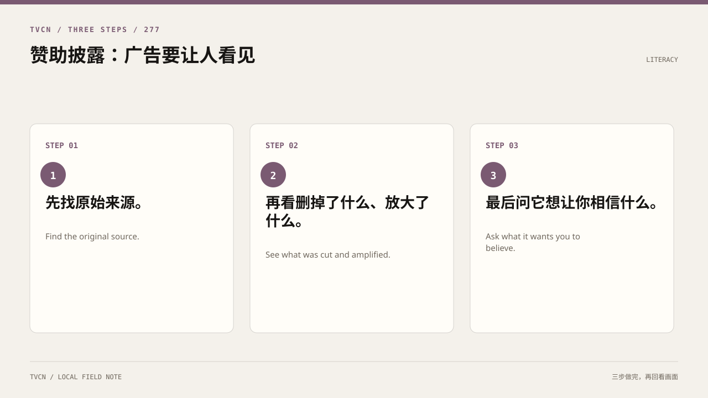

赞助披露要在观众看到推荐之前出现，不要藏在简介最后一行。

<!-- DIAGRAM_START -->
<h2>图解</h2>
<figure>
  
  <figcaption>把三步按顺序做完，再回看画面或文件。</figcaption>
</figure>
<!-- DIAGRAM_END -->
<h2>现场</h2>

广告标记放在推荐前 3 秒或标题里；不要藏在简介最后一行。

<h2>怎么做</h2>

赞助要在推荐之前出现，不要藏在简介最后一行。
<ol><li>在视频前三秒或口播第一句说“本片由某品牌赞助”。</li><li>画面加角标，简介第一行重复。</li><li>说清对方是否审稿或改过内容，不藏利益关系。</li></ol>
<h2>别踩</h2>

别用“感谢支持”代替“赞助”；观众需要知道谁付钱。

<h2>验收</h2>
<ul><li>前三秒或口播第一句说了赞助。</li><li>画面角标和简介第一行重复了。</li><li>说明对方是否审稿或改稿，没有藏利益关系。</li></ul>

<!-- SOURCES_START -->
## 参考与延伸阅读

- [S14] YouTube 社区准则
- [S15] TikTok 社区准则

完整链接与用途见 [`SOURCES.md`](../../SOURCES.md)。
<!-- SOURCES_END -->
