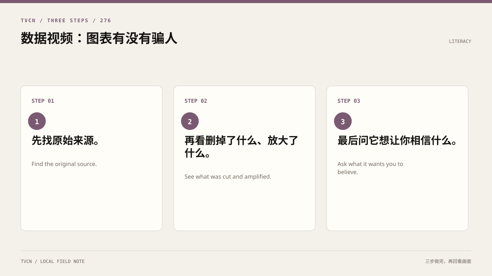

做数据视频，先把三件事写在画面上：时间范围、样本量、来源。轴从零开始还是截断，会改变观众对差距的判断；不说明，就等于误导。

<!-- DIAGRAM_START -->
<h2>图解</h2>
<figure>
  
  <figcaption>看“看纵轴是否从零开始，截断会放大差异”和“找分母和样本量，确认比较组同口径”两处，判断它替代了什么旧办法，又新增了什么限制。</figcaption>
</figure>
<!-- DIAGRAM_END -->
<section><h2 id="section-1">先看轴和样本，再看结论</h2>
动画不要制造不存在的趋势。两个时间点之间用直线连，观众会以为中间每天都一样；有缺口就画缺口。
<h2 id="section-2">边界</h2>
图表不是装饰。不要为了好看换颜色、换比例、换 3D；每一处视觉选择都要能解释它对应哪个数据关系。
</section><section><h2 id="section-3">现场</h2>
先看坐标轴是否从 0 开始、样本量、比较对象；同一群人才能比较。
</section><section><h2 id="section-4">怎么做</h2>
数据视频先看坐标轴起点、总数和比较的是不是同一群人。
<ol><li>看纵轴是否从零开始，截断会放大差异。</li><li>找分母和样本量，确认比较组同口径。</li><li>自己重画一遍；数字对不上就标“无法核实”。</li></ol></section><section><h2 id="section-5">别踩</h2>
别只看柱子的高低；先看它没画出来的部分。
</section><section><h2>今天怎么用</h2>
把这条历史放回一个今天的工作：做档案、修复、教学或短片时，先问它解决了什么，再问它今天还缺什么。
<ul><li>找一条今天的同类作品，标出一个它继承的旧限制。</li><li>找一个它已经不再需要的条件，说明为什么。</li><li>写一句今天仍不能做的事。</li></ul></section><section><h2>来源边界</h2>
这是解释，不是原始档案；关键年份、人物和法律条文回到 <a href="../../about/">SOURCES.md</a> 的原始链接复核。二手叙述只能当线索，不能当证据。
</section>
<h2>验收</h2><ul><li>纵轴是否从零开始看过。</li><li>分母、样本量和比较口径确认过。</li><li>自己重画过，数字对不上就标“无法核实”。</li></ul>

<!-- SOURCES_START -->
## 参考与延伸阅读

- [S01] [UNESCO](https://www.unesco.org/mil4teachers/en/module1) — 2026-11-26 访问。用于核对首段“数据视频先看坐标轴从哪开始、总数是多少、比较的是不是同一群人。”中的术语与公开背景（媒介素养的定义、教师模块与批判性问题）；不替代现场测试。
- [S02] [WIPO](https://www.wipo.int/en/web/copyright/faq-copyright) — 2026-11-26 访问。用于核对首段“数据视频先看坐标轴从哪开始、总数是多少、比较的是不是同一群人。”中的术语与公开背景（版权保护对象、经济权利与精神权利）；不替代现场测试。
- [S03] [全国人民代表大会：《个人信息保护法》](http://www.npc.gov.cn/npc/c2/c30834/202108/t20210820_313088.html) — 2026-11-26 访问。用于核对首段“数据视频先看坐标轴从哪开始、总数是多少、比较的是不是同一群人。”中的术语与公开背景（处理个人信息、敏感信息与告知同意的法律文本）；不替代现场测试。
- [S16] [BBC 编辑准则](https://www.bbc.co.uk/editorialguidelines/) — 2026-11-26 访问。用于核对首段“数据视频先看坐标轴从哪开始、总数是多少、比较的是不是同一群人。”中的术语与公开背景（准确性、公正、隐私与隐蔽拍摄的编辑标准）；不替代现场测试。
- [S10] [BFI](https://www.bfi.org.uk/) — 2026-11-26 访问。用于核对首段“数据视频先看坐标轴从哪开始、总数是多少、比较的是不是同一群人。”中的术语与公开背景（英国电影协会的电影史、档案与观影研究入口）；不替代现场测试。
<!-- SOURCES_END -->

