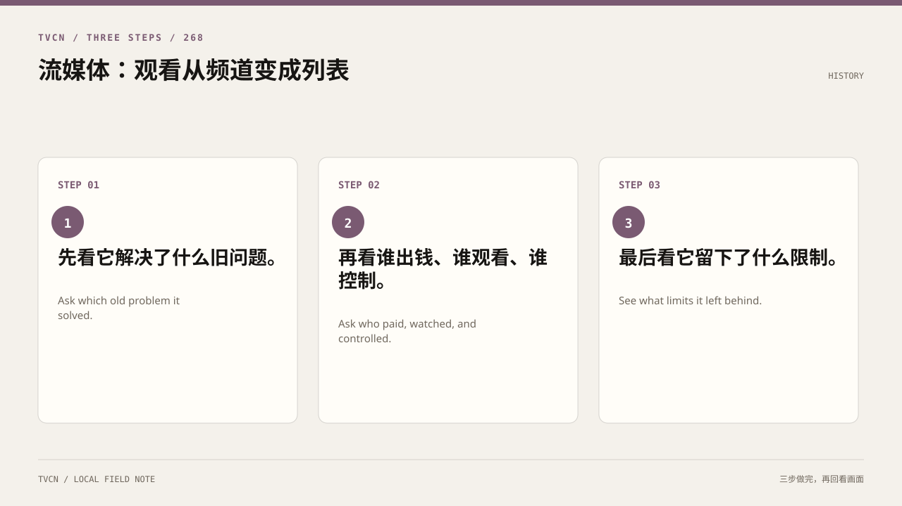

流媒体把观看从“频道和时间表”变成“列表和推荐”。片头、首帧、标题和元数据开始决定观众是否点开；发行不再只靠院线和电视窗口。

<!-- DIAGRAM_START -->
<h2>图解</h2>
<figure>
  
  <figcaption>看“对比同一类型在流媒体和电视的片长”和“数片头 30 秒给了什么”两处，判断它替代了什么旧办法，又新增了什么限制。</figcaption>
</figure>
<!-- DIAGRAM_END -->
<section><h2 id="section-1">当时改变了什么</h2><h2 id="section-2">今天怎么用</h2><ul><li>做平台交付时，先确认封面、标题、首帧、字幕和多语言元数据，不要只交视频文件。</li><li>做系列内容时，把前三秒和第一集结尾当作入口设计，而不是最后再补。</li><li>研究流媒体史时，把推荐算法、版权窗口和制作预算一起看，不要只讲“方便”。</li></ul><h2 id="section-3">不要误用</h2>
不要为了推荐把每条片都剪成同一种开头；入口需要清楚，不是所有片子都要三秒反转。
<h2 id="section-4">流媒体不是“把片子上传”，是码率、缓存和版权的重新分配</h2>

流媒体把交付从“一张母版”变成“多档码率 + 多终端 + 多地区”。观众看到的是自适应码率，不是你的原片；网络、设备和版权规则共同决定最终画面。

<h3>常见误读</h3>

“上传 4K 就等于观众看到 4K”不准确。平台会按带宽和设备转码；很多观众实际看到的是 1080p 或更低。另一个误读是“流媒体没有排期”——审核、字幕、地区版权都会影响上线。</h3>
<h3>对今天的一个用处</h3>

交付前用平台的实际播放器看一遍，不要只在本地监视器看。检查暗部、字幕和片头 5 秒；转码最先把这三处弄坏。
</section><section><h2 id="section-5">现场</h2>
流媒体按列表推荐，片头 30 秒决定留存；看片长和开头结构变化。
</section><section><h2 id="section-6">怎么做</h2><ol><li>对比同一类型在流媒体和电视的片长。</li><li>数片头 30 秒给了什么。</li><li>看列表推荐如何改变第一集的开头。</li></ol></section><section><h2 id="section-7">别踩</h2>
别把流媒体开头当影院片头；观众随时会划走。
</section><section><h2>来源边界</h2>
这是解释，不是原始档案；关键年份、人物和法律条文回到 <a href="../../about/">SOURCES.md</a> 的原始链接复核。二手叙述只能当线索，不能当证据。
</section>
<h2>验收</h2><ul><li>能说出同类型在流媒体与电视的片长差异。</li><li>片头 30 秒有明确钩子，不是演职员表。</li><li>能指出列表推荐对开头结构的一个具体影响。</li></ul>

<!-- SOURCES_START -->
## 参考与延伸阅读

- [S10] BFI：电影史与影像研究入口

完整链接与用途见 [`SOURCES.md`](../../about/)。
<!-- SOURCES_END -->
