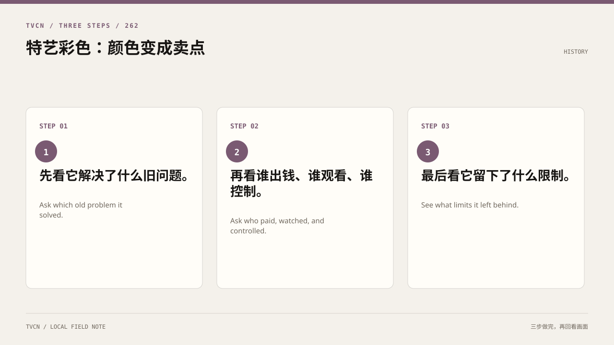

特艺彩色不是自然色，它把颜色变成奇观，让观众愿意为“更红”买票。

<!-- DIAGRAM_START -->
<h2>图解</h2>
<figure>
  
  <figcaption>把三步按顺序做完，再回看画面或文件。</figcaption>
</figure>
<!-- DIAGRAM_END -->
<h2>现场</h2>

早期特艺彩色用分光棱镜同时拍三色；看红色衣服和肤色，颜色被当成奇观。

<h2>怎么做</h2>

特艺彩色不是自然色，它把颜色变成奇观，让观众愿意为“更红”买票。
<ol><li>看分光棱镜如何同时记录三色。</li><li>选红色衣服和肤色两个区域对比。</li><li>判断颜色是被当成奇观，还是被当成真实。</li></ol>
<h2>别踩</h2>

别把特艺彩色当成“真实还原”；它的红是设计过的。

<h2>验收</h2>
<ul><li>能说出三色分光同时记录的流程。</li><li>红色衣服和肤色被分别取样对比。</li><li>能判断该片把颜色当奇观还是当真实，并举一个镜头。</li></ul>

<!-- SOURCES_START -->
## 参考与延伸阅读

- [S11] Britannica：摄影

完整链接与用途见 [`SOURCES.md`](../../SOURCES.md)。
<!-- SOURCES_END -->
