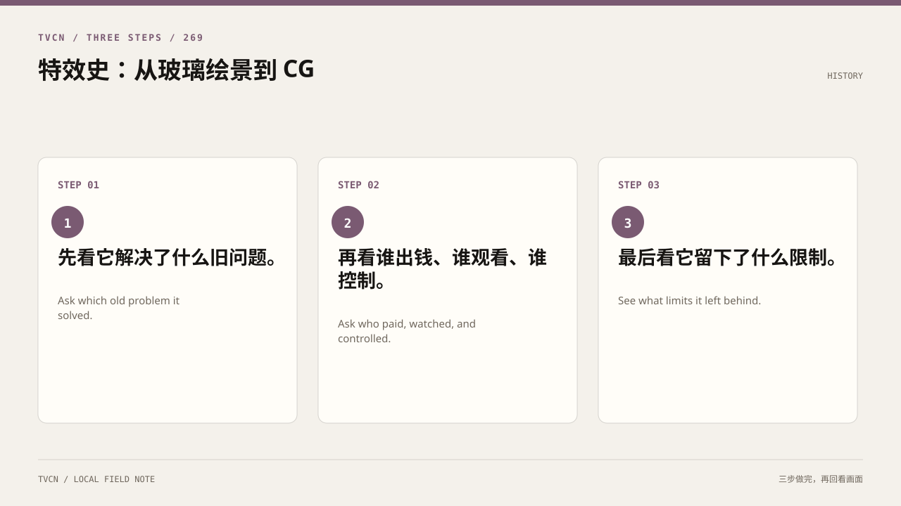

特效从玻璃绘景、模型和光学合成，走到数字绘景、CG 和实时引擎。工具变了，但核心没变：先拍一个可信的板，再让合成遵守同一套光、影、雾和镜头。

<!-- DIAGRAM_START -->
<h2>图解</h2>
<figure>
  
  <figcaption>看“按玻璃绘景、微缩、光学合成、CG 四…”和“看《星球大战》的光学打印机痕迹，比如…”两处，判断它替代了什么旧办法，又新增了什么限制。</figcaption>
</figure>
<!-- DIAGRAM_END -->
<section><h2 id="section-1">当时改变了什么</h2><h2 id="section-2">今天怎么用</h2><ul><li>拍板时记录镜头、高度、光圈、白平衡和现场光，合成才有依据。</li><li>做 CG 合成时，先匹配黑位、光源方向和雾，再调材质细节。</li><li>研究特效史时，把工艺、成本和观众期待一起看，不要只列“第一个 CG 镜头”。</li></ul><h2 id="section-3">不要误用</h2>
不要用更多特效层掩盖一个错误的板。板不对，合成越精细越假。
</section><section><h2 id="section-4">现场</h2>
玻璃绘景、微缩、光学合成到 CG；看《星球大战》的光学打印机痕迹。
</section><section><h2 id="section-5">怎么做</h2><ol><li>按玻璃绘景、微缩、光学合成、CG 四段排时间线。</li><li>看《星球大战》的光学打印机痕迹，比如遮罩线。</li><li>每段记一个“当时解决不了、后来才解决”的问题。</li></ol></section><section><h2 id="section-6">别踩</h2>
别把特效史写成软件版本史；问题没变，只是工具换了。
</section><section><h2>来源边界</h2>
这是解释，不是原始档案；关键年份、人物和法律条文回到 <a href="../../about/">SOURCES.md</a> 的原始链接复核。二手叙述只能当线索，不能当证据。
</section>
<h2>验收</h2><ul><li>时间线覆盖玻璃绘景、微缩、光学合成、CG 四段。</li><li>能指出《星球大战》里一处光学打印痕迹。</li><li>每段都写了一个当时未解、后来才解的问题。</li></ul>

<!-- SOURCES_START -->
## 参考与延伸阅读

- [S10] BFI：电影史与影像研究入口

完整链接与用途见 [`SOURCES.md`](../../about/)。
<!-- SOURCES_END -->
