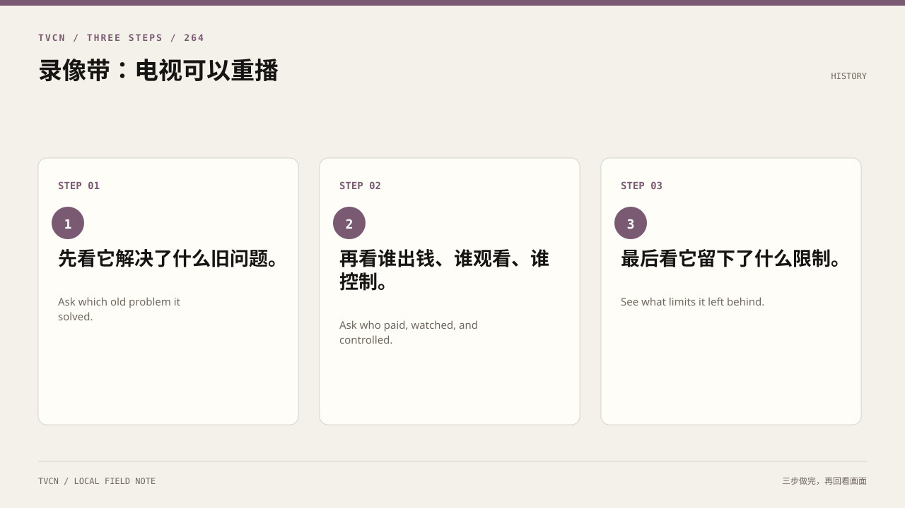

录像带让电视可以重播、可以归档、可以按节目单播出；拍摄不必同步直播，剪辑也不必在胶片上剪。它把“一次性的现场”变成“可以反复使用的素材”。

<!-- DIAGRAM_START -->
<h2>图解</h2>
<figure>
  
  <figcaption>看“按线性顺序剪一条，不许跳回”和“记录每次硬切的位置”两处，判断它替代了什么旧办法，又新增了什么限制。</figcaption>
</figure>
<!-- DIAGRAM_END -->
<section><h2 id="section-2">今天怎么用</h2><ul><li>做多机位或直播项目时，先理解磁带时代的“录制—重放—播出”链路，再设计备份录制。</li><li>做档案数字化时，确认带速、制式、磁迹和时码，不要用一个采集设置处理所有磁带。</li><li>研究电视史时，把播出制度、广告和家庭观看一起看，不要只讲机器。</li></ul><h2 id="section-3">不要误用</h2>
不要把录像带的柔化和噪点当成“复古滤镜”；它是介质与信号链的结果，不是一种万能风格。
<h2 id="section-4">录像带不是“低清”，是即时回放和可覆盖</h2>

磁带把拍摄从“冲洗后才知道”变成“现场能看”。它带来即时回放、可重录和多机位直播，也带来代际损失和存档难题。技术改变的不只是画质，是生产流程。

<h3>常见误读</h3>

“录像带一定比胶片差”不完整。广播级磁带在当时可以很清晰；差别在分辨率、动态范围和介质寿命。另一个误读是“磁带会永久保存”——磁粉脱落和机器停产后，存档会失效。

<h3>对今天的一个用处</h3>

现场回放能救一场戏，但不要依赖它做最终判断；监视器的色彩和压缩不等于成片。重要素材当天备份两份。
</section><section><h2 id="section-5">现场</h2>
录像带线性剪辑，不能跳回；看老电视节目的硬切和录带痕迹。
</section><section><h2 id="section-6">怎么做</h2><ol><li>按线性顺序剪一条，不许跳回。</li><li>记录每次硬切的位置。</li><li>看老节目里的录带痕迹，比如抖动和色彩边缘。</li></ol></section><section><h2 id="section-7">别踩</h2>
别用非编思维看录像带；它不能跳回，改一处要重录后面。
</section><section><h2>来源边界</h2>
这是解释，不是原始档案；关键年份、人物和法律条文回到 <a href="../../about/">SOURCES.md</a> 的原始链接复核。二手叙述只能当线索，不能当证据。
</section>
<h2>验收</h2><ul><li>剪辑按线性顺序完成，没有跳回前段。</li><li>每个硬切都有位置记录。</li><li>能指出至少一种录带痕迹，如抖动或色彩边缘。</li></ul>

<!-- SOURCES_START -->
## 参考与延伸阅读

- [S10] [BFI：电影史与动态影像研究](https://www.bfi.org.uk/) — 2026-11-26 访问。用于核对「今天怎么用」一节的术语/方法/规则（BFI 电影史与档案资料，不是设备评测）；不核对其中由本页经验得出的数字、型号与现场结论，也不替代测试。
- [S11] [Britannica：摄影](https://www.britannica.com/technology/photography) — 2026-11-26 访问。用于核对「不要误用」一节的术语/方法/规则（Britannica 摄影史条目，不是操作手册）；不核对其中由本页经验得出的数字、型号与现场结论，也不替代测试。
- [S50] [Kodak：动态影像](https://www.kodak.com/en/motion/home) — 2026-11-26 访问。用于核对「录像带不是“低清”，是即时回放和可覆盖」一节的术语/方法/规则（Kodak 胶片与动态影像资料，不是数码参数）；不核对其中由本页经验得出的数字、型号与现场结论，也不替代测试。
<!-- SOURCES_END -->

