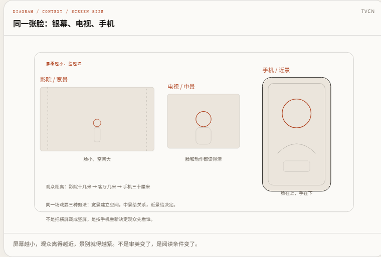

<!-- DIAGRAM_START -->
## 图解

<figure>
  
  <figcaption>屏幕越小，观众离得越近，景别就得越紧。不是审美变了，是阅读条件变了。</figcaption>
</figure>
<!-- DIAGRAM_END -->

景别不是导演突然爱拍特写，是屏幕和观看距离一起变了。

## 影院：宽景是默认

影院银幕大，观众坐在黑暗里，眼睛可以扫过整个画面。宽景能同时装下房间、人物和背景，信息多也不会丢。演员的脸可以小，因为一块银幕有半面墙那么大。

这不是“以前的导演更会拍”，是观看条件允许他们把信息铺开。观众没有手机，也没有暂停键，只能跟着画面走。

## 电视：中景变成客厅语言

电视进了客厅，屏幕缩到 4:3，观看距离只有几米。宽景里的脸变成一个小点，观众看不清表情，节目就开始用中景和近景。情景喜剧、访谈、新闻，都靠一张脸和一句话留住人。

屏幕变小，景别就得变近；这不是审美，是阅读条件。电视的构图也更居中，因为屏幕边缘常常被家具挡住。

## 手机：一个脸，一个动作

手机竖屏只有拇指宽，观众离屏幕 30 厘米。宽景在手机上几乎读不出空间，观众只看见一堆小人和背景。最有效的构图是“脸在上，手或物件在下”，一个镜头只讲一个动作。

同一场戏，影院版可以先用宽景建立空间，手机版必须用近景和插入镜头重剪。不是把横屏裁成竖屏，而是重新决定观众先看谁。

所以竖屏不是“更小的电影”，它有自己的景别、节奏和观看距离。按手机重新拍，比按电影裁一刀有用。

## 检查

- 能说出为什么宽景在手机上读不出来。
- 同一场戏有影院、电视、手机三种景别方案。
- 手机版一场只留一个脸和一个动作。

<!-- SOURCES_START -->
## 参考与延伸阅读

- [S10] BFI：电影史与影像研究入口

完整链接与用途见 [`SOURCES.md`](../../../SOURCES.md)。
<!-- SOURCES_END -->
