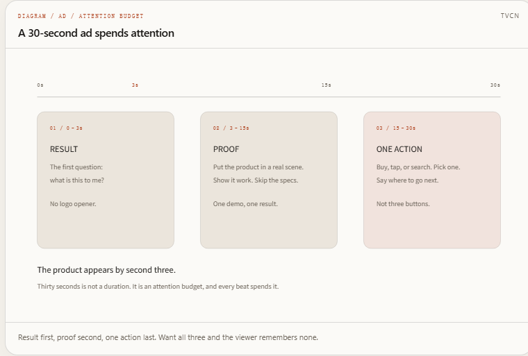

<!-- DIAGRAM_START -->
## Diagram

<figure>
  
  <figcaption>Result first, proof second, one action last. Want all three and the viewer remembers none.</figcaption>
</figure>
<!-- DIAGRAM_END -->

A product ad is not a product showcase. Give a problem in three seconds, one benefit in the middle, one action at the end.

## The first three seconds

The first three seconds do one thing: make the target user think “that is me.” Use a problem, a result, or a counterintuitive image. Do not open with a logo.

Show the product in action, not spinning on a table. Users buy what happens after use, not the shape.

## One benefit

Fifteen seconds can carry one benefit. Rank three and keep the one the image can prove. If it is light, lift it with one hand. If it is stable, put a glass of water on it.

Adjectives are cheap; proof is not. One verifiable image beats three lines about “premium quality.”

## The ending

End with a concrete action: tap, buy, claim, visit. Do not just show a logo and “learn more.” If the platform forbids a CTA, give a searchable phrase.

A fifteen-second structure: three seconds problem, seven seconds proof, three seconds result, two seconds action. If time is short, cut repeated proof, not the problem.

## Three checks

- The first three seconds make the target user recognize the problem.
- One benefit, proven on screen.
- The ending has a concrete action or a searchable phrase.

<!-- DEEP_DIVE_START -->
## Deep dive

<strong>About 6 minutes.</strong> A product ad is not a spec sheet. It names a problem in three seconds, then proves the product solves it.

### Make the problem concrete

In the first three seconds, show the trouble the user actually has: a stain, a dropped connection, lateness, an assembly that will not fit. Use their words, not internal brand language.

One film sells one benefit. The benefit must be provable on camera, not “understands you better.” Write one line: with this product, what becomes possible that was not before?

### Three kinds of proof

Demonstration: the product completes an action on screen. Comparison: same camera before and after. Third party: a number, a certificate, a real user. Use at least two of the three; specs alone do not prove anything.

The product is the hero; hands are supporting cast. Close-ups must show material, button, port. Do not hold one product image for the whole film; the viewer needs to see it work.

### One action

End with one action: buy, tap, search, watch. Do not stack a QR code, website, phone number, and store address. The fifteen-second cut keeps problem and proof; thirty or sixty seconds can add context.

Watch it muted before delivery. Can the picture alone explain the problem and the proof? If not, reshoot the demonstration.

### Five-minute drill: three-second problem, ten-second proof

Shoot two phone clips: a three-second problem (the user in trouble) and a ten-second proof (the product completing an action). No logo in between, no narration.

Play both muted three times and ask someone nearby: what problem is being solved, and do you believe it? If they cannot name the problem, reshoot the first clip; if they cannot name the proof, reshoot the second.

### When it is done

Play it muted and ask one person: what problem does the product solve, and what proof did you see? If both answers fit in one sentence, the ad is done. If one is vague, reshoot the three or ten seconds; do not fix it with subtitles.

### Ten product-ad checks
<ul><li>Concrete problem within three seconds</li><li>Only user language</li><li>One benefit per film</li><li>The benefit is provable on camera</li><li>Product completes an action</li><li>Same-camera before and after</li><li>At least two proofs</li><li>Close-up shows material or port</li><li>One closing action</li><li>It works muted</li></ul>
A product ad does not praise the product; it lets the viewer watch their problem get solved once.

<!-- DEEP_DIVE_END -->

<!-- SOURCES_START -->
## References and further reading

- [S14] [YouTube Community Guidelines](https://support.google.com/youtube/answer/2801973) — Accessed 2026-11-26. Used to check the terminology and public context in the opening paragraph (“A product ad is not a product showcase. Give a problem in th”) against Current platform rules on misleading content, dangerous acts, copyright and disclosure; not a substitute for an on-set test.
- [S15] [TikTok Community Guidelines](https://www.tiktok.com/community-guidelines/en/) — Accessed 2026-11-26. Used to check the terminology and public context in the opening paragraph (“A product ad is not a product showcase. Give a problem in th”) against Short-video platform rules on content, AI-generated media and commercial disclosure; not a substitute for an on-set test.
- [S16] [BBC Editorial Guidelines](https://www.bbc.co.uk/editorialguidelines/) — Accessed 2026-11-26. Used to check the terminology and public context in the opening paragraph (“A product ad is not a product showcase. Give a problem in th”) against Editorial standards on accuracy, fairness, privacy and secret recording; not a substitute for an on-set test.
- [S29] [YouTube Upload Specs](https://support.google.com/youtube/answer/1722171) — Accessed 2026-11-26. Used to check the terminology and public context in the opening paragraph (“A product ad is not a product showcase. Give a problem in th”) against Recommended resolution, bitrate, frame rate and audio codec; not a substitute for an on-set test.
<!-- SOURCES_END -->

