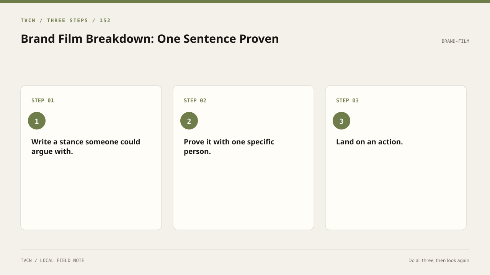

Watch how one sentence is proven. The product is evidence, not protagonist.

<!-- DIAGRAM_START -->
<h2>Diagram</h2>
<figure>
  
  <figcaption>Do the three steps in order, then look again at the image or file.</figcaption>
</figure>
<!-- DIAGRAM_END -->
<h2>On set</h2>

Write the claim as a sentence someone could argue against. Ask whether each shot proves it or just decorates.

<h2>Do this</h2>

A brand-film breakdown watches how one sentence is proven; the product is evidence, not the protagonist.
<ol><li>Write the claim as a sentence someone could oppose.</li><li>Mark each shot as proof or decoration.</li><li>Count product appearances and whether each has a reason.</li></ol>
<h2>Avoid</h2>

Do not fill in “craft, passion, dream”; they all look the same on camera.

<h2>Check</h2>
<ul><li>The claim can be opposed, not a universally agreeable platitude.</li><li>Each shot is marked proof or decoration, with decoration under half.</li><li>Every product appearance has a reason, not a ten-second exposure timer.</li></ul>
