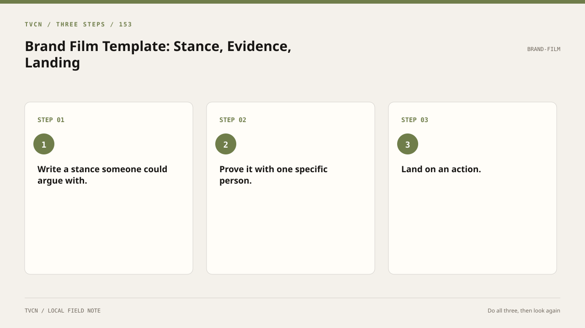

Stance, evidence, landing. The stance must be arguable and the evidence concrete.

<!-- DIAGRAM_START -->
<h2>Diagram</h2>
<figure>
  
  <figcaption>Do the three steps in order, then look again at the image or file.</figcaption>
</figure>
<!-- DIAGRAM_END -->
<h2>On set</h2>

The claim must be arguable, the proof must be one person, and the landing must be an action. No dreams or craftsmanship.

<h2>Do this</h2>

A brand-film template uses claim, evidence, landing; the claim must be opposable and the evidence specific.
<ol><li>Write a claim someone could oppose.</li><li>Prove it with one specific person.</li><li>Land on an action, not a slogan.</li></ol>
<h2>Avoid</h2>

Do not use dream or craftsmanship as the claim; without evidence they are only words.

<h2>Check</h2>
<ul><li>The claim can be opposed and a counterexample exists.</li><li>Evidence is specific to one person and one action.</li><li>The ending lands on an action, not a slogan.</li></ul>
