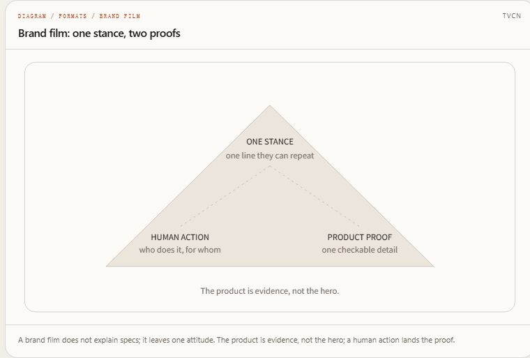

<!-- DIAGRAM_START -->
## Diagram

<figure>
  
  <figcaption>A brand film does not explain specs; it leaves one attitude. The product is evidence, not the hero; a human action lands the proof.</figcaption>
</figure>
<!-- DIAGRAM_END -->

## Write one stance first

The first line is not “founded in 1998”; it is an attitude someone could disagree with. For example, “slow down, and you can see.”

The more specific the stance, the easier the images. Vague “craft” and “passion” all look the same on screen.

## Prove it with one person

Do not prove the brand with a crowd of smiles. Choose one person doing one concrete thing, and let the product be a tool in their hand, not an icon.

The less the product appears, the more weight each appearance has. A brand film is not a long product ad.

## End on an action

Do not end with “this is our brand.” End on an action: close the door, leave, turn back, keep working. Let the audience say the attitude themselves.

A brand film can have no voice-over, but it cannot have no stance. Without a stance, it is just a more expensive promo.

## Three checks

- You can state the stance in one arguable sentence.
- The product is evidence, not the hero of every shot.
- The ending lands on an action, not a slogan.

<!-- DEEP_DIVE_START -->
## Deep dive

<strong>About 7 minutes.</strong> A brand film is not a company profile. It is one stance, proved by one person doing one thing.

### Write a stance someone could argue with

Do not write “innovation, quality, care.” Anyone can use those. Write a stance someone might disagree with, such as “slower is the only way to finish.”

The stance must become an action: waiting, redoing, refusing an order, turning the light off. Only action proves it; a slogan cannot.

### Prove it with one person

Choose one employee, customer, or founder and let them do something in a real situation that embodies the stance. Do not have them recite company values to camera.

The product is evidence, not the hero. Show it being used, repaired, refused. A hand, a desk, a workbench is more useful than a building.

### The landing

Return to the opening action at the end and let the viewer see the cost or result. No drone shot with a subtitle summary. Keep it ninety to one hundred eighty seconds, few subtitles, room for silence.

If the film still works with the brand name removed, the stance is real. If nothing remains without the name, rewrite it.

### Five-minute drill: remove the brand name

Write a stance someone could argue with, then shoot one twenty-second action: what a person did extra, or gave up, for that sentence. No office, no logo.

Remove every brand name and show it to someone who does not know the client. If they can still name the stance, it works. If not, rewrite the stance; do not add a subtitle explanation.

### When it is done

Remove the brand name, logo, and product name, then show it to a stranger. If they can still say in one sentence what these people believe, the film is done. If they only say “nice shots,” rewrite the stance. Do not add a narration summary.

### Ten brand-film checks
<ul><li>The stance can be argued with</li><li>The stance becomes an action</li><li>One main person</li><li>The person acts in a real situation</li><li>No recited values</li><li>Product is evidence, not hero</li><li>Show use, repair, or refusal</li><li>End returns to the opening action</li><li>It works without the brand name</li><li>No drone-and-subtitle summary</li></ul>
A brand film does not say who you are; it shows what you are willing to pay for.

<!-- DEEP_DIVE_END -->
<!-- SOURCES_START -->
<h2>Sources</h2>

Experience: TVCN field notes and project reviews; tested: the review setup and reproducible exercises noted on the page; references: public links below.

<ul><li>[S14] YouTube Community Guidelines</li><li>[S15] TikTok Community Guidelines</li><li>[S16] BBC Editorial Guidelines</li></ul>

<a href="../../about/">Full links and notes in SOURCES.md</a>

<!-- SOURCES_END -->
