<!-- DIAGRAM_START -->
<h2>Diagram</h2>
<figure>
  
  <figcaption>Diagram: six beats in order; miss one and it becomes a pile of footage.</figcaption>
</figure>
<!-- DIAGRAM_END -->
<h2>First decision: when to use it</h2>
Corporate video is not a company profile. Write a question the viewer wants answered, then prove with one person and one action that the company solves it.

Use it when there is one clear subject, one action, and a visible change in the final film. Do not use it when there is only a slogan, no person, and no process to shoot; go back to the brief before rolling.
<h2>Six beats: one job per beat</h2>
Write the six beats as six sentences, each answering “what does the viewer know now.” Shoot in order, but cut out of order; do not add empty shots to fill the structure.
<ol><li>A concrete problem</li><li>One person enters</li><li>Old way fails</li><li>Company intervenes</li><li>Verifiable result</li><li>One next step</li></ol><h2>How to shoot it: six tasks</h2>
At least one primary shot per beat; do not shoot everything in one framing and rely on jump cuts. Shoot irreplaceable action first—hands, face, machine—then pickups.
<ul><li>Problem: hands/desk close-up, no logo</li><li>Person: medium, act before talking</li><li>Failure: repeat the action, slow the cut</li><li>Intervention: product/process in one shot</li><li>Result: before/after or third-party proof</li><li>End: person leaves, one action remains</li></ul><h2>Common failures: three ways it collapses</h2>
<strong>1. Logo/drone first</strong>: the viewer does not know whose story this is. Replace beat one with a problem or action. <strong>2. Narration in every beat</strong>: the images carry no information. Let one action speak. <strong>3. Unverifiable result</strong>: “more efficient” with no before/after or third party. Shoot something checkable.
<h2>Cost and check: can it be shot in a day</h2>
Typically one shoot day plus two to three post days: half a day for primary shots, half for pickups; cut structure first, then sound. Check only three things: six beats complete, one primary shot per beat, result checkable. Do not accept “it feels premium.”
<h2>Check</h2><ul><li>Each of six beats is one clear sentence.</li><li>Beat one is a problem/action, not a logo.</li><li>At least one primary shot per beat.</li><li>Result has before/after or third party.</li><li>At least one irreplaceable action captured.</li><li>Six beats survive the rough cut.</li></ul>

<!-- SOURCES_START -->
## References and further reading

- [S14] [YouTube Community Guidelines](https://support.google.com/youtube/answer/2801973) — Accessed 2026-11-26. Used to check the terminology and public context in the opening paragraph (“Corporate video is not a company profile. Write a question t”) against Current platform rules on misleading content, dangerous acts, copyright and disclosure; not a substitute for an on-set test.
- [S15] [TikTok Community Guidelines](https://www.tiktok.com/community-guidelines/en/) — Accessed 2026-11-26. Used to check the terminology and public context in the opening paragraph (“Corporate video is not a company profile. Write a question t”) against Short-video platform rules on content, AI-generated media and commercial disclosure; not a substitute for an on-set test.
- [S16] [BBC Editorial Guidelines](https://www.bbc.co.uk/editorialguidelines/) — Accessed 2026-11-26. Used to check the terminology and public context in the opening paragraph (“Corporate video is not a company profile. Write a question t”) against Editorial standards on accuracy, fairness, privacy and secret recording; not a substitute for an on-set test.
- [S29] [YouTube Upload Specs](https://support.google.com/youtube/answer/1722171) — Accessed 2026-11-26. Used to check the terminology and public context in the opening paragraph (“Corporate video is not a company profile. Write a question t”) against Recommended resolution, bitrate, frame rate and audio codec; not a substitute for an on-set test.
<!-- SOURCES_END -->

