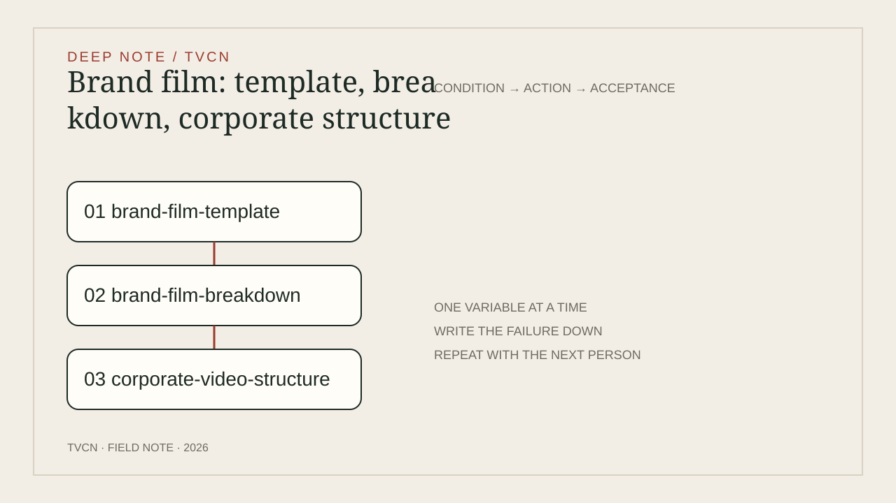

A brand film is not a company profile; one selling point, one person and one remembered action beat ten departments. One page of &amp;quot;Brand Film Template: Stance, Evidence, Landing&amp;quot; solves one local problem; joining &amp;quot;Brand Film Template: Stance, Evidence, Landing&amp;quot;, &amp;quot;Brand Film Breakdown: Build a World in Ninety Seconds&amp;quot; and &amp;quot;Corporate Video Structure: Six Beats&amp;quot; exposes the real failure: conditions are missing, too many variables move, and the result cannot be reproduced.

<!-- DEEP_DIVE_START -->
<!-- DIAGRAM_START -->
<h2>图解</h2>
<figure>
  
  <figcaption>Read &quot;Brand Film Template: Stance, Evidence, Landing&quot; and &quot;Brand Film Breakdown: Build a World in Ninety Seco…&quot;: write the condition first, then check whether the failure can be recorded.</figcaption>
</figure>
<!-- DIAGRAM_END -->

<section><h2 id="section-1">Problem</h2>
The problem is not a lack of methods; each step works alone, but together they fail because the condition was not written, too many variables moved and the result cannot be reproduced.

The order is condition, judgement, one variable and evidence. A step is complete only when the next person can repeat it.
</section>
<section><h2 id="section-2">Judgement</h2><ul><li>First gate in &quot;Brand Film Template: Stance, Evidence, Landing&quot;: The claim can be opposed and a counterexample exists.</li><li>Second gate in &quot;Brand Film Breakdown: Build a World in Ninety Seconds&quot;: Evidence is specific to one person and one action.</li><li>Third gate in &quot;Corporate Video Structure: Six Beats&quot;: The ending lands on an action, not a slogan.</li></ul>
If one gate fails, return to its single page; do not hide an unsolved point inside a longer chain.
</section>
<section><h2 id="section-3">Method</h2><ol><li>Write the condition first: turn &quot;Write a claim someone could oppose.&quot; from &quot;Brand Film Template: Stance, Evidence, Landing&quot; into three rows: material, environment, acceptance.</li><li>Run one minimal action: follow &quot;Brand Film Template: Stance, Evidence, Landing&quot; for 30 seconds and do not add the second page yet.</li><li>Attach the second page: Prove it with one specific person..</li><li>Use the third page as a control: Land on an action, not a slogan..</li><li>Change one variable at a time; write the other conditions down instead of remembering them.</li><li>Film the failure too: put failure and success side by side to see which step cannot be skipped.</li><li>Ask the next person to reproduce from the record; if they cannot, the record is not finished.</li></ol></section>
<section><h2 id="section-4">Field test</h2>
A reproducible test, not a client case: take 30 seconds of material, make version A using &quot;The claim can be opposed and a counterexample exists.&quot; from &quot;Brand Film Template: Stance, Evidence, Landing&quot;, then version B using &quot;Evidence is specific to one person and one action.&quot; from &quot;Brand Film Breakdown: Build a World in Ninety Seconds&quot;; only one variable may differ. Put them side by side and record what breaks first in &quot;Corporate Video Structure: Six Beats&quot;: condition, action or acceptance. If it works on the first try, add one real constraint and run it again.
</section>
<section><h2 id="section-5">Failure table</h2>
<table class="data-table"><thead><tr><th>Symptom</th><th>Cause</th><th>Replacement action</th></tr></thead><tbody><tr><td>Do not use dream or craftsmanship as the claim; without evidence …</td><td>Condition was not written</td><td>Return to page one and rewrite the three rows</td></tr><tr><td>Only the result is kept, not the condition</td><td>Condition was not written</td><td>Return to page one and rewrite the three rows</td></tr><tr><td>Only the result is kept, not the condition</td><td>Condition was not written</td><td>Return to page one and rewrite the three rows</td></tr></tbody></table>
</section>
<section><h2 id="section-6">Acceptance</h2><ul><li>The claim can be opposed and a counterexample exists.</li><li>Evidence is specific to one person and one action.</li><li>The ending lands on an action, not a slogan.</li><li>An action is already happening in the first five seconds, not a drone.</li><li>The want is one object or action.</li><li>Obstacle comes from the real world, not a fake villain.</li><li>Turn happens through action, not slogan.</li><li>Consequence lands on one person.</li><li>Brand appears once, in the same frame as action.</li><li>End on consequence, not logo.</li></ul></section>
<section><h2 id="section-7">Alternatives</h2><ul><li>For a single-point problem in "Brand Film Template: Stance, Evidence, Landing", go back to <a href="https://formats.tvcn.org/en/article/brand-film-template/">Brand Film Template: Stance, Evidence, Landing</a>; do not use the whole chain.</li><li>To compare two actions, read <a href="https://formats.tvcn.org/en/article/brand-film-breakdown/">Brand Film Breakdown: Build a World in Ninety Seconds</a> and leave the third page alone.</li><li>For acceptance only, use <a href="https://formats.tvcn.org/en/article/corporate-video-structure/">Corporate Video Structure: Six Beats</a> as a self-test sheet.</li></ul></section>
