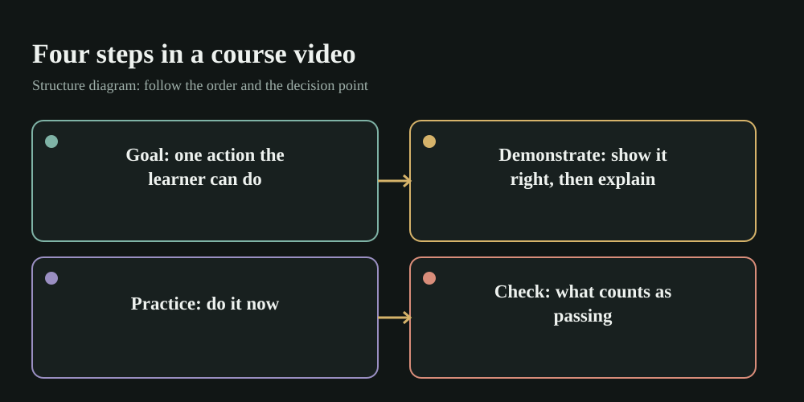

Course video easily mistakes “covered” for “learned”: the teacher talks for twelve minutes, the picture is clear, the subtitles are accurate, and the learner nods. The next day they shoot a frame and still cannot do it. The problem is not the amount of information; the course never designed what the learner does.

<!-- DIAGRAM_START -->
<h2 id="diagram">Diagram</h2>
<figure class="diagram">
  
  <figcaption>Check whether goal, demonstration, practice and check all appear. A course that only talks lets the learner remember, not do.</figcaption>
</figure>
<!-- DIAGRAM_END -->

<section><h2 id="section-1">On location</h2>
A five-lesson photography course, twelve minutes each, covers exposure triangle, white balance, composition, sound and editing. The teacher is thorough and the slides are handsome. Learners finish and submit overexposed frames. Follow-up finds they know “protect the highlights” but do not know which button on their camera shows the waveform.
</section>
<section><h2 id="section-2">What to look for</h2><ul><li><strong>Doable goal:</strong> “understand exposure” cannot be checked; “open the waveform on your camera and adjust one stop” can.</li><li><strong>Practice inside the video:</strong> does the video ask the learner to pause and do it once? Without practice, information only passes through the eyes.</li><li><strong>Specific error demo:</strong> not “do not overexpose” but “when the highlight hits the top, which part of the waveform turns red”.</li><li><strong>Checkable result:</strong> the learner can say pass or fail without waiting for the teacher.</li></ul></section>
<section><h2 id="section-3">What to do</h2><ol><li>Write one doable goal: after this lesson the learner can perform one action on their own device within ten minutes.</li><li>Demonstrate first: the first thirty seconds show the result done right; then explain why.</li><li>One action per lesson: exposure, sound and composition stay separate; do not pack three new concepts into one lesson.</li><li>Put practice inside: at the key moment, a caption says “pause and do it once”, with three checkpoints.</li><li>Give a check: a three-line table where the learner marks done, not done or stuck; the next lesson starts from stuck.</li></ol></section>
<section><h2 id="section-4">Failure modes</h2><ul><li><strong>Reading slides:</strong> the teacher finishes the deck, the learner copies the concepts, nobody does anything once.</li><li><strong>Information overload:</strong> eight concepts in twelve minutes; the learner remembers the first and blurs the rest.</li><li><strong>No error demo:</strong> only the right answer is shown, so the learner cannot locate a fault on their own device.</li></ul></section>
<section><h2 id="section-5">Limits</h2>
This structure suits skill courses: camera, editing, sound, software. It is not for pure theory, history or conceptual courses, which need argument and reading. A course video also cannot replace a full curriculum: it owns one action, not a semester of ability. Complex skills split into lessons, one action each.
</section>
<section><h2 id="section-6">Check</h2><ul><li>Every learner can state the doable goal of the lesson.</li><li>The video contains at least one pause-and-practice moment, and the learner actually does it.</li><li>The learner can judge pass or fail without asking the teacher.</li><li>The next lesson starts from where they got stuck, not from page one.</li></ul></section>
<!-- DEEP_DIVE_START -->
## Deep dive

<strong>About 8 minutes.</strong> This section places the same judgement in two different conditions, then gives a counterexample and a reusable model. It does not repeat the page; it decides when to change the method.

### Condition A: self-paced online

Self-paced online has no teacher nearby, so the course must design the environment too. Assume the most common camera, software and version; give both menu path and shortcut for every operation to survive version differences. The exercise must fit in ten minutes and cannot require a set, an actor or a location.

Online courses overestimate hand skill: the teacher thinks “open the waveform” is obvious; the learner cannot find it. Keep the finger or cursor on the button for two seconds and put the button name in the subtitle; do not sweep through menus.

### Condition B: in-person workshop

An in-person workshop has a teacher present, so the video should not carry the lecture; it carries demonstration and replay. Open with a two-minute demo of one action, then learners do it while the teacher circulates. When someone is stuck, return to the matching timecode instead of repeating the lecture.

Workshop assessment is public: each learner performs the action within three minutes while others watch. Public performance exposes the illusion of knowing; the teacher logs where people stick and fills that minute next round, not the whole lesson.

### Counterexample: the learner nods but cannot do it

A fifteen-minute editing lesson covers tracks, bins, in and out points and ripple delete. The learner says “got it”. The assignment is a thirty-second cut; every submission has no J-cut and all in points sit mid-line. The learner did not fail to listen; they never did it once inside the lesson.

The fix is not another explanation. Stop at the J-cut, have the learner use the same footage: sound enters twelve frames early, picture follows. Then continue. The lesson grows three minutes and the work doubles in quality.

### Reusable model

<strong>Goal → demonstrate → practice → check.</strong> The goal is one action; the demo shows the result first; practice does it now; the check lets the learner judge. When all four are in the video, it is a course, not a lecture.

Keep one action per lesson; move everything else to “next lesson” or an appendix. What you cut is not wasted; it lets the learner actually learn this one. Confidence from one action brings them back for the second.

<!-- DEEP_DIVE_END -->
<!-- SOURCES_START -->
## Further reading

- [S42] [Pixar: Pixar in a Box](https://www.khanacademy.org/partner-content/pixar) — accessed 2026-11-26. Used to check the terms, method or rule in the “What to look for” section; not the page's field numbers, gear models or conclusions, and not a substitute for a test or contract.
- [S16] [BBC Editorial Guidelines: BBC Editorial Guidelines](https://www.bbc.co.uk/editorialguidelines/) — accessed 2026-11-26. Used to check the terms, method or rule in the “Limits” section; not the page's field numbers, gear models or conclusions, and not a substitute for a test or contract.
<!-- SOURCES_END -->
