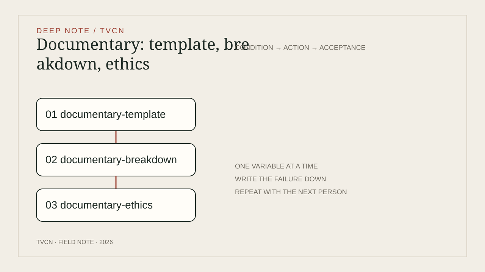

Documentary is not capturing reality; template, breakdown and ethics decide whose voice remains. One page of &amp;quot;Documentary Template: One Person, One Thing, One Change&amp;quot; solves one local problem; joining &amp;quot;Documentary Template: One Person, One Thing, One Change&amp;quot;, &amp;quot;Documentary Breakdown: One Person, One Event, One Change&amp;quot; and &amp;quot;Documentary Ethics: Filming Vulnerable People&amp;quot; exposes the real failure: conditions are missing, too many variables move, and the result cannot be reproduced.

<!-- DEEP_DIVE_START -->
<!-- DIAGRAM_START -->
<h2>图解</h2>
<figure>
  
  <figcaption>Read &quot;Documentary Template: One Person, One Thing, One C…&quot; and &quot;Documentary Breakdown: One Person, One Event, One …&quot;: write the condition first, then check whether the failure can be recorded.</figcaption>
</figure>
<!-- DIAGRAM_END -->

<section><h2 id="section-1">Problem</h2>
The problem is not a lack of methods; each step works alone, but together they fail because the condition was not written, too many variables moved and the result cannot be reproduced.

The order is condition, judgement, one variable and evidence. A step is complete only when the next person can repeat it.
</section>
<section><h2 id="section-2">Judgement</h2><ul><li>First gate in &quot;Documentary Template: One Person, One Thing, One Change&quot;: The film has one person and one task in progress.</li><li>Second gate in &quot;Documentary Breakdown: One Person, One Event, One Change&quot;: Interview does not open the piece; action comes first.</li><li>Third gate in &quot;Documentary Ethics: Filming Vulnerable People&quot;: A visible change occurs, not only the subject saying so.</li></ul>
If one gate fails, return to its single page; do not hide an unsolved point inside a longer chain.
</section>
<section><h2 id="section-3">Method</h2><ol><li>Write the condition first: turn &quot;Choose one person and one task in progress.&quot; from &quot;Documentary Template: One Person, One Thing, One Change&quot; into three rows: material, environment, acceptance.</li><li>Run one minimal action: follow &quot;Documentary Template: One Person, One Thing, One Change&quot; for 30 seconds and do not add the second page yet.</li><li>Attach the second page: Shoot the task before the interview..</li><li>Use the third page as a control: Wait for a visible change before fixing the structure..</li><li>Change one variable at a time; write the other conditions down instead of remembering them.</li><li>Film the failure too: put failure and success side by side to see which step cannot be skipped.</li><li>Ask the next person to reproduce from the record; if they cannot, the record is not finished.</li></ol></section>
<section><h2 id="section-4">Field test</h2>
A reproducible test, not a client case: take 30 seconds of material, make version A using &quot;The film has one person and one task in progress.&quot; from &quot;Documentary Template: One Person, One Thing, One Change&quot;, then version B using &quot;Interview does not open the piece; action comes first.&quot; from &quot;Documentary Breakdown: One Person, One Event, One Change&quot;; only one variable may differ. Put them side by side and record what breaks first in &quot;Documentary Ethics: Filming Vulnerable People&quot;: condition, action or acceptance. If it works on the first try, add one real constraint and run it again.
</section>
<section><h2 id="section-5">Failure table</h2>
<table class="data-table"><thead><tr><th>Symptom</th><th>Cause</th><th>Replacement action</th></tr></thead><tbody><tr><td>Do not start with historical background; that is usually a thesis…</td><td>Condition was not written</td><td>Return to page one and rewrite the three rows</td></tr><tr><td>Do not treat “he agreed” as ethical clearance; he may not know wh…</td><td>Condition was not written</td><td>Return to page one and rewrite the three rows</td></tr><tr><td>Only the result is kept, not the condition</td><td>Condition was not written</td><td>Return to page one and rewrite the three rows</td></tr></tbody></table>
</section>
<section><h2 id="section-6">Acceptance</h2><ul><li>The film has one person and one task in progress.</li><li>Interview does not open the piece; action comes first.</li><li>A visible change occurs, not only the subject saying so.</li><li>An action is happening in the first ten seconds.</li><li>Person, place, and task are clear within thirty seconds.</li><li>Want is filmable, not abstract.</li><li>Obstacle happens naturally, no fake conflict.</li><li>At least one complete attempt.</li><li>The same action after the change differs from the opening.</li><li>No summarizing narration at the end.</li></ul></section>
<section><h2 id="section-7">Alternatives</h2><ul><li>For a single-point problem in "Documentary Template: One Person, One Thing, One Change", go back to <a href="https://formats.tvcn.org/en/article/documentary-template/">Documentary Template: One Person, One Thing, One Change</a>; do not use the whole chain.</li><li>To compare two actions, read <a href="https://formats.tvcn.org/en/article/documentary-breakdown/">Documentary Breakdown: One Person, One Event, One Change</a> and leave the third page alone.</li><li>For acceptance only, use <a href="https://context.tvcn.org/en/article/documentary-ethics/">Documentary Ethics: Filming Vulnerable People</a> as a self-test sheet.</li></ul></section>

<!-- SOURCES_START -->
## References and further reading

- [S12] [Animation](https://www.britannica.com/art/animation) — Accessed 2026-11-26. Used to check the terminology and public context in the opening paragraph (“Documentary is not capturing reality; template, breakdown an”) against Encyclopedia entry on animation principles, techniques and industry history; not a substitute for an on-set test.
- [S14] [YouTube Community Guidelines](https://support.google.com/youtube/answer/2801973) — Accessed 2026-11-26. Used to check the terminology and public context in the opening paragraph (“Documentary is not capturing reality; template, breakdown an”) against Current platform rules on misleading content, dangerous acts, copyright and disclosure; not a substitute for an on-set test.
- [S15] [TikTok Community Guidelines](https://www.tiktok.com/community-guidelines/en/) — Accessed 2026-11-26. Used to check the terminology and public context in the opening paragraph (“Documentary is not capturing reality; template, breakdown an”) against Short-video platform rules on content, AI-generated media and commercial disclosure; not a substitute for an on-set test.
- [S16] [BBC Editorial Guidelines](https://www.bbc.co.uk/editorialguidelines/) — Accessed 2026-11-26. Used to check the terminology and public context in the opening paragraph (“Documentary is not capturing reality; template, breakdown an”) against Editorial standards on accuracy, fairness, privacy and secret recording; not a substitute for an on-set test.
- [S29] [YouTube Upload Specs](https://support.google.com/youtube/answer/1722171) — Accessed 2026-11-26. Used to check the terminology and public context in the opening paragraph (“Documentary is not capturing reality; template, breakdown an”) against Recommended resolution, bitrate, frame rate and audio codec; not a substitute for an on-set test.
<!-- SOURCES_END -->

