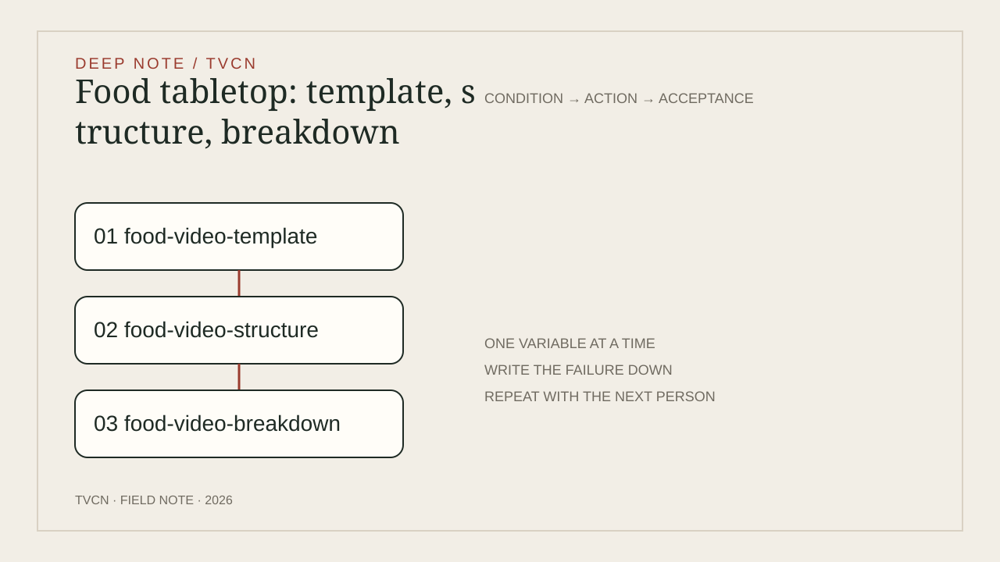

Food film is not a reel of close-ups; tabletop, sound and a 30-second action order decide appetite. One page of &amp;quot;Food &amp;amp; Table Template: One Sheet to Shoot&amp;quot; solves one local problem; joining &amp;quot;Food &amp;amp; Table Template: One Sheet to Shoot&amp;quot;, &amp;quot;Food &amp;amp; Table Structure: Six Beats&amp;quot; and &amp;quot;Food &amp;amp; Table Breakdown: Six Beats in Practice&amp;quot; exposes the real failure: conditions are missing, too many variables move, and the result cannot be reproduced.

<!-- DEEP_DIVE_START -->
<!-- DIAGRAM_START -->
<h2>图解</h2>
<figure>
  
  <figcaption>Read &quot;Food &amp; Table Template: One Sheet to Shoot&quot; and &quot;Food &amp; Table Structure: Six Beats&quot;: write the condition first, then check whether the failure can be recorded.</figcaption>
</figure>
<!-- DIAGRAM_END -->

<section><h2 id="section-1">Problem</h2>
The problem is not a lack of methods; each step works alone, but together they fail because the condition was not written, too many variables moved and the result cannot be reproduced.

The order is condition, judgement, one variable and evidence. A step is complete only when the next person can repeat it.
</section>
<section><h2 id="section-2">Judgement</h2><ul><li>First gate in &quot;Food &amp; Table Template: One Sheet to Shoot&quot;: The condition from Food &amp; Table Template: One Sheet to Shoot fits on one line and can be r…</li><li>Second gate in &quot;Food &amp; Table Structure: Six Beats&quot;: Only one variable changes and the other page&#x27;s result still reproduces.</li><li>Third gate in &quot;Food &amp; Table Breakdown: Six Beats in Practice&quot;: A failure is recorded as condition, action and result, not a feeling.</li></ul>
If one gate fails, return to its single page; do not hide an unsolved point inside a longer chain.
</section>
<section><h2 id="section-3">Method</h2><ol><li>Write the condition first: turn &quot;can or cannot&quot; from &quot;Food &amp; Table Template: One Sheet to Shoot&quot; into three rows: material, environment, acceptance.</li><li>Run one minimal action: follow &quot;Food &amp; Table Template: One Sheet to Shoot&quot; for 30 seconds and do not add the second page yet.</li><li>Attach the second page: change one variable and hold everything else.</li><li>Use the third page as a control: shoot a same-condition version and compare.</li><li>Change one variable at a time; write the other conditions down instead of remembering them.</li><li>Film the failure too: put failure and success side by side to see which step cannot be skipped.</li><li>Ask the next person to reproduce from the record; if they cannot, the record is not finished.</li></ol></section>
<section><h2 id="section-4">Field test</h2>
A reproducible test, not a client case: take 30 seconds of material, make version A using &quot;The condition from Food &amp; Table Template: One Sheet to Shoot fits…&quot; from &quot;Food &amp; Table Template: One Sheet to Shoot&quot;, then version B using &quot;Only one variable changes and the other page&#x27;s result still repro…&quot; from &quot;Food &amp; Table Structure: Six Beats&quot;; only one variable may differ. Put them side by side and record what breaks first in &quot;Food &amp; Table Breakdown: Six Beats in Practice&quot;: condition, action or acceptance. If it works on the first try, add one real constraint and run it again.
</section>
<section><h2 id="section-5">Failure table</h2>
<table class="data-table"><thead><tr><th>Symptom</th><th>Cause</th><th>Replacement action</th></tr></thead><tbody><tr><td>Only the result is kept, not the condition</td><td>Condition was not written</td><td>Return to page one and rewrite the three rows</td></tr><tr><td>Only the result is kept, not the condition</td><td>Condition was not written</td><td>Return to page one and rewrite the three rows</td></tr><tr><td>Only the result is kept, not the condition</td><td>Condition was not written</td><td>Return to page one and rewrite the three rows</td></tr></tbody></table>
</section>
<section><h2 id="section-6">Acceptance</h2><ul><li>The condition from Food &amp; Table Template: One Sheet to Shoot fits on one line and can be repeated by someone else.</li><li>Only one variable changes and the other page&#x27;s result still reproduces.</li><li>A failure is recorded as condition, action and result, not a feeling.</li><li>A colleague can reproduce the same version without asking you.</li></ul></section>
<section><h2 id="section-7">Alternatives</h2><ul><li>For a single-point problem in "Food & Table Template: One Sheet to Shoot", go back to <a href="https://formats.tvcn.org/en/article/food-video-template/">Food & Table Template: One Sheet to Shoot</a>; do not use the whole chain.</li><li>To compare two actions, read <a href="https://formats.tvcn.org/en/article/food-video-structure/">Food & Table Structure: Six Beats</a> and leave the third page alone.</li><li>For acceptance only, use <a href="https://formats.tvcn.org/en/article/food-video-breakdown/">Food & Table Breakdown: Six Beats in Practice</a> as a self-test sheet.</li></ul></section>
