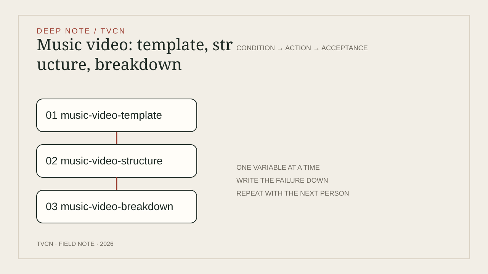

A music video is not images over a song; structure, performance and cuts follow the music, not dialogue. One page of &amp;quot;Music Video Template: Verse, Chorus, Memory&amp;quot; solves one local problem; joining &amp;quot;Music Video Template: Verse, Chorus, Memory&amp;quot;, &amp;quot;Music Video Structure: The Song Is the Timeline&amp;quot; and &amp;quot;Music Video Breakdown: Map Song Structure to Image&amp;quot; exposes the real failure: conditions are missing, too many variables move, and the result cannot be reproduced.

<!-- DEEP_DIVE_START -->
<!-- DIAGRAM_START -->
<h2>图解</h2>
<figure>
  
  <figcaption>Read &quot;Music Video Template: Verse, Chorus, Memory&quot; and &quot;Music Video Structure: The Song Is the Timeline&quot;: write the condition first, then check whether the failure can be recorded.</figcaption>
</figure>
<!-- DIAGRAM_END -->

<section><h2 id="section-1">Problem</h2>
The problem is not a lack of methods; each step works alone, but together they fail because the condition was not written, too many variables moved and the result cannot be reproduced.

The order is condition, judgement, one variable and evidence. A step is complete only when the next person can repeat it.
</section>
<section><h2 id="section-2">Judgement</h2><ul><li>First gate in &quot;Music Video Template: Verse, Chorus, Memory&quot;: The verse establishes where the person is.</li><li>Second gate in &quot;Music Video Structure: The Song Is the Timeline&quot;: The chorus hook appears at least twice and is memorable.</li><li>Third gate in &quot;Music Video Breakdown: Map Song Structure to Image&quot;: The bridge changes space or relationship, not just volume.</li></ul>
If one gate fails, return to its single page; do not hide an unsolved point inside a longer chain.
</section>
<section><h2 id="section-3">Method</h2><ol><li>Write the condition first: turn &quot;Let the verse establish space and location.&quot; from &quot;Music Video Template: Verse, Chorus, Memory&quot; into three rows: material, environment, acceptance.</li><li>Run one minimal action: follow &quot;Music Video Template: Verse, Chorus, Memory&quot; for 30 seconds and do not add the second page yet.</li><li>Attach the second page: Give the chorus one repeatable memory action..</li><li>Use the third page as a control: Let the bridge turn by changing space or relationship..</li><li>Change one variable at a time; write the other conditions down instead of remembering them.</li><li>Film the failure too: put failure and success side by side to see which step cannot be skipped.</li><li>Ask the next person to reproduce from the record; if they cannot, the record is not finished.</li></ol></section>
<section><h2 id="section-4">Field test</h2>
A reproducible test, not a client case: take 30 seconds of material, make version A using &quot;The verse establishes where the person is.&quot; from &quot;Music Video Template: Verse, Chorus, Memory&quot;, then version B using &quot;The chorus hook appears at least twice and is memorable.&quot; from &quot;Music Video Structure: The Song Is the Timeline&quot;; only one variable may differ. Put them side by side and record what breaks first in &quot;Music Video Breakdown: Map Song Structure to Image&quot;: condition, action or acceptance. If it works on the first try, add one real constraint and run it again.
</section>
<section><h2 id="section-5">Failure table</h2>
<table class="data-table"><thead><tr><th>Symptom</th><th>Cause</th><th>Replacement action</th></tr></thead><tbody><tr><td>Do not make the bridge just a volume drop; without a visual turn…</td><td>Condition was not written</td><td>Return to page one and rewrite the three rows</td></tr><tr><td>Do not illustrate every lyric; that is a slideshow, not an MV.</td><td>Condition was not written</td><td>Return to page one and rewrite the three rows</td></tr><tr><td>Only the result is kept, not the condition</td><td>Condition was not written</td><td>Return to page one and rewrite the three rows</td></tr></tbody></table>
</section>
<section><h2 id="section-6">Acceptance</h2><ul><li>The verse establishes where the person is.</li><li>The chorus hook appears at least twice and is memorable.</li><li>The bridge changes space or relationship, not just volume.</li><li>Verse, chorus, and bridge times are marked on the timeline.</li><li>Verse shots run longer and chorus cuts denser.</li><li>The chorus has a repeatable memory action, not lyric subtitles.</li><li>Track split into clear sections</li><li>One emotional job per section</li><li>One memory point</li><li>Three visual motifs</li></ul></section>
<section><h2 id="section-7">Alternatives</h2><ul><li>For a single-point problem in "Music Video Template: Verse, Chorus, Memory", go back to <a href="https://formats.tvcn.org/en/article/music-video-template/">Music Video Template: Verse, Chorus, Memory</a>; do not use the whole chain.</li><li>To compare two actions, read <a href="https://formats.tvcn.org/en/article/music-video-structure/">Music Video Structure: The Song Is the Timeline</a> and leave the third page alone.</li><li>For acceptance only, use <a href="https://formats.tvcn.org/en/article/music-video-breakdown/">Music Video Breakdown: Map Song Structure to Image</a> as a self-test sheet.</li></ul></section>

<!-- SOURCES_START -->
## References and further reading

- [S42] [Pixar in a Box: Storytelling](https://www.khanacademy.org/partner-content/pixar) — Accessed 2026-11-26. Used to check the terminology/method/rule in the “Problem” section against Pixar storytelling course, not project pricing; it does not verify numbers, model choices or on-set conclusions derived from this page, and is not a substitute for a test.
- [S14] [YouTube: Community Guidelines](https://support.google.com/youtube/answer/2801973) — Accessed 2026-11-26. Used to check the terminology/method/rule in the “Judgement” section against YouTube community rules, not creative standards; it does not verify numbers, model choices or on-set conclusions derived from this page, and is not a substitute for a test.
<!-- SOURCES_END -->

