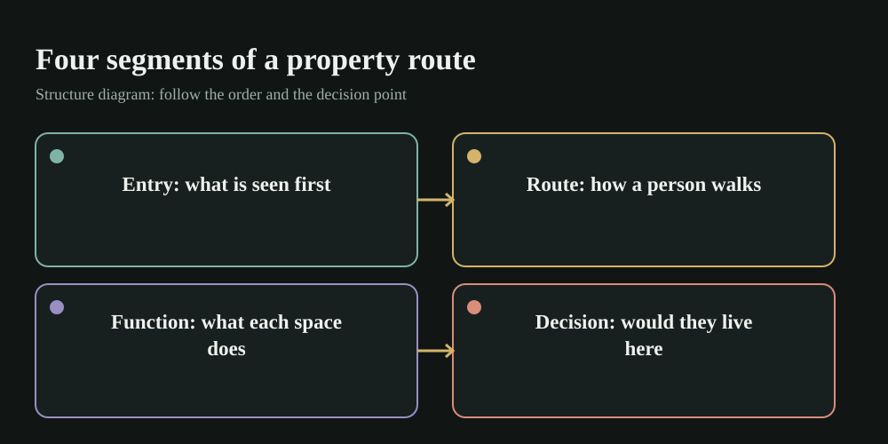

Real estate video easily becomes a wide-angle sweep: every room appears, and after it the viewer still does not know what living there feels like. The problem is not a wide enough lens; there is no route. The viewer sees square metres, not life.

<!-- DIAGRAM_START -->
<h2 id="diagram">Diagram</h2>
<figure class="diagram">
  
  <figcaption>Check entry, route, function and decision. If the camera only sweeps rooms and nobody walks, the viewer will not remember the layout.</figcaption>
</figure>
<!-- DIAGRAM_END -->

<section><h2 id="section-1">On location</h2>
A ninety-square-metre three-bedroom with good light and a long corridor. The client asks for “high-end”; the previous video sweeps from the entry to the main bedroom with a wide lens and piano music. The owner says it looks like a hotel, not a home. The agent says buyers cannot remember which room faces south.
</section>
<section><h2 id="section-2">What to look for</h2><ul><li><strong>Clear route:</strong> the viewer can repeat entry, shoes, living room, kitchen, bedroom in order.</li><li><strong>Credible scale:</strong> a person or a piece of furniture gives reference; wide angle alone makes rooms look falsely large.</li><li><strong>Visible function:</strong> each space has at least one use action: sit, boil water, open a cabinet, look out.</li><li><strong>Directional light:</strong> the viewer knows where light comes from; not every room is equally bright.</li></ul></section>
<section><h2 id="section-3">What to do</h2><ol><li>Draw a route: start at the entry and walk in real living order; do not shoot by room number.</li><li>Set the entry first: the first shot is the first look through the door, at 24–28mm, not ultra-wide; the viewer must know where they are.</li><li>Move with a person: gimbal or slider at walking speed; each space is crossed once, not swept repeatedly.</li><li>Give function an action: sit, turn on a light, put down a bag, boil water; action turns space into life.</li><li>End on a decision: window, balcony or dining table; make the viewer ask whether they would sit here.</li></ol></section>
<section><h2 id="section-4">Failure modes</h2><ul><li><strong>Wide sweep:</strong> every room appears, the viewer remembers “big” and not the layout.</li><li><strong>Too fast:</strong> three seconds per room; the viewer cannot see before the cut. It feels like a listing app, not a viewing.</li><li><strong>Empty rooms only:</strong> no person, no furniture in use; the space has no scale and no life.</li></ul></section>
<section><h2 id="section-5">Limits</h2>
A property video cannot replace listing facts: area, orientation, title and price come from text and the agent, not from images. It is not for commercial leasing or architectural documentary, which need fuller spatial analysis. Get owner or tenant permission before shooting, and do not show house numbers, plates or private photos.
</section>
<section><h2 id="section-6">Check</h2><ul><li>After one viewing the viewer can sketch the route without rewinding.</li><li>Each space has one use action, not an empty shot.</li><li>A person or furniture gives scale reference.</li><li>The ending lands on a specific life scene, not a logo.</li></ul></section>
<!-- DEEP_DIVE_START -->
## Deep dive

<strong>About 8 minutes.</strong> This section places the same judgement in two different conditions, then gives a counterexample and a reusable model. It does not repeat the page; it decides when to change the method.

### Condition A: owner-occupier

Owner-occupiers care how they will live daily, not how big the property is. The route starts from repeated actions: bedroom to kitchen in the morning, living room to balcony at night, where a guest sits. Shoot each repeated action once; the viewer connects the day.

Leave room for imperfection: a long corridor, little storage, a small second bedroom can be shown, not hidden. Buyers trust the advantages when they see the limits. Hiding defects leads to disappointment at the viewing and a slower sale.

### Condition B: investment or rental

Investors care who will use it, for how long and whether it can change, not whether they like it. Show functional combinations: can it work from home, can a second room be partitioned, can the balcony be used. Do not only show finish. Prove each function with an action: open a laptop at the dining table, air bedding on the balcony.

Label visible and invisible: which finishes, furniture and styling are included, which are staging. Do not let a show flat imply the handover standard. The prettier the frame, the clearer the caption: “for display, not included in the price”.

### Counterexample: beautiful but the layout is unreadable

A property film uses drone, slider and slow motion with car-commercial music. After it, viewers remember a big living room and a bright kitchen but cannot say how the two bedrooms connect or where the bathroom is. There is no route, only shot display.

The fix is not a caption saying “master bedroom 18 sqm”. Have a person walk from the entry to the master, passing the bathroom and second bedroom; the camera follows and the order sticks. Put the number in the caption and the relationship in the body.

### Reusable model

<strong>Entry → route → function → decision.</strong> Entry tells the viewer where they are; route fixes the order; function shows life; decision asks whether they would live here. With all four, the film is not a room slideshow.

Before shooting, ask the agent to say in one sentence who this property suits. If they cannot, the film becomes generic. Define the person before the route; different buyers should get a different order in the same property.

<!-- DEEP_DIVE_END -->
<!-- SOURCES_START -->
## Further reading

- [S31] [ARRI Cine Systems: ARRI Cine Systems](https://www.arri.com/en/cine-systems) — accessed 2026-11-26. Used to check the terms, method or rule in the “What to look for” section; not the page's field numbers, gear models or conclusions, and not a substitute for a test or contract.
- [S29] [YouTube Upload Specs: YouTube Upload Specs](https://support.google.com/youtube/answer/1722171) — accessed 2026-11-26. Used to check the terms, method or rule in the “Limits” section; not the page's field numbers, gear models or conclusions, and not a substitute for a test or contract.
<!-- SOURCES_END -->
