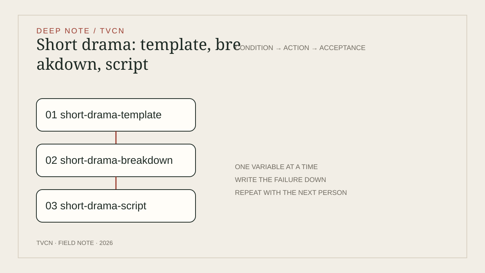

Short drama is not a shortened feature; template, breakdown and script are rebuilt around a 30-second hook. One page of &amp;quot;Short Drama Template: A Hook Every Thirty Seconds&amp;quot; solves one local problem; joining &amp;quot;Short Drama Template: A Hook Every Thirty Seconds&amp;quot;, &amp;quot;Short Drama Breakdown: One Turn in Thirty Seconds&amp;quot; and &amp;quot;Short Drama: A Hook Every Thirty Seconds&amp;quot; exposes the real failure: conditions are missing, too many variables move, and the result cannot be reproduced.

<!-- DEEP_DIVE_START -->
<!-- DIAGRAM_START -->
<h2>图解</h2>
<figure>
  
  <figcaption>Read &quot;Short Drama Template: A Hook Every Thirty Seconds&quot; and &quot;Short Drama Breakdown: One Turn in Thirty Seconds&quot;: write the condition first, then check whether the failure can be recorded.</figcaption>
</figure>
<!-- DIAGRAM_END -->

<section><h2 id="section-1">Problem</h2>
The problem is not a lack of methods; each step works alone, but together they fail because the condition was not written, too many variables moved and the result cannot be reproduced.

The order is condition, judgement, one variable and evidence. A step is complete only when the next person can repeat it.
</section>
<section><h2 id="section-2">Judgement</h2><ul><li>First gate in &quot;Short Drama Template: A Hook Every Thirty Seconds&quot;: 0–5, 5–35, and 35–60 each add new information or an obstacle.</li><li>Second gate in &quot;Short Drama Breakdown: One Turn in Thirty Seconds&quot;: The information gap is set in the first five seconds.</li><li>Third gate in &quot;Short Drama: A Hook Every Thirty Seconds&quot;: The final question is grounded in the previous minute.</li></ul>
If one gate fails, return to its single page; do not hide an unsolved point inside a longer chain.
</section>
<section><h2 id="section-3">Method</h2><ol><li>Write the condition first: turn &quot;0–5 seconds establish an information gap.&quot; from &quot;Short Drama Template: A Hook Every Thirty Seconds&quot; into three rows: material, environment, acceptance.</li><li>Run one minimal action: follow &quot;Short Drama Template: A Hook Every Thirty Seconds&quot; for 30 seconds and do not add the second page yet.</li><li>Attach the second page: 5–35 seconds add a new obstacle..</li><li>Use the third page as a control: 35–60 seconds add a new cost and end on a question..</li><li>Change one variable at a time; write the other conditions down instead of remembering them.</li><li>Film the failure too: put failure and success side by side to see which step cannot be skipped.</li><li>Ask the next person to reproduce from the record; if they cannot, the record is not finished.</li></ol></section>
<section><h2 id="section-4">Field test</h2>
A reproducible test, not a client case: take 30 seconds of material, make version A using &quot;0–5, 5–35, and 35–60 each add new information or an obstacle.&quot; from &quot;Short Drama Template: A Hook Every Thirty Seconds&quot;, then version B using &quot;The information gap is set in the first five seconds.&quot; from &quot;Short Drama Breakdown: One Turn in Thirty Seconds&quot;; only one variable may differ. Put them side by side and record what breaks first in &quot;Short Drama: A Hook Every Thirty Seconds&quot;: condition, action or acceptance. If it works on the first try, add one real constraint and run it again.
</section>
<section><h2 id="section-5">Failure table</h2>
<table class="data-table"><thead><tr><th>Symptom</th><th>Cause</th><th>Replacement action</th></tr></thead><tbody><tr><td>Do not rescue every segment with a new character; if the person d…</td><td>Condition was not written</td><td>Return to page one and rewrite the three rows</td></tr><tr><td>Do not let a character explain the reversal; it must happen on sc…</td><td>Condition was not written</td><td>Return to page one and rewrite the three rows</td></tr><tr><td>Only the result is kept, not the condition</td><td>Condition was not written</td><td>Return to page one and rewrite the three rows</td></tr></tbody></table>
</section>
<section><h2 id="section-6">Acceptance</h2><ul><li>0–5, 5–35, and 35–60 each add new information or an obstacle.</li><li>The information gap is set in the first five seconds.</li><li>The final question is grounded in the previous minute.</li><li>An odd action in the first two seconds.</li><li>The first twenty-five seconds serve one false answer.</li><li>Setup uses three facts.</li><li>Escalation is one wrong action, not a new character.</li><li>Clue appears twice in frame.</li><li>Turn is action, not dialogue explanation.</li><li>End on reaction, no voice-over recap.</li></ul></section>
<section><h2 id="section-7">Alternatives</h2><ul><li>For a single-point problem in "Short Drama Template: A Hook Every Thirty Seconds", go back to <a href="https://formats.tvcn.org/en/article/short-drama-template/">Short Drama Template: A Hook Every Thirty Seconds</a>; do not use the whole chain.</li><li>To compare two actions, read <a href="https://formats.tvcn.org/en/article/short-drama-breakdown/">Short Drama Breakdown: One Turn in Thirty Seconds</a> and leave the third page alone.</li><li>For acceptance only, use <a href="https://story.tvcn.org/en/article/short-drama-script/">Short Drama: A Hook Every Thirty Seconds</a> as a self-test sheet.</li></ul></section>

<!-- SOURCES_START -->
## References and further reading

- [S14] [YouTube: Community Guidelines](https://support.google.com/youtube/answer/2801973) — Accessed 2026-11-26. Used to check the terminology/method/rule in the “Problem” section against YouTube community rules, not creative standards; it does not verify numbers, model choices or on-set conclusions derived from this page, and is not a substitute for a test.
- [S15] [TikTok: Community Guidelines](https://www.tiktok.com/community-guidelines/en/) — Accessed 2026-11-26. Used to check the terminology/method/rule in the “Judgement” section against TikTok community rules, not creative standards; it does not verify numbers, model choices or on-set conclusions derived from this page, and is not a substitute for a test.
- [S29] [YouTube: Upload Encoding Specs](https://support.google.com/youtube/answer/1722171) — Accessed 2026-11-26. Used to check the terminology/method/rule in the “Method” section against YouTube upload encoding recommendations, not creative standards; it does not verify numbers, model choices or on-set conclusions derived from this page, and is not a substitute for a test.
<!-- SOURCES_END -->

