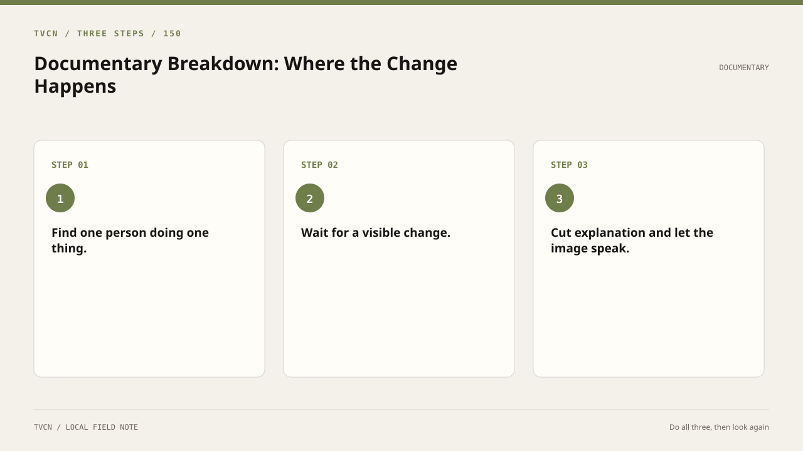

A documentary breakdown locates the change. Footage without change is only a record.

<!-- DIAGRAM_START -->
<h2>Diagram</h2>
<figure>
  
  <figcaption>Do the three steps in order, then look again at the image or file.</figcaption>
</figure>
<!-- DIAGRAM_END -->
<h2>On set</h2>

Note the minute the subject changes what they do. If nothing changes by minute ten, cut shorter.

<h2>Do this</h2>

A documentary breakdown finds the minute where change happens; footage without change is only a record.
<ol><li>Note the change minute: when the subject alters what they do.</li><li>If nothing changes by minute ten, cut shorter.</li><li>Compare action before and after to confirm the change is not only narrated.</li></ol>
<h2>Avoid</h2>

Do not let voiceover stand in for change; if the subject does not act differently, the film does not move.

<h2>Check</h2>
<ul><li>The change has a minute and second.</li><li>Before and after show different behavior on screen.</li><li>If nothing changed by minute ten, the cut is already shorter.</li></ul>
