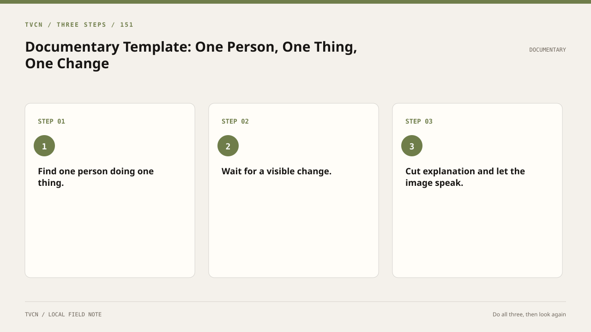

One person, one concrete task, one visible change. Do not start with an era.

<!-- DIAGRAM_START -->
<h2>Diagram</h2>
<figure>
  
  <figcaption>Do the three steps in order, then look again at the image or file.</figcaption>
</figure>
<!-- DIAGRAM_END -->
<h2>On set</h2>

One person, one ongoing task, one visible change. Shoot the task first, not the interview.

<h2>Do this</h2>

A documentary template is one person, one concrete task, one visible change; do not start with the era.
<ol><li>Choose one person and one task in progress.</li><li>Shoot the task before the interview.</li><li>Wait for a visible change before fixing the structure.</li></ol>
<h2>Avoid</h2>

Do not start with historical background; that is usually a thesis, not a film.

<h2>Check</h2>
<ul><li>The film has one person and one task in progress.</li><li>Interview does not open the piece; action comes first.</li><li>A visible change occurs, not only the subject saying so.</li></ul>
