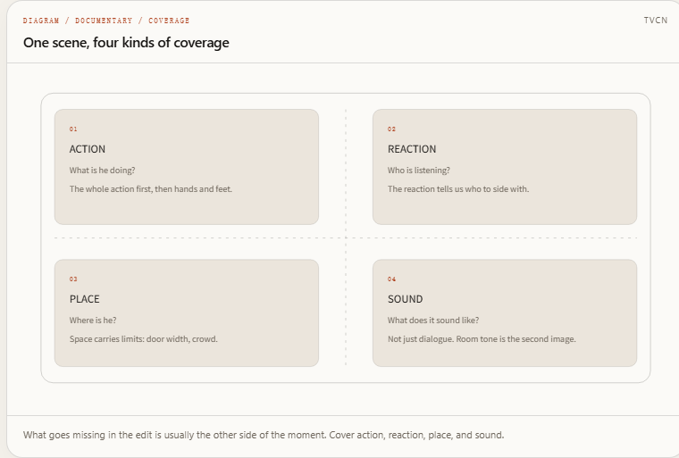

<!-- DIAGRAM_START -->
## Diagram

<figure>
  
  <figcaption>What goes missing in the edit is usually the other side of the moment. Cover action, reaction, place, and sound.</figcaption>
</figure>
<!-- DIAGRAM_END -->

Documentary is not recording life. It is finding a before and an after. A change gives you structure.

## Find a change

Ask: what changes for this person during this time? A move, a graduation, a shop opening, quitting, a first performance. The change can be an event or an attitude.

Without change, you have a pile of nice footage. The change does not need to be grand; even “he finally looks at the camera” can be enough.

## Interview questions

Do not ask “what do you think.” Ask for specifics: “What time did you get up that day?” “How did it feel the first time you took payment?” “What did you say?” Details bring emotion; opinions do not.

Let the subject finish. Do not rush to fill the gap. Three seconds of silence is often better than another question.

## Structure

Use four beats: change, obstacle, cost, now. Start with something happening, return to how the change began, and end on an action today.

Do not let narration explain everything. Let images and location sound carry half the information; narration fills only what the audience cannot see.

## Three checks

- You can name the before and after for this person.
- The interview has three concrete details, not opinions.
- The ending lands on an action today.

<!-- DEEP_DIVE_START -->
## Deep dive

<strong>About 7 minutes.</strong> A documentary short is not a collection of interviews. It waits for a change that is happening now.

### Choose someone in the middle of a decision

Do not find “a person with a story” and sit them down to talk about the past. Find someone facing a deadline, a conflict, a choice. The audience wants now, not recollection.

Write a hypothesis before rolling: will he finish, will he change? Let the location disprove it. If you did not capture a change, do not cut one into existence.

### Wait, do not push

Ask about actions: what did you do first that day, who stopped you, what did you change? Do not ask “how did you feel?”

Shoot process, not conclusions. Shoot the failure, the retry, the hesitation. If the material is thin, wait another day; do not fill it with narration.

### Structure and ethics

One person, one ongoing event, one change. End after the change; do not summarize its meaning.

When filming vulnerable people, explain use, scope, and the right to withdraw. Avoid the face when you can; blur early when you must.

### Five-minute drill: wait ten minutes for one action

Find someone doing something and write one hypothesis before rolling: will they finish today? Shoot ten minutes without interrupting: hands, feet, breathing, the doorway.

Look for the second where change happens: a pause, a changed action, a sigh. If there is no change, keep it as material. Do not cut it into a story that is not there.

### When it is done

Ask someone who has not seen the footage to point to the minute where the change happens and say what the person did before and after. If they can, the film is done. If not, you shot a state, not a change. Wait another day; do not force the cut.

### Ten documentary checks
<ul><li>The person is mid-decision</li><li>A deadline or friction exists</li><li>A hypothesis before rolling</li><li>The hypothesis can be disproved</li><li>Questions ask about actions</li><li>Failure or retry is on camera</li><li>End after the change</li><li>No narration invents the change</li><li>Use and scope are explained</li><li>Vulnerable subjects are protected</li></ul>
Documentary does not explain life; it lets the audience watch one person actually change once.

<!-- DEEP_DIVE_END -->
<!-- SOURCES_START -->
<h2>Sources</h2>

Experience: TVCN field notes and project reviews; tested: the review setup and reproducible exercises noted on the page; references: public links below.

<ul><li>[S14] YouTube Community Guidelines</li><li>[S15] TikTok Community Guidelines</li><li>[S16] BBC Editorial Guidelines</li></ul>

<a href="../../about/">Full links and notes in SOURCES.md</a>

<!-- SOURCES_END -->
