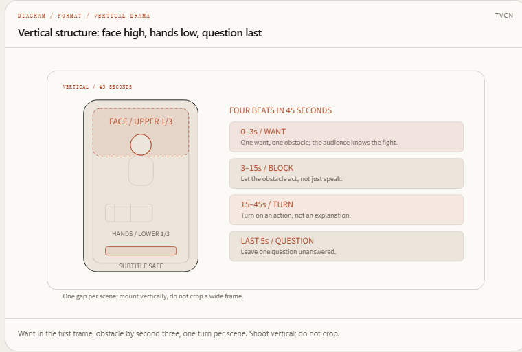

<!-- DIAGRAM_START -->
## Diagram

<figure>
  
  <figcaption>Want in the first frame, obstacle by second three, one turn per scene. Shoot vertical; do not crop.</figcaption>
</figure>
<!-- DIAGRAM_END -->

Vertical drama has no time for a world. The first frame has to put a want on screen.

## One person, one want in the first frame

A vertical screen cannot hold environment, two people, subtitles, and mood at once. The first frame should hold one person, one want, one obstacle. She wants in; the door is locked. He needs a signature; the pen is dry. She came to return the key; he thinks she came back.

Do not open on an empty city shot. A viewer swiping a vertical feed asks, “Is this about me?” One person staring at one object builds that faster than ten seconds of scenery.

The want has to be visible: a door, a contract, a phone, a key, a pregnancy test. Do not let a voice-over announce “I have to get the money today.” Show the payment notice in her hand; that lands harder than saying it.

## One information gap per scene

Short drama runs on an information gap, not an argument. One person knows; the other does not. She knows the contract is fake; he is still counting his commission. He knows the child is not his; she is still choosing a name.

One gap per scene, one turn. Add a second and third reversal and the audience gets tired and stops believing. One scene written through beats five twists.

Turn on an action, not a line like “I knew all along.” Push the contract back, put the key on the table, turn the phone screen around.

## Vertical framing: face high, hands low

The most useful vertical frame is “face in the upper third, hands or object in the lower third.” The audience reads expression first, action second. For a confrontation, do not force a two-shot. Cut between close-ups; the faces get bigger and the pressure rises.

Vertical movement works better than horizontal blocking: entering, going downstairs, sitting, standing up. A sideways pan in vertical easily throws the subject out of frame. Mount the phone vertically; do not shoot wide and crop later, or you lose heads and hands.

Keep subtitles in the bottom safe area, off the mouth and hands. Platform UI covers the bottom, so lift important action a little.

## Checks

- In the first three seconds, you can name the want and the obstacle.
- One information gap per scene, one turn.
- Face high, hands low, and one question left unanswered.

<!-- DEEP_DIVE_START -->
## Deep dive

<strong>About 6 minutes.</strong> Vertical drama is not a long show cut short. It builds a want, hides information, and turns once in thirty seconds.

### A want in three seconds

In the first second, someone wants something concrete: money, keys, a signature, an admission. In the second, show who blocks it. No company, job title, or backstory first.

An information gap drives the form: the audience knows something the character does not, or the character knows something we do not. Either one pulls the viewer forward.

### One room, two people, one turn

One location is enough: a front desk, a car, a table, an elevator. Two people are enough: the one who wants and the one who blocks. A third person only splits attention.

Offer a false answer so the viewer thinks the problem will resolve one way; then turn it with an action or a line. The turn must change the relationship, not just swap a sentence.

### Vertical performance and coverage

Use medium and close shots; the face should fill about a third of the frame. Do not place two people too far apart or the expressions vanish. Keep lines short, under twelve characters, and leave the pauses.

Do not use a three-shot montage for backstory. Hide it in a prop, a form of address, an action. End on a hook: a new problem, threat, or secret. No moral summary.

### Five-minute drill: one room, one turn

Write a thirty-second scene: one person wants, one blocks, one prop decides what is true. Give a false answer in the first fifteen seconds, then turn it with an action in the last fifteen.

Shoot vertical medium shots, lines under twelve characters. Show it to someone new and ask who ended up with power. If they cannot answer, the turn changed a line, not the relationship.

### When it is done

Show it to someone new and ask who ended up with power and which line changed the relationship. If both answers are clear, the scene is done. If they only say “there was a twist” but cannot name the change, the turn is still only in the dialogue.

### Ten vertical-drama checks
<ul><li>A concrete want in second one</li><li>The blocker visible in second two</li><li>An information gap exists</li><li>One location only</li><li>Two main characters only</li><li>False answer and turn</li><li>The turn changes the relationship</li><li>Medium or close framing</li><li>Lines under twelve characters</li><li>A new question at the end</li></ul>
Short drama is not short. It is every second changing the distance between two people.

<!-- DEEP_DIVE_END -->

<!-- SOURCES_START -->
## References and further reading

- [S14] [YouTube Community Guidelines](https://support.google.com/youtube/answer/2801973) — Accessed 2026-11-26. Used to check the terminology and public context in the opening paragraph (“Vertical drama has no time for a world. Put a want in the fi”) against Current platform rules on misleading content, dangerous acts, copyright and disclosure; not a substitute for an on-set test.
- [S15] [TikTok Community Guidelines](https://www.tiktok.com/community-guidelines/en/) — Accessed 2026-11-26. Used to check the terminology and public context in the opening paragraph (“Vertical drama has no time for a world. Put a want in the fi”) against Short-video platform rules on content, AI-generated media and commercial disclosure; not a substitute for an on-set test.
- [S16] [BBC Editorial Guidelines](https://www.bbc.co.uk/editorialguidelines/) — Accessed 2026-11-26. Used to check the terminology and public context in the opening paragraph (“Vertical drama has no time for a world. Put a want in the fi”) against Editorial standards on accuracy, fairness, privacy and secret recording; not a substitute for an on-set test.
- [S29] [YouTube Upload Specs](https://support.google.com/youtube/answer/1722171) — Accessed 2026-11-26. Used to check the terminology and public context in the opening paragraph (“Vertical drama has no time for a world. Put a want in the fi”) against Recommended resolution, bitrate, frame rate and audio codec; not a substitute for an on-set test.
<!-- SOURCES_END -->

