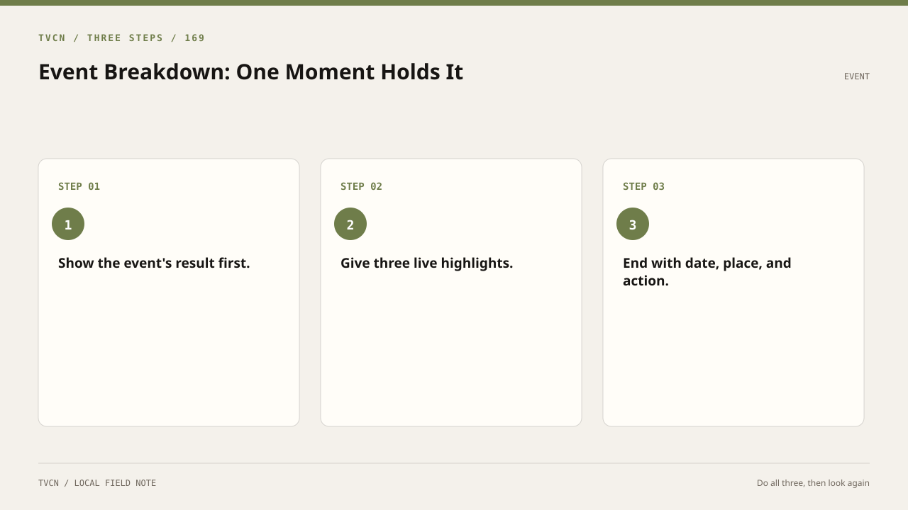

Find the one moment that makes an absent viewer believe the event.

<!-- DIAGRAM_START -->
<h2>Diagram</h2>
<figure>
  
  <figcaption>Do the three steps in order, then look again at the image or file.</figcaption>
</figure>
<!-- DIAGRAM_END -->
<h2>On set</h2>

Find the moment: one person does something that makes an absent viewer believe the event.

<h2>Do this</h2>

An event breakdown finds the moment that makes a non-attendee believe the event happened.
<ol><li>Find the moment: what one person did.</li><li>Check whether that action could only happen on site.</li><li>See whether music or slow motion buries it.</li></ol>
<h2>Avoid</h2>

Do not substitute empty scenery for the moment; without human action, the event did not happen.

<h2>Check</h2>
<ul><li>One action could only have happened on site.</li><li>The moment is not buried by music or slow motion.</li><li>A non-attendee believes the event took place after one viewing.</li></ul>
