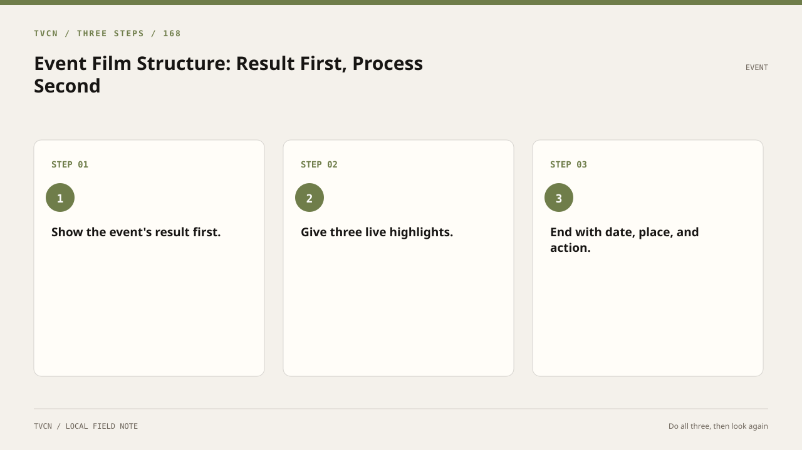

The common event-film mistake is chronological coverage from check-in to load-out. The audience wants “what happened here,” so open on the hottest second or the finished room, then return to arrival and process.

<!-- DIAGRAM_START -->
<h2>Diagram</h2>
<figure>
  
  <figcaption>Watch “Give the result in the first ten seconds:” and “Then three on-site highlights.”; judge whether the reason given in the first three seconds still holds at the end.</figcaption>
</figure>
<!-- DIAGRAM_END -->
<section><h2 id="section-1">Result first, process second</h2>
Pick three different highlights in the middle, one shot each. Do not give every guest speech equal time.
<h2 id="section-2">Limits</h2>
An event film is neither news nor a brand ad. It can move fast, but it cannot invent a result; do not use music and slow motion to fill what did not happen.
<h2 id="section-3">Case: a 90-second event recap that leads with the result</h2>
Case note: an anonymised composite of several similar projects. Figures are ranges; people, places and clients are withheld. It does not represent one real client job.

<table class="data-table"><thead><tr><th>Project</th><th>Constraint</th><th>Result</th></tr></thead><tbody>
<tr><td>90-second event recap</td><td>One venue, one shoot day, two people</td><td>Shot today, delivered tomorrow</td></tr>
<tr><td>Budget band</td><td>¥2,000–6,000</td><td>No rehearsal, no staged setups</td></tr>
<tr><td>Purpose</td><td>Tell absent people what happened</td><td>Not a full record of the program</td></tr>
</tbody></table>

<h3>What happened</h3>
<ol><li>The opening did not show an empty hall. It showed the first sentence and first action of a guest arriving, so viewers knew what the day was about.</li><li>The middle kept three highlights, no longer than eight seconds each. Executive speeches kept one sentence that could stand alone, not the full talk.</li><li>The ending gave the next event's date and action, not a “success” title card.</li></ol>
<h3>The trade-off</h3>

We dropped the full program and multiple interviews for one result, three proofs and one next step. Location audio was unreliable, so key lines became subtitle cards, but two seconds of real room tone stayed so it still feels live.

<h3>Reusable / not transferable</h3>
<ul><li>Reusable: event films lead with the result, then the process; one visible action per highlight.</li><li>Not transferable: launches can involve unannounced products or guest likeness. Check the organizer's clearance list before publishing; “it happened live” is not consent.</li></ul></section><section><h2 id="section-4">On set</h2>
Give the result in ten seconds: attendance, deals, or closing. Then return to the process.
</section><section><h2 id="section-5">Do this</h2>
An event film gives the result before the process; viewers need to know what the event became.
<ol><li>Give the result in the first ten seconds: attendance, sales, or closing.</li><li>Then three on-site highlights.</li><li>End with time, place, and action.</li></ol></section><section><h2 id="section-6">Avoid</h2>
Do not cut the event into a list of officials; viewers need to know what happened.
</section><figure class="article-audio"><audio controls preload="none" src="../../../assets/audio/en/fmt-event.en.mp3"></audio><figcaption>20-second audio demo: one check point and the most common failure. Transcript and steps are in the article.</figcaption></figure><aside class="regional-note">
<strong>Regional note for US / UK / EU readers</strong>

This English page keeps mainland-China examples where they are part of the method. Read platform names as examples, not as the only market: Douyin ↔ TikTok/Reels, Bilibili ↔ YouTube, Xiaohongshu ↔ Instagram/Pinterest; RMB figures are not converted here. Platform names and monetisation rules differ by market; treat Douyin, Bilibili and Xiaohongshu as examples, then re-check TikTok, YouTube, Instagram or the local platform.
</aside><section><h2>Judge</h2>
This page passes on three observable checks, not slogans:
<ul><li><strong>1.</strong> The first ten seconds give a measurable or visible result.</li><li><strong>2.</strong> The middle has three on-site highlights, not speeches.</li><li><strong>3.</strong> The ending states time, place, and how to join.</li></ul></section><section><h2>Failures</h2>
Any one of these means stop and fix it before post:
<ul><li><strong>1.</strong> Check 1 is only staged (“The first ten seconds give a measurable or vis…”); another camera position or location exposes it.</li><li><strong>2.</strong> Check 2 is left to post or a verbal explanation (“The middle has three on-site highlights, not s…”); nothing on set can be rechecked.</li><li><strong>3.</strong> Do not cut the event into a list of officials; viewers need to know what happened.</li></ul></section><section><h2>Extend</h2>
<strong>10-minute exercise:</strong> Break down one 30-second reference, mark the timecodes for “Give the result in the first ten seconds:” and “Then three on-site highlights.”, then answer: if one disappeared, would the film still hold?
</section>
<h2>Check</h2><ul><li>The first ten seconds give a measurable or visible result.</li><li>The middle has three on-site highlights, not speeches.</li><li>The ending states time, place, and how to join.</li></ul>

<!-- DEEP_DIVE_START -->
## Deep dive

<strong>About 6 minutes.</strong> An event film is not a record of the schedule. Give the result, three highlights, then how to join.

### Lead with the result

Open with the busiest or most informative moment: a full room, lights up, a product raised, applause landing. Do not start at the registration desk and an empty hall.

The viewer must know what this is and whether it is worth watching before they invest in the schedule. One subtitle for time, place, attendance. No host introduction.

### Three highlights

Pick one highlight each from people, action, and space: a face, a product being used, the scale of the room. Five to eight seconds each; do not divide the film evenly.

Give each highlight one piece of live sound or one interview line. No three-part narration. Keep the interview line that stands alone; do not run the full Q&A.

### Close with the information

End with date, venue, registration, organizer. One piece of information per frame; do not squeeze four lines into a corner.

Fifteen to sixty seconds is enough. You can return to the opening moment so the viewer knows it will happen again. Do not replace the concrete result with “a complete success.”

### Five-minute drill: a fifteen-second event cut

Cut fifteen seconds from existing footage: three seconds of result, three highlights at three seconds each, three seconds of information. No registration desk, no full executive speech.

Watch muted and ask: what event is this, when is it, how do I join? If any answer is missing, cut one highlight and make the information clear.

### When it is done

Play it muted and ask someone who did not attend: what event is this, when is it, how do I register? If all three answers are clear, the promo is done. If one is missing, cut a highlight and put the information on screen.

### Ten event-promo checks
<ul><li>Busiest moment within three seconds</li><li>No opening at registration</li><li>One subtitle for time, place, attendance</li><li>One highlight each for people, action, space</li><li>Five to eight seconds per highlight</li><li>Live sound or one interview line</li><li>Only one interview line</li><li>One information item per closing frame</li><li>Fifteen to sixty seconds</li><li>No “complete success” instead of a result</li></ul>
An event film does not finish the schedule; it helps the viewer decide whether to come next time.

<!-- DEEP_DIVE_END -->

<!-- SOURCES_START -->
## References and further reading

- [S43] [BFI: National Archive](https://www.bfi.org.uk/bfi-national-archive) — Accessed 2026-11-26. Used to check the terminology/method/rule in the “Result first, process second” section against BFI archive material, not distribution rules; it does not verify numbers, model choices or on-set conclusions derived from this page, and is not a substitute for a test.
- [S16] [BBC: Editorial Guidelines](https://www.bbc.co.uk/editorialguidelines/) — Accessed 2026-11-26. Used to check the terminology/method/rule in the “Limits” section against BBC editorial guidelines, not platform growth rules; it does not verify numbers, model choices or on-set conclusions derived from this page, and is not a substitute for a test.
<!-- SOURCES_END -->

