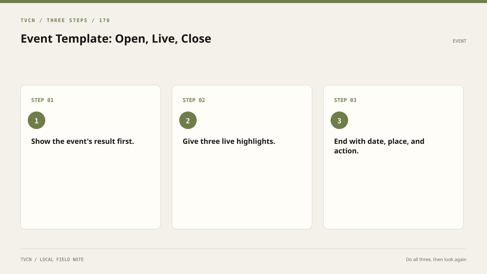

An event template runs opening, site, close; the site section needs ambient sound, not wall-to-wall music.

<!-- DIAGRAM_START -->
<h2>Diagram</h2>
<figure>
  
  <figcaption>Watch “Open with the result.” and “Give three highlights with ambient sound.”; judge whether the reason given in the first three seconds still holds at the end.</figcaption>
</figure>
<!-- DIAGRAM_END -->
<section><h2 id="section-1">A usable 60-second segment table</h2>
<table class="template-table"><thead><tr><th>Segment</th><th>Time</th><th>Picture</th><th>Sound / pass line</th></tr></thead><tbody><tr><td>Result</td><td>0–10s</td><td>The hottest second of the event, or the finished room</td><td>One “what happened” line; not the host opening</td></tr><tr><td>Opening</td><td>10–20s</td><td>People enter, sign in, space established</td><td>Ambience; time and place clear</td></tr><tr><td>Three highlights</td><td>20–40s</td><td>Three different highlights, one shot each</td><td>Keep event sound; no wall-to-wall music</td></tr><tr><td>Close</td><td>40–50s</td><td>The crowd leaves or one final action</td><td>One result line; no VIP list</td></tr><tr><td>Action</td><td>50–60s</td><td>Time, place or registration entry</td><td>One next step only</td></tr></tbody></table>
<h2 id="section-2">Fill three lines before rolling</h2><ul><li><strong>Result:</strong> what happened by the end? One sentence.</li><li><strong>Three highlights:</strong> write what the camera sees, not “good atmosphere.”</li><li><strong>Action:</strong> how does the viewer join next time? Time, place, entry.</li></ul></section><section><h2 id="section-3">On set</h2>
Result, three live highlights, and a close with time, place, and action. No list of VIPs.
</section><section><h2 id="section-4">Do this</h2><ol><li>Open with the result.</li><li>Give three highlights with ambient sound.</li><li>Close with time, place, and action, not an officials list.</li></ol></section><section><h2 id="section-5">Avoid</h2>
Do not score everything; without site sound, it feels like a promo.
</section><section><h2>Judge</h2>
Three signals are observable on set:
<ul><li>the first three seconds give a believable reason</li><li>the middle adds information or resistance, not just mood</li><li>the ending shows a visible change instead of narrating it</li></ul></section><section><h2>Failures</h2>
These three moves erase the detail you just built:
<ul><li>the template is filled but the person and problem are not</li><li>no reason in the first three seconds, only title and music</li><li>no visible change at the end, only voice-over</li></ul></section><section><h2>Extend</h2>
<strong>10-minute exercise:</strong> Break down one 30-second reference, mark the timecodes for “Open with the result.” and “Give three highlights with ambient sound.”, then answer: if one disappeared, would the film still hold?
</section>
<h2>Check</h2><ul><li>The opening gives the result, not an emcee walking on.</li><li>The site section has three highlights and audible ambience.</li><li>The close states time, place, and how to join.</li></ul>
