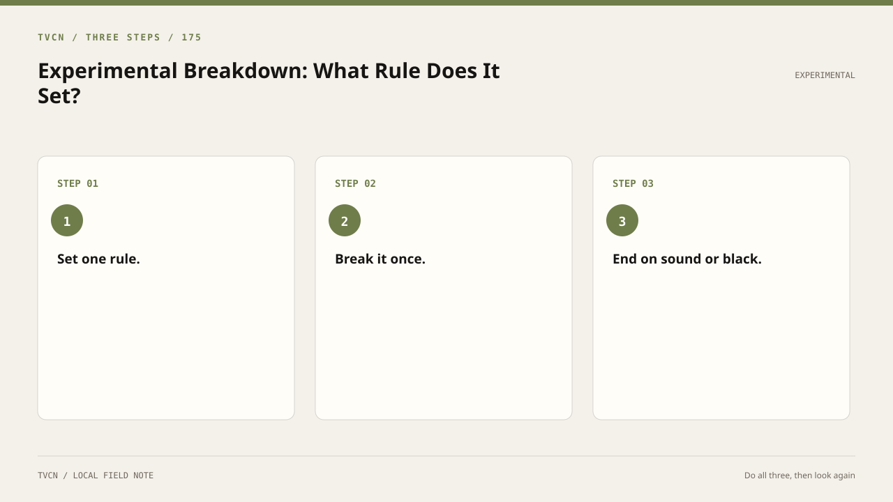

Ask what rule it sets and breaks; do not stop at "I don't get it."

<!-- DIAGRAM_START -->
<h2>Diagram</h2>
<figure>
  
  <figcaption>Do the three steps in order, then look again at the image or file.</figcaption>
</figure>
<!-- DIAGRAM_END -->
<h2>On set</h2>

Write the rule first, then find where the film breaks it. If you cannot find the rule, it is not experimental.

<h2>Do this</h2>

An experimental breakdown names the rule and the break, not just “I did not get it.”
<ol><li>Write the rule: camera, duration, color, action.</li><li>Find where the film breaks it.</li><li>If no rule is findable, it is not experimental; it is unfinished.</li></ol>
<h2>Avoid</h2>

Do not use “I did not get it” as a verdict; without the rule, there is nothing to judge.

<h2>Check</h2>
<ul><li>A clear rule is written with camera, duration, or color.</li><li>The exact break point is identifiable.</li><li>The judgment rests on rule and break, not “I did not get it.”</li></ul>
