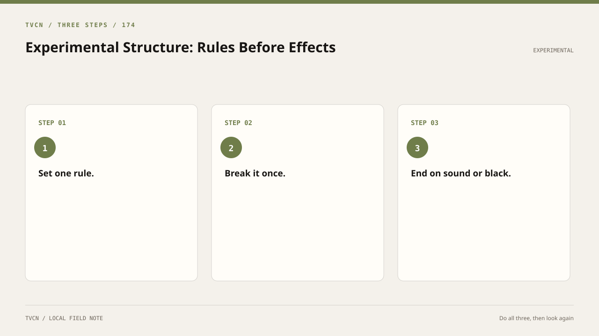

An experimental film is not random cutting. Write one rule first: fixed camera, fixed duration, fixed color, or one action per shot. The whole piece varies that rule so the strangeness has a logic.

<!-- DIAGRAM_START -->
<h2>Diagram</h2>
<figure>
  
  <figcaption>Watch “Set one rule: locked camera for ten minutes,” and “Break it once in the film.”; judge whether the reason given in the first three seconds still holds at the end.</figcaption>
</figure>
<!-- DIAGRAM_END -->
<section><h2 id="section-1">Experimental can be strange, but it needs a traceable rule</h2>
Put the rule on paper and check after the shoot: which shot broke it, and was that intentional or loss of control? Those answers decide whether it stays.
<h2 id="section-2">Limits</h2>
Anti-narrative is not structureless. The viewer may not know the story, but something must accumulate or change, or after three minutes it is only noise.
<h2 id="section-3">Experimental film template: one rule, three repeats, one break</h2>

Experimental film is not “shoot whatever.” A usable template needs a rule the viewer can recognize, repetition to build expectation, and one controlled break to create change. Without a rule, the break means nothing.

<table class="template-table"><thead><tr><th>Segment</th><th>Duration</th><th>Image</th><th>Sound</th><th>Viewer expectation</th></tr></thead><tbody>
<tr><td>Rule</td><td>0–15s</td><td>Locked camera, one repeated action</td><td>Location sound, no score</td><td>“I know what this is”</td></tr>
<tr><td>Repeat 1</td><td>15–30s</td><td>Same action, slight change</td><td>Same ambience</td><td>“It will happen again”</td></tr>
<tr><td>Repeat 2</td><td>30–45s</td><td>Same action, longer hold</td><td>One foreign sound</td><td>“Something is off”</td></tr>
<tr><td>Break</td><td>45–55s</td><td>Action interrupted or reversed</td><td>Sound cuts, then returns</td><td>“The rule failed”</td></tr>
<tr><td>Aftermath</td><td>55–60s</td><td>Return to the rule, incomplete</td><td>Ambience only</td><td>“What just happened”</td></tr>
<tr><td>End card</td><td>2s</td><td>Black or a still object</td><td>Silence</td><td>Space</td></tr>
</tbody></table>

<h3>Rules for filling it in</h3>
<ol><li>The rule must be one sentence: who, in what space, repeating what action. If it cannot be written, do not shoot.</li><li>Repeat at least three times, changing one variable only: duration, sound, framing or action size.</li><li>Break once. A second break exhausts the viewer.</li><li>Aftermath returns to the rule without explanation. Explanation turns the experiment into a lecture.</li></ol>
<aside class="template-download">
<strong>Reusable Markdown template</strong> Same segments as the table above; replace the brackets with your own shots.
<a href="../../../assets/templates/experimental-template.en.md" download>Download .md</a></aside>

Acceptance: show it to someone who has not read the script, then ask “what was the rule, where did it break?” If they can answer, the template works. If not, cut a segment before adding an effect.
</section><section><h2 id="section-4">On set</h2>
Set one rule: a locked camera for ten minutes, one room, one color. Break it once.
</section><section><h2 id="section-5">Do this</h2>
Experimental film sets a rule first: fixed camera, repeated action, single color; the clearer the rule, the stronger the effect.
<ol><li>Set one rule: locked camera for ten minutes, one room, one color.</li><li>Break it once in the film.</li><li>End on sound or black.</li></ol></section><section><h2 id="section-6">Avoid</h2>
Do not use “unintelligible” as depth; an unclear rule means no rule.
</section><figure class="article-audio"><audio controls preload="none" src="../../../assets/audio/en/fmt-experimental.en.mp3"></audio><figcaption>20-second audio demo: one check point and the most common failure. Transcript and steps are in the article.</figcaption></figure><section><h2>Judge</h2>
Three signals are observable on set:
<ul><li>the first three seconds give a believable reason</li><li>the middle adds information or resistance, not just mood</li><li>the ending shows a visible change instead of narrating it</li></ul></section><section><h2>Failures</h2>
These three moves erase the detail you just built:
<ul><li>the template is filled but the person and problem are not</li><li>no reason in the first three seconds, only title and music</li><li>no visible change at the end, only voice-over</li></ul></section><section><h2>Extend</h2>
<strong>10-minute exercise:</strong> Break down one 30-second reference, mark the timecodes for “Set one rule: locked camera for ten minutes,” and “Break it once in the film.”, then answer: if one disappeared, would the film still hold?
</section>
<h2>Check</h2><ul><li>The whole film's rule fits one sentence.</li><li>The rule breaks once at an identifiable point.</li><li>The ending lands on sound or black, not an arbitrary stop.</li></ul>

<!-- DEEP_DIVE_START -->
## Deep dive

<strong>About 6 minutes.</strong> Experimental film is not random. It sets one rule, then lets the image change inside that rule.

### Set the rule first

The simpler the rule, the more visible the change: locked camera, one repeated action, one color, one duration. Do not juggle five effects; the viewer sees only noise.

Write the rule on one line and tape it to the monitor: “one window, once every ten minutes, twelve times.” With a rule, change means something.

### Break one rule

Break the rule once in the whole film: the camera suddenly moves, color drops out, sound cuts. The fewer the breaks, the louder each one lands.

When the rule breaks, cut or sound must change with it. Do not pile on effects. Effects decorate; the rule structures.

### Sound and length

Sound can carry the structure: a sustained room tone, one sudden silence, a repeated mechanical noise. Do not start with wall-to-wall music.

One to five minutes. The ending needs a reason to stop: the last action completes, the light dims, the sound disappears. No story is fine; no ending is not.

### Five-minute drill: one rule, one break

Set a rule that can run sixty seconds: locked camera, one repeated action, one color. Shoot it three times; on the third, change one variable only: light, sound, or camera position.

Cut the three takes together and see whether the viewer can name which take changed. If not, the rule is not clear enough; if too much changed, you broke more than one rule.

### When it is done

Ask the viewer what the rule was and where it broke. If they can answer both, the film is done. If they only say “good atmosphere,” the rule did not land. Cut half the effects and keep one change.

### Ten experimental-film checks
<ul><li>The rule fits in one sentence</li><li>The rule is simple and repeatable</li><li>The rule breaks once</li><li>Sound or cut changes at the break</li><li>No pile of effects</li><li>Sound carries structure</li><li>Not wall-to-wall music</li><li>One to five minutes</li><li>The ending has a reason to stop</li><li>No story is fine, no ending is not</li></ul>
Experimental freedom is not “shoot anything.” It is setting one rule and daring to break it once.

<!-- DEEP_DIVE_END -->

<!-- SOURCES_START -->
## References and further reading

- [S14] [YouTube Community Guidelines](https://support.google.com/youtube/answer/2801973) — Accessed 2026-11-26. Used to check the terminology and public context in the opening paragraph (“Set rules first: locked camera, repeated action, one color. ”) against Current platform rules on misleading content, dangerous acts, copyright and disclosure; not a substitute for an on-set test.
- [S15] [TikTok Community Guidelines](https://www.tiktok.com/community-guidelines/en/) — Accessed 2026-11-26. Used to check the terminology and public context in the opening paragraph (“Set rules first: locked camera, repeated action, one color. ”) against Short-video platform rules on content, AI-generated media and commercial disclosure; not a substitute for an on-set test.
- [S16] [BBC Editorial Guidelines](https://www.bbc.co.uk/editorialguidelines/) — Accessed 2026-11-26. Used to check the terminology and public context in the opening paragraph (“Set rules first: locked camera, repeated action, one color. ”) against Editorial standards on accuracy, fairness, privacy and secret recording; not a substitute for an on-set test.
- [S29] [YouTube Upload Specs](https://support.google.com/youtube/answer/1722171) — Accessed 2026-11-26. Used to check the terminology and public context in the opening paragraph (“Set rules first: locked camera, repeated action, one color. ”) against Recommended resolution, bitrate, frame rate and audio codec; not a substitute for an on-set test.
<!-- SOURCES_END -->

