<!-- DIAGRAM_START -->
<h2>Diagram</h2>
<figure>
  
  <figcaption>Diagram: six beats in order; miss one and it becomes a pile of footage.</figcaption>
</figure>
<!-- DIAGRAM_END -->
<h2>First decision: when to use it</h2>
Fashion and beauty is not a runway clip. Define texture first—fabric, skin, light—and prove it with close-ups and action, not a beauty filter.

Use it when there is one clear subject, one action, and a visible change in the final film. Do not use it when there is only a slogan, no person, and no process to shoot; go back to the brief before rolling.
<h2>Six beats: one job per beat</h2>
Write the six beats as six sentences, each answering “what does the viewer know now.” Shoot in order, but cut out of order; do not add empty shots to fill the structure.
<ol><li>Material close-up</li><li>Body movement</li><li>Product enters</li><li>Light shift</li><li>Detail proof</li><li>Attitude ending</li></ol><h2>How to shoot it: six tasks</h2>
At least one primary shot per beat; do not shoot everything in one framing and rely on jump cuts. Shoot irreplaceable action first—hands, face, machine—then pickups.
<ul><li>Material: fabric/skin macro, keep texture</li><li>Movement: turn/raise hand/look back</li><li>Product: hand use, no pack rotation</li><li>Light: same shot soft to hard</li><li>Proof: apply/blend/edge</li><li>End: look/leave, no slogan</li></ul><h2>Common failures: three ways it collapses</h2>
<strong>1. Logo/drone first</strong>: the viewer does not know whose story this is. Replace beat one with a problem or action. <strong>2. Narration in every beat</strong>: the images carry no information. Let one action speak. <strong>3. Unverifiable result</strong>: “more efficient” with no before/after or third party. Shoot something checkable.
<h2>Cost and check: can it be shot in a day</h2>
Typically one shoot day plus two to three post days: half a day for primary shots, half for pickups; cut structure first, then sound. Check only three things: six beats complete, one primary shot per beat, result checkable. Do not accept “it feels premium.”
<h2>Check</h2><ul><li>Each of six beats is one clear sentence.</li><li>Beat one is a problem/action, not a logo.</li><li>At least one primary shot per beat.</li><li>Result has before/after or third party.</li><li>At least one irreplaceable action captured.</li><li>Six beats survive the rough cut.</li></ul>
<!-- SOURCES_START -->
<h2>Sources</h2>

Experience: TVCN field notes and project reviews; tested: the review setup and reproducible exercises noted on the page; references: public links below.

<ul><li>[S14] YouTube Community Guidelines</li><li>[S15] TikTok Community Guidelines</li><li>[S16] BBC Editorial Guidelines</li></ul>

<a href="../../about/">Full links and notes in SOURCES.md</a>

<!-- SOURCES_END -->
