<!-- DIAGRAM_START -->
<h2>Diagram</h2>
<figure>
  
  <figcaption>Diagram: six columns filled before rolling; a missing column makes the set guess.</figcaption>
</figure>
<!-- DIAGRAM_END -->
<h2>When to use this sheet</h2>
Fill it 24 hours before rolling and send one copy each to director, camera, sound, and producer. It does not replace the storyboard; it compresses it into “what must be shot today.” When the client changes scope, change the sheet before the budget.
<h2>The sheet: five columns plus a pass line</h2>
One beat per row. Picture is what the viewer sees, not “premium”; sound is what they hear; pass line is what must be captured to pass.

<table class="data-table"><thead><tr><th>Beat</th><th>Picture</th><th>Sound</th><th>Duration</th><th>Pass line</th></tr></thead><tbody><tr><td>Material</td><td>Macro texture</td><td>Fabric/ambience</td><td>5–6 sec</td><td>Texture kept</td></tr><tr><td>Movement</td><td>Body action</td><td>Ambience</td><td>6–8 sec</td><td>No product yet</td></tr><tr><td>Product</td><td>Hand use</td><td>Click/apply</td><td>6–8 sec</td><td>No pack rotation</td></tr><tr><td>Light</td><td>Same shot shift</td><td>Music</td><td>5–6 sec</td><td>Texture visible</td></tr><tr><td>Proof</td><td>Edge/blend</td><td>Quiet</td><td>5–6 sec</td><td>No smoothing</td></tr><tr><td>End</td><td>Look/leave</td><td>Ambience</td><td>5–6 sec</td><td>No slogan</td></tr></tbody></table>
<h2>Filling example: hardest first</h2>
Fill the beats that need people, weather, or permits first; pickups last. Durations are ceilings, not targets. Stop when the pass line is met; do not repeat to fill time.
<h2>On set: how to run the sheet</h2>
Five minutes before rolling, read the sheet: which rows today, what pass line, who owns it. After each row, tick it and note the actual take. Photograph the sheet at wrap and archive it with the footage.
<h2>Check: a filled sheet is not a finished film</h2>
At wrap, check only: every pass line has footage, sound has an independent backup, the hardest beat has at least two takes. If one is missing, pick it up next day, not in post.
<h2>Check</h2><ul><li>One row per beat, no merging.</li><li>Picture is what is seen, not adjectives.</li><li>Sound is what is heard, including ambience.</li><li>Pass line is judgeable, not “feels right.”</li><li>Hardest beat shot first.</li><li>Sheet archived with footage at wrap.</li></ul>

<!-- SOURCES_START -->
## References and further reading

- [S14] [YouTube Community Guidelines](https://support.google.com/youtube/answer/2801973) — Accessed 2026-11-26. Used to check the terminology and public context in the opening paragraph (“A one-sheet fashion & beauty plan: six beats, picture, sound”) against Current platform rules on misleading content, dangerous acts, copyright and disclosure; not a substitute for an on-set test.
- [S15] [TikTok Community Guidelines](https://www.tiktok.com/community-guidelines/en/) — Accessed 2026-11-26. Used to check the terminology and public context in the opening paragraph (“A one-sheet fashion & beauty plan: six beats, picture, sound”) against Short-video platform rules on content, AI-generated media and commercial disclosure; not a substitute for an on-set test.
- [S16] [BBC Editorial Guidelines](https://www.bbc.co.uk/editorialguidelines/) — Accessed 2026-11-26. Used to check the terminology and public context in the opening paragraph (“A one-sheet fashion & beauty plan: six beats, picture, sound”) against Editorial standards on accuracy, fairness, privacy and secret recording; not a substitute for an on-set test.
- [S29] [YouTube Upload Specs](https://support.google.com/youtube/answer/1722171) — Accessed 2026-11-26. Used to check the terminology and public context in the opening paragraph (“A one-sheet fashion & beauty plan: six beats, picture, sound”) against Recommended resolution, bitrate, frame rate and audio codec; not a substitute for an on-set test.
<!-- SOURCES_END -->

