<!-- DIAGRAM_START -->
<h2>Diagram</h2>
<figure>
  
  <figcaption>Diagram: time, beat, picture, sound, and job aligned in five columns.</figcaption>
</figure>
<!-- DIAGRAM_END -->
<h2>Sample note: not a real client</h2>
Composite sample: one bowl of beef noodles in a small shop. Not one real project; shop, people, and price are composite.

The point is not to memorize shots but to see what makes each beat work. For a client film, replace every number, brand, and person with your own footage and evidence.
<h2>Beat by beat: five columns</h2>
Read time, then beat, then whether picture and sound serve the same job. If one column disagrees, the beat becomes “pretty but useless.”

<table class="data-table"><thead><tr><th>Time</th><th>Beat</th><th>Picture</th><th>Sound</th><th>Job</th></tr></thead><tbody><tr><td>00:00–00:08</td><td>Ingredient</td><td>Beef texture/noodle close-up</td><td>Knife/water</td><td>Texture first</td></tr><tr><td>00:08–00:20</td><td>Hands</td><td>Salt/noodles into pot</td><td>Hand sounds</td><td>Let hands work</td></tr><tr><td>00:20–00:35</td><td>Heat</td><td>Steam/oil at pan edge</td><td>Boil</td><td>Make heat visible</td></tr><tr><td>00:35–00:50</td><td>Change</td><td>Same angle raw/cooked</td><td>Sound softens</td><td>One change only</td></tr><tr><td>00:50–01:05</td><td>Bite</td><td>Noodles/soup/face</td><td>Chewing</td><td>No exaggeration</td></tr><tr><td>01:05–01:15</td><td>Aftertaste</td><td>Empty bowl/hand down</td><td>Ambience</td><td>No “delicious”</td></tr></tbody></table>
<h2>Picture and sound: what to copy, what not</h2>
<strong>Copy</strong>: before/after of one action, hand close-ups, ambience cuts, locked-off repetition. <strong>Do not copy</strong>: slow motion for emotion, music covering location sound, illustrative numbers as results. Borrow shots, not evidence.
<h2>Three reusable moves</h2>
1. Shoot the same action twice—failure and success—and cut them together; the viewer compares. 2. Every 15 seconds, give a hand/object close-up to ground abstract information. 3. Do not summarize at the end; leave an action or a question as a door to the next piece.
<h2>Failure and check: breakdown is not copying</h2>
The common failure is “the shots look similar, but the proof is fake.” Ask three questions: what happens if this beat is removed? Does the sound stand alone? Is the result checkable? If two answers fail, re-shoot or re-cut.
<h2>Check</h2><ul><li>Labeled composite, not a real client.</li><li>Picture and sound serve the same job per beat.</li><li>At least one before/after is checkable.</li><li>Music does not cover key location sound.</li><li>Ending leaves an action/question, no summary.</li><li>Structure survives removing any one beat.</li></ul>

<section><h2>Boundary</h2>
This page only covers “Food & Table Breakdown: Six Beats in Practice”; it does not replace Food & Table Structure: Six Beats, Food & Table Template: One Sheet to Shoot, Adjusting Actors: Give Verbs, Not Adjectives. When the problem belongs to one of those pages, use that page instead of adding more parameters here.
</section>
<!-- DEEP_DIVE_START -->
## Deep dive

<strong>About 7 minutes.</strong> This section does not repeat the method above. It adds three things: two conditions, a counterexample and a reusable model, so you can decide when to change the method.

### Condition A: recipe or tutorial

The first job of a recipe film is reproducibility. Every key step needs an observable signal: how hot the oil, what the dough looks like, how reduced the sauce. Do not say “some” or “about”; if the viewer cannot repeat it, the film is unfinished.

Tutorials need an error demo: heat too high, dough too wet, salt too early. One error shot is more useful than three success shots because the viewer will make the same mistake. Be specific; “watch the heat” is empty.

### Condition B: mood or brand

A mood food film does not sell steps; it sells the feeling of wanting to eat. Appetite signals come in order: sound (fry, chop, pour), steam, fat, the first bite. Do not open with a wide of the finished dish; let the audience hear first, see second, want third.

Mood work also needs a person: a chopstick, a hand, someone waiting. Without a person, food is a specimen; with one, the food has a fate of being eaten.

### Counterexample: lots of steam, no bite

A food film has steam, slow motion and oil splashes, with rousing music, but nobody eats. The audience thinks it looks good, not that they are hungry. The last step of appetite is the bite, not the wok.

The fix is not more steam; add a first bite: chopsticks lift, teeth sink, chew, face. The bite does not need acting, only truth; real eating is more appetising than slow motion.

### Reusable model

<strong>Sound → steam → texture → first bite.</strong> Let the audience hear the food working, then see steam, then texture, then someone eating. In that order, appetite builds.

A tutorial replaces the bite with a reproducibility check: the viewer cooks once and reproduces the key signals. A mood film replaces the check with wanting to eat, but the four-step order stays.

<!-- DEEP_DIVE_END -->

<!-- SOURCES_START -->
## References and further reading

- [S16] [BBC: Editorial Guidelines](https://www.bbc.co.uk/editorialguidelines/) — Accessed 2026-11-26. Used to check the terminology/method/rule in the “Sample note: not a real client” section against BBC editorial guidelines, not platform growth rules; it does not verify numbers, model choices or on-set conclusions derived from this page, and is not a substitute for a test.
- [S14] [YouTube: Community Guidelines](https://support.google.com/youtube/answer/2801973) — Accessed 2026-11-26. Used to check the terminology/method/rule in the “Beat by beat: five columns” section against YouTube community rules, not creative standards; it does not verify numbers, model choices or on-set conclusions derived from this page, and is not a substitute for a test.
<!-- SOURCES_END -->

