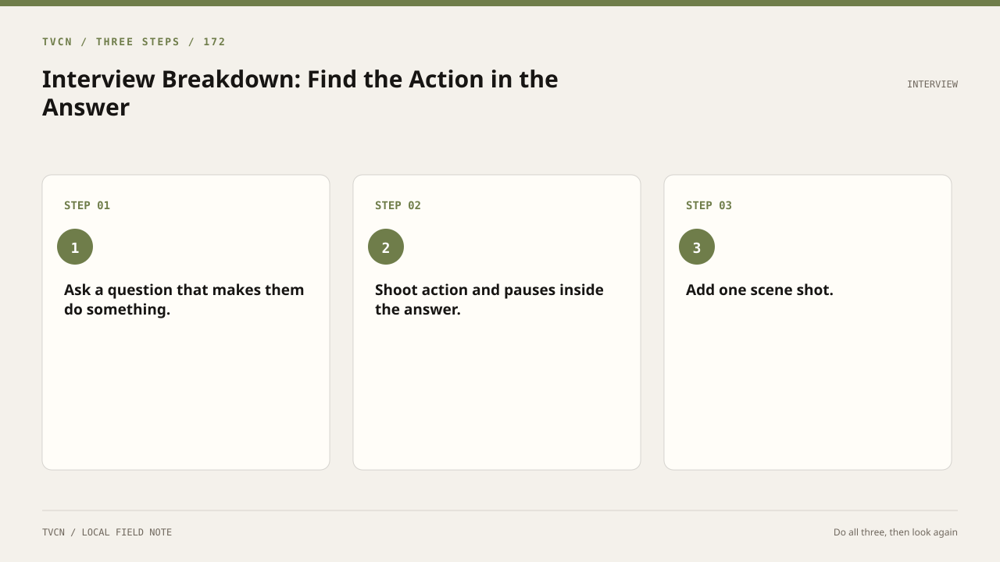

<!-- DIAGRAM_START -->
<h2>Diagram</h2>
<figure>
  
  <figcaption>The diagram is an entry point: watch the timecodes, then use the checks at the end.</figcaption>
</figure>
<!-- DIAGRAM_END -->
<h2>Fix Three Variables First</h2>
Fix three variables: three minutes, Bilibili/Channels, and the goal is the person stands on their own, not the host finishing questions. The trap is talking heads; count shots of the person working, not questions.
<blockquote>
<strong>Sample note:</strong> the timecodes below are a teaching sample for this format's usual length. They do not correspond to one specific film and are not frame-accurate analysis. Use the same positions on your own film; do not treat these beats as the only answer.
</blockquote><h2>Timecode Breakdown: 9 Beats</h2>
Watch in order; do not read commentary first. For each beat record four things: picture, sound, job, and steal or do-not-copy.
<ol class="timecode-list"><li><strong>0:00–0:08</strong> | Picture: the person is already speaking; first line is an answer/conflict. Sound: sync. Job: hook first, no introduction. Steal: start mid-answer. Do not copy: host intro.</li><li><strong>0:08–0:25</strong> | Picture: the person works/walks/operates; interview continues. Sound: action plus interview. Job: give the person a body, not just a face. Steal: cover interview with work. Do not copy: cut faces throughout.</li><li><strong>0:25–0:50</strong> | Picture: question one, but keep the answer, not the question. Sound: answer. Job: let viewers listen to the person, not the reporter. Steal: cut the question. Do not copy: keep “what do you think.”</li><li><strong>0:50–1:15</strong> | Picture: evidence: hands, object, document, place. Sound: action. Job: make the claim verifiable. Steal: one touchable proof. Do not copy: repeat the answer in captions.</li><li><strong>1:15–1:40</strong> | Picture: question two; the answer contradicts or changes. Sound: answer slows/pauses. Job: give the person layers. Steal: keep the pause. Do not copy: fill with music.</li><li><strong>1:40–2:05</strong> | Picture: turn: the person does something and the answer becomes a decision. Sound: action. Job: turn interview into event. Steal: let action interrupt. Do not copy: keep the answer seated.</li><li><strong>2:05–2:30</strong> | Picture: context: place/time/rules/what happened before. Sound: ambience. Job: give the personal story a world. Steal: three environmental details. Do not copy: narrate history.</li><li><strong>2:30–2:50</strong> | Picture: close: the person returns to work, no summary. Sound: action plus one answer. Job: end on the person. Steal: return to the opening action. Do not copy: host summarizes.</li><li><strong>2:50–3:00</strong> | Picture: hold: a face or empty frame. Sound: ambience. Job: let viewers judge. Steal: stop unfinished. Do not copy: caption “this is…”.</li></ol><h2>Read the Structure</h2>
The spine is answer, body, question, evidence, contradiction, turn, context, return, hold. Fewer questions make a stronger person; every answer needs visible evidence.

Ask only three questions: what proof arrives in the first ten seconds; whether every ten to fifteen seconds adds information; whether the end lands one action, one change, or one question. If any is missing, a 3 min film falls apart.
<h2>Budget Order of Magnitude</h2>
Budget is a rough mainland-China production range, excluding media spend; it is an order of magnitude, not a quote. At the same length, a stage, cast, effects, or music rights can each double the cost.
<ul><li>Low: RMB 2,000–8,000, two people, one camera and one mic, one location, half a day.</li><li>Mid: RMB 8,000–30,000, three to five people, two cameras, light, sound, one to two days.</li><li>High: RMB 30,000–100,000+, director, camera, sound, art, multiple locations, three to five days.</li></ul><h2>Three Structures You Can Steal</h2>
Steal structure, not images. These three still work when you change the subject.
<ol><li>Start mid-answer; cut the introduction.</li><li>Cover interview with work; give the person a body.</li><li>Keep one pause/contradiction for layers.</li></ol><h2>Three Reasons Not to Copy</h2>
Not “bad,” but built on different conditions; copying exposes your budget, platform, and audience.
<ol><li>Do not copy host/guest alternating cuts: without work shots, it is radio.</li><li>Do not copy quote mining: if every line is a quote, the person feels fake.</li><li>Do not copy historical narration: context comes from environmental detail, not a lecture.</li></ol><h2>Breakdown Exercises</h2>
Do them before shooting; do not just read. Do the three in order, and the third must become a fifteen-second file.
<ol><li>Watch muted; can the picture say what the person does?</li><li>Count work shots versus talking-head cuts; if talking heads exceed half, recut.</li><li>Compress to sixty seconds: answer, evidence, turn.</li></ol>
<h2>Check</h2><ul><li>The first line within eight seconds is an answer/conflict, not an intro.</li><li>The person is working within twenty-five seconds.</li><li>Questions are cut; answers remain.</li><li>Every answer has one touchable proof.</li><li>One pause or contradiction is kept.</li><li>Context comes from environmental detail, not narration.</li><li>End returns to the person/work, not a host summary.</li></ul>

> Intent split: this page covers the practical details of “Interview Breakdown: Make a Person Land in Three Minutes”; start with <a href="https://formats.tvcn.org/article/interview-structure/">Interview Structure: The Question Matters More</a> for the cluster-level judgement, then return here.

<!-- INTENT_SCOPE -->

<section><h2>Boundary</h2>
This page only covers “Interview Breakdown: Make a Person Land in Three Minutes”; it does not replace Interview Structure: The Question Matters More, Interview Template: Person, Question, Scene, Adjusting Actors: Give Verbs, Not Adjectives. When the problem belongs to one of those pages, use that page instead of adding more parameters here.
</section>
<!-- SOURCES_START -->
## Experience note

Experience note:This page draws on 4 format breakdowns of finished films, 30 seconds to five minutes, delivered to one platform; it covers the structure and decision order of “Interview Breakdown: Make a Person Land in Three Minutes”, not an external laboratory test, multi-camera live, cinema delivery or a long-form custom narrative.
<!-- SOURCES_END -->

