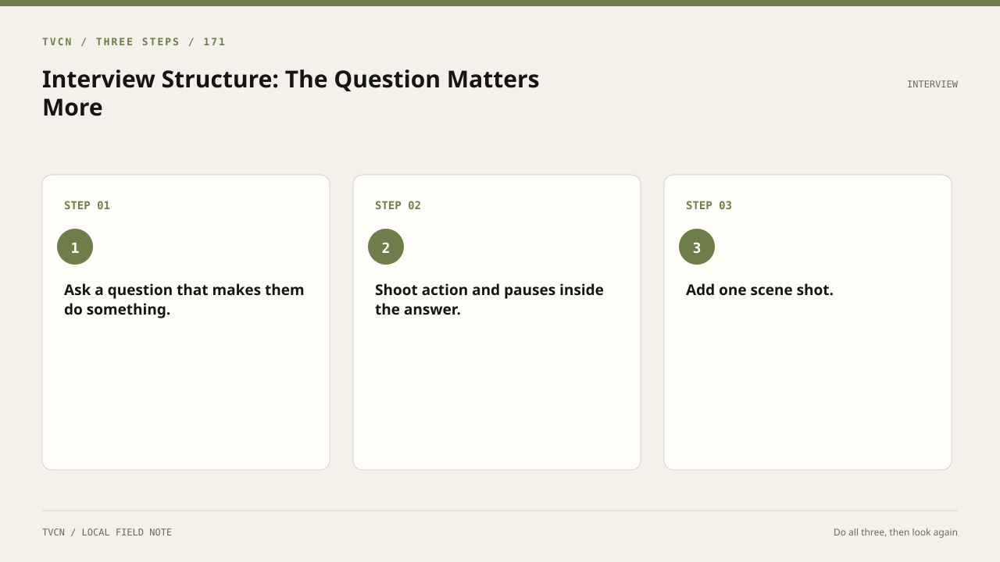

The question matters more than the camera; a vague question gets a vague answer.

<!-- DIAGRAM_START -->
<h2>Diagram</h2>
<figure>
  
  <figcaption>Do the three steps in order, then look again at the image or file.</figcaption>
</figure>
<!-- DIAGRAM_END -->
<h2>On set</h2>

Ask a question that makes them do something: show me how you do it. Do not ask about feelings.

<h2>Do this</h2>

In an interview, the question matters more than the camera; an empty question yields an empty answer.
<ol><li>Ask a question that makes them do something: show me how you work.</li><li>Shoot the actions and pauses in the answer.</li><li>Add one environment shot.</li></ol>
<h2>Avoid</h2>

Do not ask “how do you feel”; feelings cannot be shown, actions can.

<h2>Check</h2>
<ul><li>The first question makes the subject do something, not just answer.</li><li>Actions or pauses are captured within the answer.</li><li>An environment shot establishes where they are.</li></ul>

<!-- DEEP_DIVE_START -->
## Deep dive

<strong>About 7 minutes.</strong> An interview is not a recorded Q&A. Give the guest something to do and let the questions follow the action.

### Questions that produce action

Do not ask “how did you feel?” Ask “what did you do first that day?” Do not ask “why did you persist?” Ask “when did you almost quit, and what happened the last time?”

Follow the detail: what time, where, who was there, what did you say, how did they answer. Detail brings emotion with it; do not force the guest to perform it.

### The scene

Interview at the place where they work: hands busy, eyes not locked on the lens. Cooking, repairing, sorting papers beats a white wall.

Two cameras are nice; one works too: a medium and a hand or room detail. Without a second camera, shoot hand close-ups after the Q&A. Record thirty seconds of room tone separately.

### Structure

One question, one story, one contradiction, one close. Do not run from childhood to today. Let the audience hear one concrete scene first, then add context.

Do not narrate “he is persistent.” Let the guest name the cost. Subtitles must be accurate; keep pauses and repetition where they carry meaning, do not rewrite everything into formal prose.

### Five-minute drill: three action questions

Ask one person three questions only: what did you do first that day, who stopped you, what did you change in the end? No feelings, no “what do you think.”

Let them answer while doing something with their hands. Record sixty seconds and look for one concrete scene. If there is none, follow up: where were you, what time, who was nearby?

### When it is done

Ask someone who has never met the guest to repeat one concrete scene: where they were, what their hands were doing, who blocked them. If they can, the interview is done. If all they retain is “he worked hard,” go back for action detail, not narration.

### Ten interview checks
<ul><li>Questions ask actions, not feelings</li><li>At least three detail follow-ups</li><li>Guest is at the work site</li><li>Hands have something to do</li><li>Hand close-ups even with one camera</li><li>Thirty seconds of room tone</li><li>Concrete scene before context</li><li>One contradiction</li><li>No narration summarizing the person</li><li>Subtitles keep spoken texture</li></ul>
An interview does not get answers; it lets the viewer see the part of the person that appears while they work.

<!-- DEEP_DIVE_END -->
