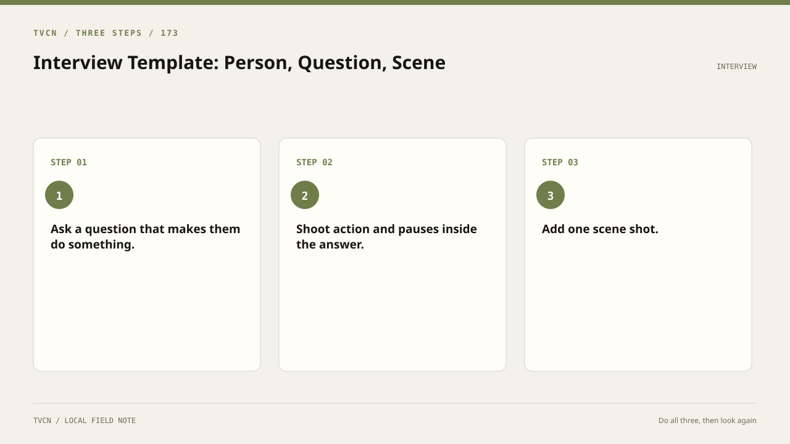

An interview template uses person, question, scene; shoot where they work before sitting down.

<!-- DIAGRAM_START -->
<h2>Diagram</h2>
<figure>
  
  <figcaption>Watch “Choose a place where they can do their” and “Shoot the work first, then sit for the”; judge whether the reason given in the first three seconds still holds at the end.</figcaption>
</figure>
<!-- DIAGRAM_END -->
<section><h2 id="section-1">A usable 60-second segment table</h2>
<table class="template-table"><thead><tr><th>Segment</th><th>Time</th><th>Picture</th><th>Sound / pass line</th></tr></thead><tbody><tr><td>Scene action</td><td>0–10s</td><td>The person in the place where they actually work, hands busy</td><td>Ambience; no résumé question first</td></tr><tr><td>Work</td><td>10–25s</td><td>One complete work action shows difficulty</td><td>Sync sound; interview does not cover the action</td></tr><tr><td>Question 1</td><td>25–40s</td><td>Sit-down interview, work traces still in the background</td><td>Question about the action just seen</td></tr><tr><td>Question 2</td><td>40–50s</td><td>Reaction shot and hand detail</td><td>Ask about cost, not birthplace</td></tr><tr><td>Close</td><td>50–60s</td><td>The person returns to work or looks at the space</td><td>One concrete line; no life summary</td></tr></tbody></table>
<h2 id="section-2">Fill three lines before rolling</h2><ul><li><strong>Place:</strong> where do they really work? Why not a meeting room?</li><li><strong>Action:</strong> what will you shoot first? It must be complete.</li><li><strong>Questions:</strong> all three circle that action; delete résumé questions.</li></ul></section><section><h2 id="section-3">On set</h2>
Person, question, place. Shoot where they can work before sitting them down.
</section><section><h2 id="section-4">Do this</h2><ol><li>Choose a place where they can do their work.</li><li>Shoot the work first, then sit for the interview.</li><li>Base questions on one concrete action, not a résumé.</li></ol></section><section><h2 id="section-5">Avoid</h2>
Do not let the subject read a résumé; a résumé has no images.
</section><section><h2>Judge</h2>
Three signals are observable on set:
<ul><li>the first three seconds give a believable reason</li><li>the middle adds information or resistance, not just mood</li><li>the ending shows a visible change instead of narrating it</li></ul></section><section><h2>Failures</h2>
These three moves erase the detail you just built:
<ul><li>the template is filled but the person and problem are not</li><li>no reason in the first three seconds, only title and music</li><li>no visible change at the end, only voice-over</li></ul></section><section><h2>Extend</h2>
<strong>10-minute exercise:</strong> Break down one 30-second reference, mark the timecodes for “Choose a place where they can do their” and “Shoot the work first, then sit for the”, then answer: if one disappeared, would the film still hold?
</section>
<h2>Check</h2><ul><li>The scene is where they actually work, not an empty meeting room.</li><li>One action is captured before the sit-down interview.</li><li>Questions center on the action, not birthplace or résumé.</li></ul>
