<!-- DIAGRAM_START -->
<h2>Diagram</h2>
<figure>
  
  <figcaption>Diagram: time, beat, picture, sound, and job aligned in five columns.</figcaption>
</figure>
<!-- DIAGRAM_END -->
<h2>Sample note: not a real client</h2>
Composite sample: a two-person podcast on “should creators publish weekly.” Not one real show; people, views, and data are composite.

The point is not to memorize shots but to see what makes each beat work. For a client film, replace every number, brand, and person with your own footage and evidence.
<h2>Beat by beat: five columns</h2>
Read time, then beat, then whether picture and sound serve the same job. If one column disagrees, the beat becomes “pretty but useless.”

<table class="data-table"><thead><tr><th>Time</th><th>Beat</th><th>Picture</th><th>Sound</th><th>Job</th></tr></thead><tbody><tr><td>00:00–00:10</td><td>Opening</td><td>Question straight away</td><td>Live sound</td><td>No intro</td></tr><tr><td>00:10–03:00</td><td>Question</td><td>Two-shot</td><td>Dialogue</td><td>Keep reactions</td></tr><tr><td>03:00–06:00</td><td>Story</td><td>Hands/object</td><td>Ambience</td><td>Story complete</td></tr><tr><td>06:00–09:00</td><td>Counterexample</td><td>Change angle</td><td>Dialogue</td><td>Views collide</td></tr><tr><td>09:00–11:00</td><td>Conclusion</td><td>Close-up</td><td>Quiet</td><td>One line only</td></tr><tr><td>11:00–11:30</td><td>Next</td><td>Wide</td><td>Ambience</td><td>Leave a question</td></tr></tbody></table>
<h2>Picture and sound: what to copy, what not</h2>
<strong>Copy</strong>: before/after of one action, hand close-ups, ambience cuts, locked-off repetition. <strong>Do not copy</strong>: slow motion for emotion, music covering location sound, illustrative numbers as results. Borrow shots, not evidence.
<h2>Three reusable moves</h2>
1. Shoot the same action twice—failure and success—and cut them together; the viewer compares. 2. Every 15 seconds, give a hand/object close-up to ground abstract information. 3. Do not summarize at the end; leave an action or a question as a door to the next piece.
<h2>Failure and check: breakdown is not copying</h2>
The common failure is “the shots look similar, but the proof is fake.” Ask three questions: what happens if this beat is removed? Does the sound stand alone? Is the result checkable? If two answers fail, re-shoot or re-cut.
<h2>Check</h2><ul><li>Labeled composite, not a real client.</li><li>Picture and sound serve the same job per beat.</li><li>At least one before/after is checkable.</li><li>Music does not cover key location sound.</li><li>Ending leaves an action/question, no summary.</li><li>Structure survives removing any one beat.</li></ul>
<!-- SOURCES_START -->
<h2>Sources</h2>

Experience: TVCN field notes and project reviews; tested: the review setup and reproducible exercises noted on the page; references: public links below.

<ul><li>[S14] YouTube Community Guidelines</li><li>[S15] TikTok Community Guidelines</li><li>[S16] BBC Editorial Guidelines</li></ul>

<a href="../../SOURCES.md">Full links and notes in SOURCES.md</a>

<!-- SOURCES_END -->
