<!-- DIAGRAM_START -->
<h2>Diagram</h2>
<figure>
  
  <figcaption>Diagram: six columns filled before rolling; a missing column makes the set guess.</figcaption>
</figure>
<!-- DIAGRAM_END -->
<h2>When to use this sheet</h2>
Fill it 24 hours before rolling and send one copy each to director, camera, sound, and producer. It does not replace the storyboard; it compresses it into “what must be shot today.” When the client changes scope, change the sheet before the budget.
<h2>The sheet: five columns plus a pass line</h2>
One beat per row. Picture is what the viewer sees, not “premium”; sound is what they hear; pass line is what must be captured to pass.

<table class="data-table"><thead><tr><th>Unit</th><th>Picture</th><th>Sound</th><th>Duration</th><th>Pass line</th></tr></thead><tbody><tr><td>Opening</td><td>Question straight</td><td>Live</td><td>10 sec</td><td>No intro</td></tr><tr><td>Question</td><td>Two-shot</td><td>Dialogue</td><td>3–5 min</td><td>Complete question</td></tr><tr><td>Story</td><td>Object/hands</td><td>Ambience</td><td>3–5 min</td><td>Story complete</td></tr><tr><td>Counterexample</td><td>Change angle</td><td>Dialogue</td><td>3–5 min</td><td>Views collide</td></tr><tr><td>Conclusion</td><td>Close-up</td><td>Quiet</td><td>2 min</td><td>One line</td></tr><tr><td>Next</td><td>Wide</td><td>Ambience</td><td>30 sec</td><td>Question left</td></tr></tbody></table>
<h2>Filling example: hardest first</h2>
Fill the beats that need people, weather, or permits first; pickups last. Durations are ceilings, not targets. Stop when the pass line is met; do not repeat to fill time.
<h2>On set: how to run the sheet</h2>
Five minutes before rolling, read the sheet: which rows today, what pass line, who owns it. After each row, tick it and note the actual take. Photograph the sheet at wrap and archive it with the footage.
<h2>Check: a filled sheet is not a finished film</h2>
At wrap, check only: every pass line has footage, sound has an independent backup, the hardest beat has at least two takes. If one is missing, pick it up next day, not in post.
<h2>Check</h2><ul><li>One row per beat, no merging.</li><li>Picture is what is seen, not adjectives.</li><li>Sound is what is heard, including ambience.</li><li>Pass line is judgeable, not “feels right.”</li><li>Hardest beat shot first.</li><li>Sheet archived with footage at wrap.</li></ul>

<section><h2>Boundary</h2>
This page only covers “Live & Podcast Template: One Sheet to Shoot”; it does not replace Music Video Breakdown: Map Song Structure to Image, Music Video Structure: The Song Is the Timeline, The One-Line Story: Who Wants What, and What Stands in the Way. When the problem belongs to one of those pages, use that page instead of adding more parameters here.
</section>
<!-- SOURCES_START -->
## References and further reading

- [S14] [YouTube: Community Guidelines](https://support.google.com/youtube/answer/2801973) — Accessed 2026-11-26. Used to check the terminology/method/rule in the “When to use this sheet” section against YouTube community rules, not creative standards; it does not verify numbers, model choices or on-set conclusions derived from this page, and is not a substitute for a test.
- [S15] [TikTok: Community Guidelines](https://www.tiktok.com/community-guidelines/en/) — Accessed 2026-11-26. Used to check the terminology/method/rule in the “The sheet: five columns plus a pass line” section against TikTok community rules, not creative standards; it does not verify numbers, model choices or on-set conclusions derived from this page, and is not a substitute for a test.
- [S29] [YouTube: Upload Encoding Specs](https://support.google.com/youtube/answer/1722171) — Accessed 2026-11-26. Used to check the terminology/method/rule in the “Filling example: hardest first” section against YouTube upload encoding recommendations, not creative standards; it does not verify numbers, model choices or on-set conclusions derived from this page, and is not a substitute for a test.
<!-- SOURCES_END -->

